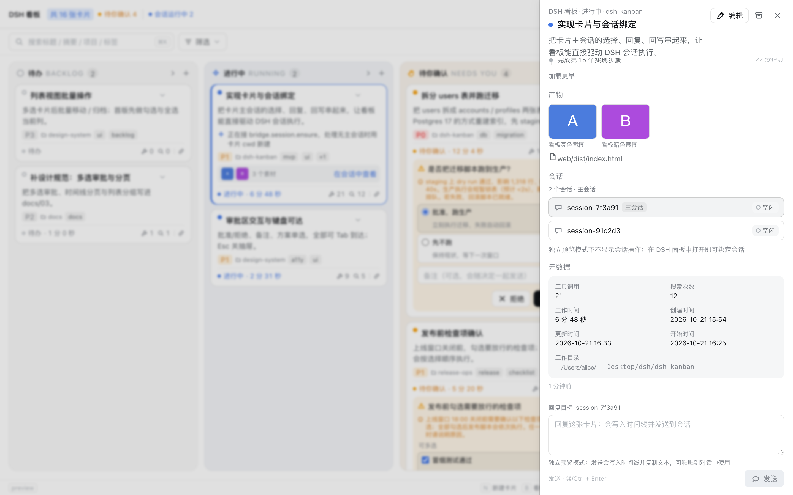
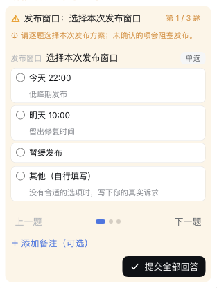
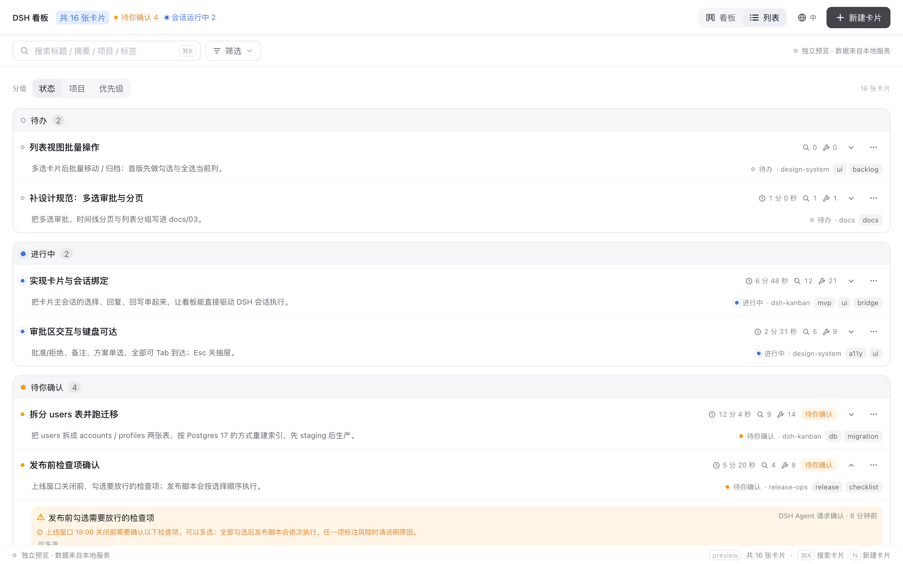
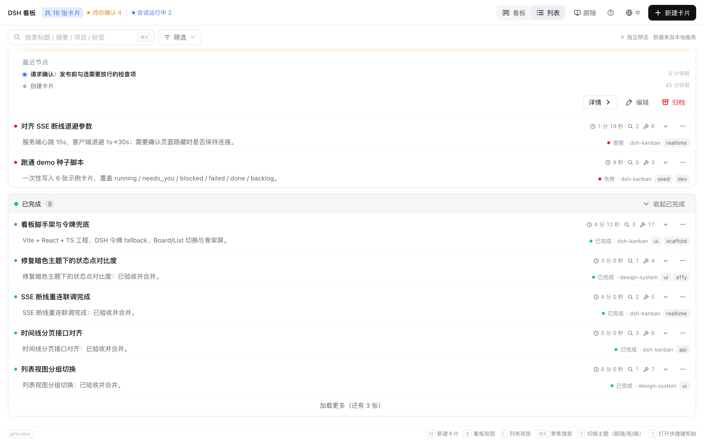
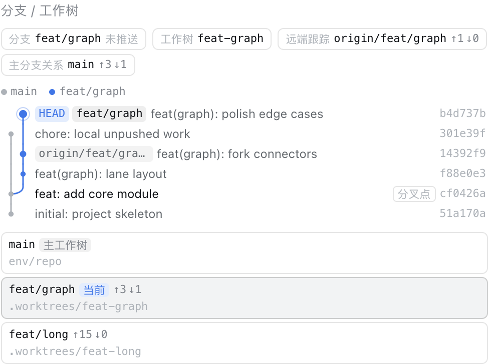
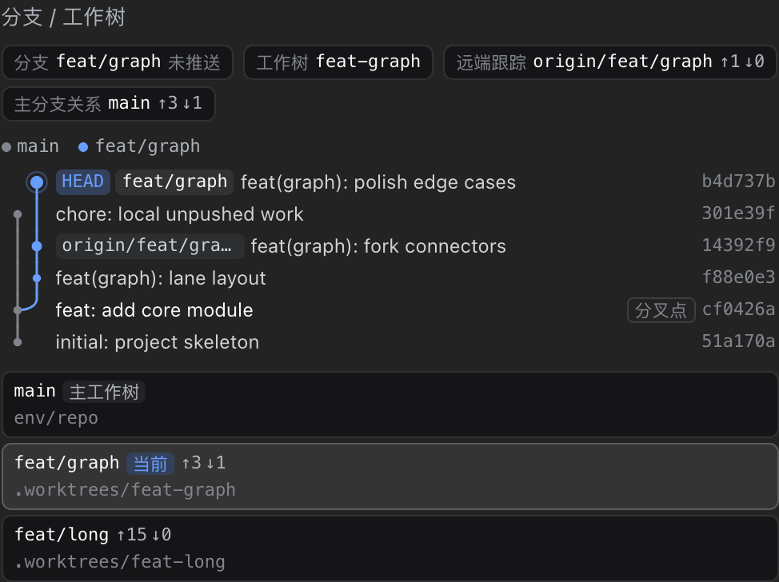
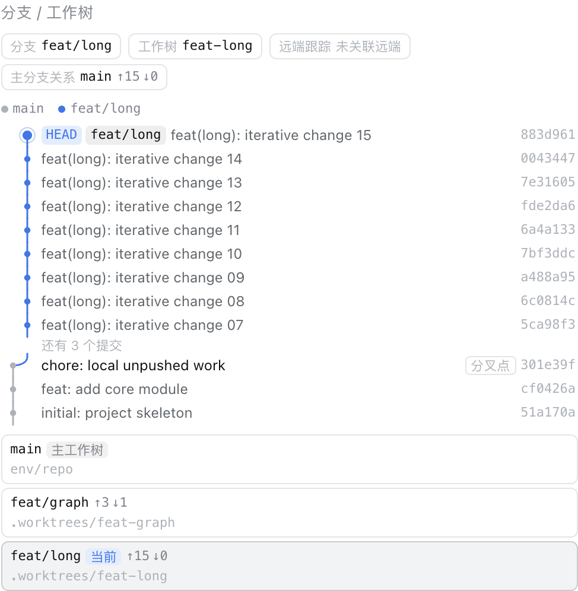
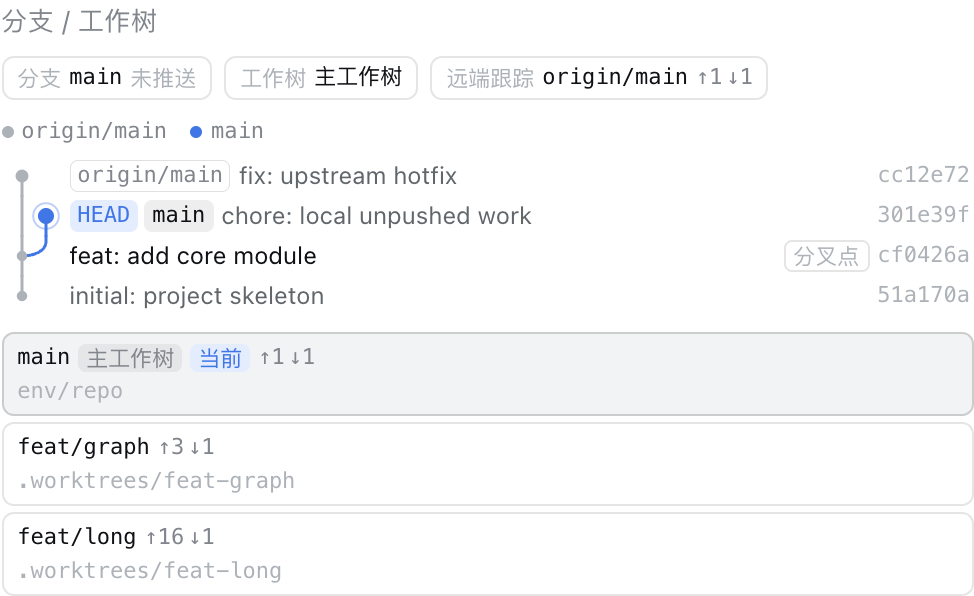
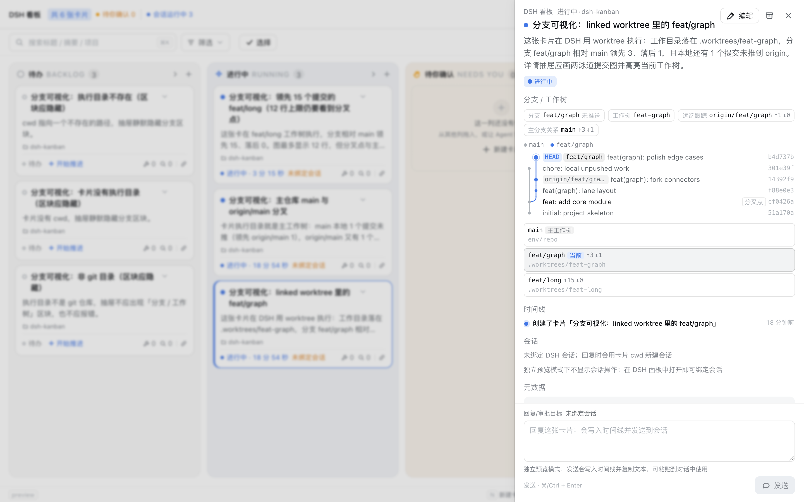
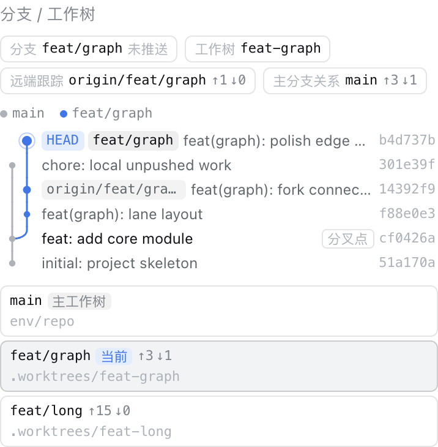

# DSH 看板 · dsh-kanban

一个跑在 [DeepSeek Harness](https://github.com/deepseek-ai/deepseek-harness)（DSH）里的原生看板插件。
**卡片是控制面，DSH 会话是执行面**：你在看板里管理"要做什么、到哪了、需要你决定什么"，agent 在会话里执行，并通过原生工具把进展写回卡片。卡片内回复会直接进入绑定的 DSH 会话，会话里的决定也会回到卡片。

> 状态：v0.13.0（工作区，已合入主线 `97ad6da`），已在 DSH `0.1.5-rc.2` / 桌面 `0.2.1-rc.2` 上完成端到端验证（安装 → 侧栏 → 全屏面板 → 会话桥 → agent 工具 → 审批回写 → 会话归档 → 多会话回复目标 → 卡片 Git 分支 / 工作树可视化）。v0.9.2 起含服务端改动（审批自定义回答、摘要上限），v0.10.0 决策日志、v0.11.0 会话归档联动 + 会话运行失败同步、v0.12.0 多会话目标下拉与主会话切换时间线、v0.13.0 卡片 Git 分支 / 工作树可视化同样含服务端改动，**都需要重启 DSH 后生效**；纯前端修复刷新看板即可。数据存本机 `~/.dsh-kanban/data.json`，决策日志另存同目录 `decisions.jsonl`（只追加）。
> 仓库：[github.com/roxorlt/dsh-kanban](https://github.com/roxorlt/dsh-kanban)


## 功能

- **看板 / 列表双布局**：四列（待办、进行中、待你确认、已完成），可切换为按列分组的列表。
- **卡片 CRUD + 拖拽**：新建、编辑、归档、拖拽换列；列内排序持久化；乐观更新失败自动回滚。
- **卡片摘要分层**：摘要（≤600 字，表单显示字数计数）→ 当前动作 → 最近节点 → 结果 → 待决策；折叠、展开、详情三档信息密度。
- **重要节点时间线**：状态变化、进展、评论、审批、会话绑定、产物、会话运行失败/恢复全部记录。
- **会话运行失败同步（v0.11）**：绑定的主会话某一轮运行失败（断网 / 模型错误 / 进程中断）时，卡片时间线立刻出现失败节点；卡片若在「进行中」自动置「失败」进「待你确认」；同一会话下一轮成功后自动回「进行中」，失败记录保留。
- **审批与确认**：卡片进入"待你确认"时带结构化待定项（单选 / 多选 / **多问题** + 备注），所有选项与说明在卡片内完整展示；多问题审批一次一题翻页作答（上一题 / 题号进度点 / 下一题），每题选项末尾固定「其他（自行填写）」——选中后展开并自动聚焦输入框，自定义文本计入作答；逐题作答后决定直接发回会话；对齐 DSH `ask_user_question`；**提交即改列**（v0.9.5）：选项可声明 `outcome`，提交后卡片立刻离开「待你确认」（未声明时批准回进行中、驳回回待办）。
- **决策日志（v0.10）**：正式审批从请求到结果的原始事件流，独立存 `<dataDir>/decisions.jsonl`，只追加，不随单卡 20 条审批上限裁剪或 `/seed` 重置丢失；记录请求快照、最终选择与自定义回答、等待时长、未提交就关闭的原因（归档 / 离开待你确认 / 裁剪 / 重置）。首次启用自动回填存量审批历史，可经 HTTP 接口或只读工具 `kanban_decisions` 查询。
- **开始推进**：待办卡片一键移入进行中并启动/续接主会话，附带目标与验收提示；失败自动回滚。
- **新建建议**：工作区/目录/项目/会话建议来自 DSH 工作区与会话记录；进行中新建卡自动建会话并交给 agent；详情可先选目录补建会话。
- **交接摘要（handoff）**：agent 可在会话暂停/归档前写入交接摘要；详情只读展示+复制，新会话启动时自动拼入提示续接。
- **卡片内回复**：回复写时间线，并通过桥进入 DSH 会话；没有会话时可从卡片新建；待办卡回复不会隐式改状态。
- **会话返回看板**：DSH 会话标题右侧提供「看板」按钮，从卡片打开的会话可一键回看板。
- **会话绑定**：选择已有会话作为主会话、打开会话跳转 DSH 对话、显示运行状态。
- **多会话目标与主会话切换（v0.12）**：详情抽屉列出卡片全部会话（主会话徽标 + 完整 session id + 运行状态）；`设为主会话` 即置顶并写入时间线（「主会话切换为「X」」），已是主会话时幂等不重复记录；**回复/审批目标**用 Composer 上方的下拉切换，默认主会话，设为主会话后默认目标跟随。
- **分支 / 工作树可视化（v0.13）**：详情抽屉按卡片执行目录只读探测 Git，展示当前分支、是否 linked worktree、远端跟踪 ↑↓、相对主分支（main/master/远端 HEAD 自动探测）的领先与落后；**Fork 风格两泳道提交图**——HEAD 高亮、分叉点汇合线、共享主干，领先再长也优先保住分叉点（超出 12 行给「还有 N 个提交」）；多工作树时列出各工作树分支 / 相对主分支 ↑↓ / 路径并高亮当前工作树；工作目录不是 Git 仓库、不存在或无 `cwd` 时整块静默隐藏。DSH 用 worktree 执行任务时，卡片 `cwd` 仍是主仓库也行——主会话已在 linked worktree 时前端会带上会话执行目录候选，服务端校验同仓库后采纳。
- **会话归档联动（v0.11）**：卡片完成后可在详情归档其 DSH 会话（从侧栏隐藏、随时可恢复）；归档前检查共享该会话的其它卡片是否都已完成、会话是否空闲/有待确认；运行中会话弹「停止并归档」二次确认（写明会丢弃排队输入、删除定时任务、被停止的工作不会自动继续）；已完成列支持批量归档（dryRun 预览 + 跳过原因，可直接处理历史数据）；卡片完成时轻提示，重开卡片/打开会话/发消息前自动恢复；已完成超过 7 天的卡片会话自动归档（`autoArchiveSessionsDays` 可配，0 关闭）；旧宿主无可逆能力时入口自动隐藏。
- **实时刷新**：SSE 推送 revision，断线指数退避，页面隐藏暂停；手动重试只在断连错误条出现。
- **批量操作**：工具栏「选择」进入选择模式（与拖拽手势分离），批量移动到列 / 批量归档；列表视图同样支持。
- **自动归档**：已完成/已取消卡片超过 30 天自动归档（`autoArchiveDays` 可配，0 关闭），不删除数据。
- **密度与规模**：已完成列只显示最近 5 张（查看全部进入列表）；列表支持按状态/项目分组；时间线分页加载；卡片内素材用紧凑媒体行。
- **优先级/标签暂隐藏（v0.9.0）**：卡片 `priority` / `labels` 仍在 API 与数据中保留，Web 端的新建/编辑表单、卡片、详情、筛选与「按优先级分组」不再展示；观察一版后再决定是否彻底移除（见 CHANGELOG v0.9.0）。
- **横竖屏响应式**：宽屏四列，窄屏列分段 + 单列 + 底部弹层；跟随 DSH 明暗主题。
- **Agent 原生工具**：11 个 `kanban_*` 工具，agent 不需要学 HTTP 就能建卡、推进、请求审批、写结果、回顾决策日志。
- **本地优先**：JSON 存储、原子写、损坏自动备份重建；无云端依赖。

## 已验证

- 服务端 `node --test`：**162/162 通过**（v0.13 新增 12 例 Git 上下文与接口用例）；Web `tsc` + Vite 构建通过，vitest 25 文件 / 249 测试，令牌 lint 0 error / 0 warning。
- v0.13.0 卡片 Git 分支 / 工作树可视化：详情抽屉新增只读「分支 / 工作树」区块（分支 + 工作树 + 远端跟踪 ↑↓ + 主分支关系 ↑↓ + 两泳道提交图 + 多工作树列表）。真实临时 git 仓库（main 与 origin/main 分叉、`feat/graph` / `feat/long` 两个 linked worktree）验证：worktree 卡正确显示 `feat/graph` 与分叉点、领先 15 条的 `feat/long` 在 12 行上限下仍可见分叉点与「还有 3 个提交」、`?cwd=` 候选被同仓库校验后采纳、非 git / 无 cwd / 目录不存在三种卡整块隐藏；Chromium 1440×900 DPR2 + 390×844、亮/暗共 16 项断言全过、console 0 error / pageerror 0 / 4xx 0、无横向溢出（证据 `docs/assets/screens/git-branch-*.png`，全部见 docs/06 §1.26）。含服务端改动，需重启 DSH 后生效；已合入主线（merge `97ad6da`），真实宿主复验待重启桌面 DSH 后执行（见 docs/06 §1.27）。
- v0.12.0 多会话主会话切换与回复/审批目标：合并后服务端 150/150、Web vitest 24 文件 / 225 测试；`设为主会话` 写入 `session_primary` 时间线（「主会话切换为「X」」，已是主会话幂等不重复），Composer 上方「回复/审批目标」下拉默认主会话、设为主会话后默认跟随，回复与审批决定都发到选中会话；隔离真实 DSH 宿主（0.1.5-rc.2 + 真实插件 + 3 个真实会话，Playwright）4/4 验收全过、console 0 error、0 个 4xx（截图 `design/screens/m2-merged-host-*.png`）；2026-10-27 09:41 重启桌面 DSH 后 `/api/kanban/health` 返回 0.12.0、真实数据与 v0.10/v0.11 接口共存（全部证据见 docs/06 §1.25）。
- v0.11.0 会话归档联动：真实 Chromium E2E（真服务端路由 + 假 workspaceRegistry + 假父页面桥）覆盖归档/恢复/停止并归档/共享会话阻塞/待确认阻塞/批量预览+执行/时间线活动，10 项断言全过；真实宿主需重启 DSH 加载服务端 v0.11 后复验（证据 `design/screens/session-archive-e2e-*.png`）。
- v0.11.0 会话运行失败同步：并入后服务端 149/149（本特性 12 例覆盖失败判定口径、主会话过滤、同轮去重、自动置失败/恢复、监听器接线与开关）；dev-server 冒烟正常；真实宿主失败复验在重启 DSH 后执行（步骤见 docs/06 §1.23）。
- 在**独立 DSH profile** 中真实安装并加载：侧栏入口、`main` 全屏面板、iframe 桥就绪、49 个主题令牌同步、明暗主题、console 0 error。
- 会话桥：`session.create → refresh → open → binding → prompt` 实测 `accepted: true`。
- agent 工具：真实 agent 调用 `kanban_create_card` 创建卡片，SSE 实时出现在看板。
- 审批闭环：看板内「批准」→ 决定写入绑定会话 → agent 通过工具把卡片移到已完成并写结果。
- v0.2 回归：多选审批提交 `optionIds:["unit-test","build"]`、时间线 `before` 分页、脏草稿二次确认、列表按项目分组、done 折叠、竖屏动作区，Playwright 全部通过。
- v0.2.1 修复：DSH 0.2.x 会话 API 兼容（`uiWorkspace.openSession` / `sessions.using`）、三态主题、宿主安全区、快捷键、筛选空文案、审批未绑定兜底。
- v0.3.0 多问题审批；v0.3.1 列表审批动作左对齐；v0.4.0 批量选择 + 自动归档（67 服务端 / 57 Web 测试）。
- v0.9.2 多题审批逐题翻页 + 每题自定义回答 + 摘要上限 600（89 服务端 / 158 Web 测试；隔离 dev-server CDP 实测翻页、自动聚焦、校验跳题、已解决展示与移动端）。
- v0.9.4 修复卡片状态点 / 审批选项圆点与文案竖直错位（1440/1280/1200/1100/1028/900/390 × 亮暗实测状态点偏差 5.5→0.5px、选项换行 2→0、圆点与首行偏差 21→0px）。
- v0.9.5 审批提交即改列：提交「待你确认」选项后卡片立刻离开该列（默认批准→进行中、驳回→待办；选项可声明 `outcome` 进已完成），Web 端乐观移列、失败回滚；服务端 94 测试 / Web 165 测试。
- v0.10.0 决策日志：服务端 127/127；真实 `data.json` 副本启动回填 26 条历史事件（含 1 条等待中），`/decisions`、`/decisions/meta`、`/decisions/export` 与非法参数 400 均实测通过。
- 截图与复跑命令见 [验证记录](docs/06-verification.md)。

| 真实 DSH 内（亮） | 真实 DSH 内（暗） |
| --- | --- |
|  |  |

| 卡片展开（多选审批） | 详情抽屉（多会话/审批回写） |
| --- | --- |
|  |  |

| 多题审批翻页（v0.9.2） | 每题「其他（自行填写）」 |
| --- | --- |
|  |  |

| 已解决态展示自定义回答 | 移动端 |
| --- | --- |
|  |  |

| 列表视图（按项目分组） | 已完成防膨胀 |
| --- | --- |
|  |  |

| 详情「分支 / 工作树」（linked worktree，v0.13） | 暗色 |
| --- | --- |
|  |  |

| 领先 15 条仍保住分叉点（12 行上限） | main 与 origin/main 分叉 |
| --- | --- |
|  |  |

| 看板 + 右侧详情全貌 | 390 竖屏 |
| --- | --- |
|  |  |

## 安装

要求：DSH `0.1.5-rc.2` 或兼容版本，Node.js ≥ 22。

```bash
# 1. 克隆仓库
git clone https://github.com/roxorlt/dsh-kanban.git
cd dsh-kanban

# 2. 构建前端（仓库已提交 dist，可跳过）
npm --prefix web install && npm --prefix web run build

# 3. 安装
#    Web / 自建 profile：用官方 CLI
dsh plugin --profile web add "$(pwd)"
#    桌面版：desktop profile 由 Electron 应用独占管理，CLI 会拒绝；用随附脚本：
node scripts/install-desktop.mjs --dry-run   # 先看将要改什么
node scripts/install-desktop.mjs             # 写入 profile（自动备份 package.json）

# 4. 重启 DSH（或在桌面应用里刷新一次页面）
```

重启后侧栏出现「看板」图标，点击进入全屏看板。首次启动会写入一组示例卡片；删除 `~/.dsh-kanban/data.json` 后重启即可恢复为空看板（或调用 `POST /api/kanban/seed`）。

> 安装机制：插件加入 profile 的 `dsh.profile.bundles`，`cordis.patch.yml` 再把插件行挂到 profile 根。桌面版脚本做的事与 CLI 相同（link 依赖 + bundles 条目 + node_modules 符号链接），只是绕过了「desktop 由应用管理」的限制；写前会备份 `package.json`。
> 移除：`node scripts/install-desktop.mjs --remove`（桌面版）或 `dsh plugin --profile web remove dsh-kanban`（Web 版）。

### 配置

在 `~/.dsh/profiles/desktop/cordis.patch.yml` 里可以覆盖：

```yaml
- id: kanban
  config:
    seed: empty                # demo（默认）| empty
    dataDir: /path/to/data
    autoArchiveDays: 30        # 已完成卡片自动归档天数；0 关闭（默认 30）
    autoArchiveSessionsDays: 7 # 已完成卡片的会话自动归档天数；0 关闭（默认 7，需 DSH 0.2.x 可逆归档）
```

## 使用

| 动作 | 怎么做 |
| --- | --- |
| 新建卡片 | 列底「+ 新建」或顶部「新建」；填标题、摘要、项目；工作区/执行目录/会话按需 |
| 推进卡片 | agent 用工具自动移动；你也可以拖拽或卡片菜单「移动到」 |
| 查看进展 | 点卡片文字区域或右上箭头展开"重要节点"；双击卡片或点「详情」看完整时间线、清单、产物 |
| 处理待定项 | 卡片展开后审批区选择方案 / 批准 / 拒绝，可附备注；决定自动发回会话 |
| 回复 agent | 卡片详情底部输入框，发送后进入「回复/审批目标」下拉选中的会话（默认主会话） |
| 绑定会话 | 详情 →「会话」→ 选择已有会话，或「新建会话」 |
| 打开会话 | 详情 →「打开会话」，跳转 DSH 对话面板 |
| 归档会话 | 卡片完成/取消后 → 详情 →「会话」→「归档会话」；会话运行中/有待确认/共享卡未完成时会禁用并给出原因 |
| 恢复会话 | 详情 →「会话」→「恢复会话」；打开会话、卡片内回复、重开卡片时也会自动恢复 |
| 批量归档会话 | 已完成列头「批量归档会话」→ 预览可归档/跳过清单 → 确认执行（一次性处理历史已完成卡片） |
| 切换布局 | 工具栏 Board / List；筛选、搜索、按项目过滤 |
| 移动端 | 窄屏顶部列分段 + 单列，详情为底部弹层 |

### 给 agent 的技能

`skills/manage-kanban/` 是一份 DSH 技能，教 agent 按"建卡 → 领取 → 写进展 → 请求审批 → 完成"的节奏使用看板。安装：

```bash
ln -s "$(pwd)/skills/manage-kanban" ~/.dsh/skills/manage-kanban
```

也可以不装技能：工具描述本身已经包含工作流约束。

## Agent 工具

| 工具 | 作用 |
| --- | --- |
| `kanban_boards` | 列出看板与各列计数 |
| `kanban_cards` | 查询卡片（项目/状态/标签/关键词/会话） |
| `kanban_card` | 卡片详情（时间线、待定项、清单） |
| `kanban_decisions` | 只读查询决策日志（审批请求 / 提交 / 未决关闭、等待时长） |
| `kanban_create_card` | 建卡 |
| `kanban_update_card` | 更新摘要、当前动作、结果、优先级、清单、产物等 |
| `kanban_move_card` | 移动状态/列（agent 自主推进） |
| `kanban_add_activity` | 追加进展节点 |
| `kanban_request_approval` | 请求授权/方案选择（卡片进入待你确认） |
| `kanban_link_session` | 绑定会话 |
| `kanban_complete_card` | 完成卡片并写结果 |

## 开发

```bash
# 服务端（独立于 DSH，含 demo 数据与静态资源）
node scripts/dev-server.mjs --port 4599

# 前端热更新（代理 /api 到 4599）
npm --prefix web install
npm --prefix web run dev

# 测试
npm test

# 构建
npm --prefix web run build

# 造一个带分叉 / 远端 / linked worktree 的演示仓库（验证详情抽屉「分支 / 工作树」区块）
node scripts/demo-git-repo.mjs
```

目录结构：

```
lib/
  client.js       # DSH 客户端插件：侧栏入口 + main 面板 + iframe 桥
  index.js        # DSH 服务端插件：路由、工具、SSE
  store.js        # 本地 JSON 存储（原子写 / 乐观锁 / revision）
  decisions.js    # 决策日志：decisions.jsonl 只追加事件流（读取 / 回填 / 导出）
  domain.js       # 状态与列、种子数据、节点构造
  git.js          # 卡片 Git 上下文：只读探测分支 / worktree / 远端关系（v0.13）
  routes.js       # REST API + SSE + 静态资源
  tools.js        # 11 个 kanban_* agent 工具
web/              # 看板 UI（React + Vite），构建产物 web/dist
skills/           # agent 工作流技能
docs/             # 分析、契约、设计、架构、验证
```

## 文档

- [参考项目分析：Codex Taskboard 的核心功能与会话信息架构](docs/01-reference-analysis.md)
- [DSH 插件机制与集成要点](docs/02-dsh-integration.md)
- [设计规范与响应式规格](docs/03-design-system.md)
- [架构与信息架构](docs/04-architecture.md)
- [契约：数据模型](docs/contracts/01-data-model.md) / [HTTP API](docs/contracts/02-http-api.md) / [客户端桥](docs/contracts/03-client-bridge.md) / [决策日志](docs/contracts/05-decision-log.md) / [卡片 Git 上下文](docs/contracts/06-git-context.md)
- [验证记录（含 0.2.1 宿主）](docs/06-verification.md)
- [Deep link 提案（已搁置，应用内打开会话已实现）](docs/08-deeplink-proposal.md)
- [OpenDesign 设计/动效 skill 调研](docs/09-design-motion-skills.md)
- [视觉审计（进行中）](docs/10-visual-audit.md)

## 已知限制

- 每个 workspace 一个看板的模式尚未实现（M2）。
- 会话事件（工具调用数、耗时）目前由 agent 工具写入；自动回填在 M3。
- 审批与 DSH 原生工具审批（bash 等）是两套收件箱，是否合并待评估。
- 无团队协作/云端同步，数据仅本机。
- 决策日志只追加、不自动清理/轮转，长期使用会持续增长；需要备份可在 DSH 停止写入时直接复制 `decisions.jsonl`（或调 `/decisions/export`）。
- 未做超大看板（>500 卡）压力测试与真机软键盘验证；旧版 DSH 仅保证降级不崩溃。
- 分支可视化（v0.13）只比较「当前分支 vs 主分支/上游」两条泳道，不画任意多分支拓扑；远端只识别 `origin`；数据是打开详情时的快照（4s 缓存），不会随会话新提交自动刷新；工作树列表上限 8 个。
- 卡片未绑定会话或会话无 `cwd` 时，「分支 / 工作树」以卡片 `cwd` 为准；卡片 `cwd` 缺失则整块隐藏。

## 路线图

| 阶段 | 内容 |
| --- | --- |
| M1（当前） | 单看板、四列、CRUD、审批、会话绑定、卡片内回复、SSE、双布局、响应式、agent 工具与技能 |
| M2（进行中） | 多会话回复目标（v0.12 完成）、handoff 交接摘要（v0.8）、审批收件箱合并（v0.10）、卡片 Git 分支 / 工作树可视化（v0.13）；剩余：卡片依赖与阻塞、按 workspace 分看板 |
| M3 | 会话事件自动回填（工具调用数 / 耗时 / 搜索结果数）、审批与原生审批联动、卡片自动重开、周期卡 |
| M4 | 团队协作、GitHub/Jira 集成、仪表盘（吞吐/阻塞时长）、导出 Markdown/JSON |

## 致谢

信息架构与卡片要素参考了 [chuspeeism/dashi-taskboard](https://github.com/chuspeeism/dashi-taskboard)（Codex Taskboard）；UI 遵循 DSH 的 alias 令牌与设计规范。

## License

MIT
