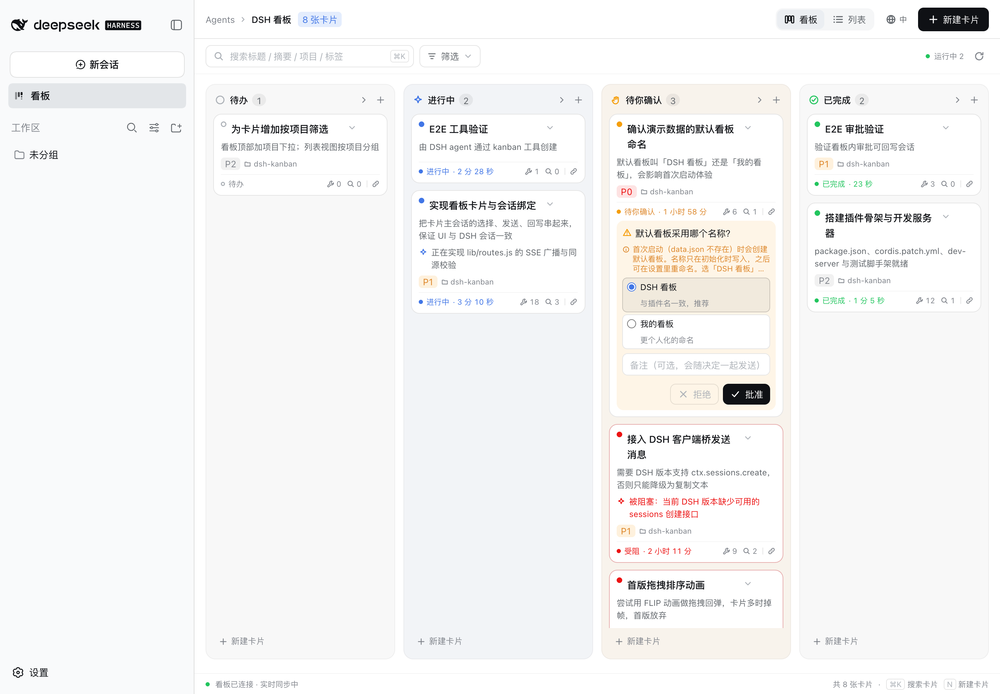
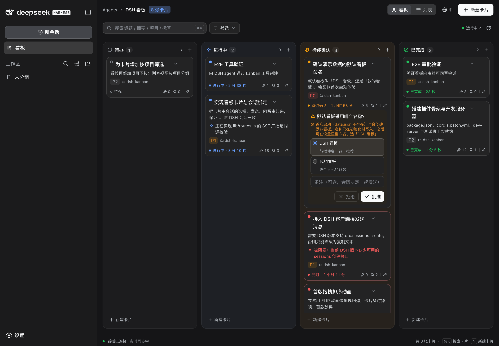
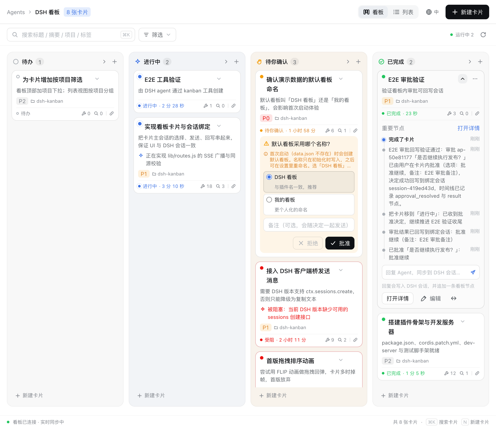
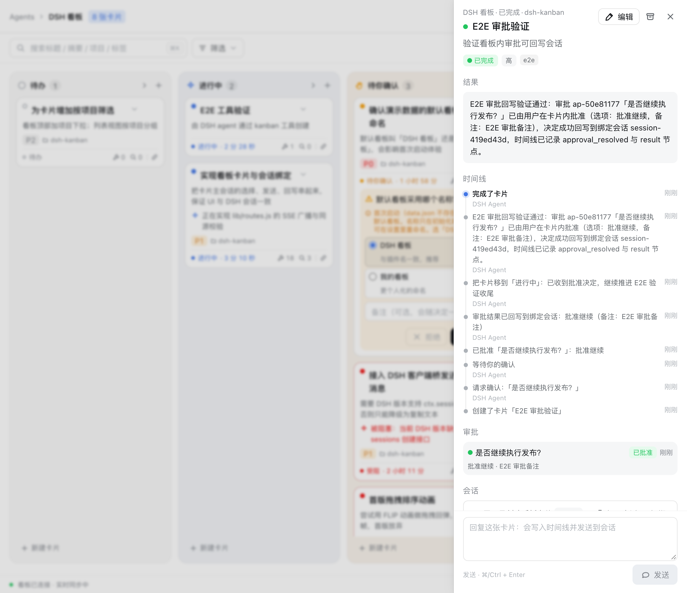

# DSH 看板 · dsh-kanban

一个跑在 [DeepSeek Harness](https://github.com/deepseek-ai/deepseek-harness)（DSH）里的原生看板插件。
**卡片是控制面，DSH 会话是执行面**：你在看板里管理"要做什么、到哪了、需要你决定什么"，agent 在会话里执行，并通过原生工具把进展写回卡片。卡片内回复会直接进入绑定的 DSH 会话，会话里的决定也会回到卡片。

> 状态：v0.1 MVP，已在 DSH `0.1.5-rc.2` 上完成端到端验证（安装 → 侧栏 → 全屏面板 → 会话桥 → agent 工具 → 审批回写）。数据存本机 `~/.dsh-kanban/data.json`。
> 仓库：[github.com/roxorlt/dsh-kanban](https://github.com/roxorlt/dsh-kanban)



## 功能

- **看板 / 列表双布局**：四列（待办、进行中、待你确认、已完成），可切换为按列分组的列表。
- **卡片 CRUD + 拖拽**：新建、编辑、归档、拖拽换列；列内排序持久化；乐观更新失败自动回滚。
- **卡片摘要分层**：一句话摘要 → 当前动作 → 最近节点 → 结果 → 待决策；折叠、展开、详情三档信息密度。
- **重要节点时间线**：状态变化、进展、评论、审批、会话绑定、产物全部记录。
- **审批与确认**：卡片进入"待你确认"时带结构化待定项（批准/拒绝/多方案），决定直接发回会话。
- **卡片内回复**：回复写时间线，并通过桥进入 DSH 会话；没有会话时可从卡片新建。
- **会话绑定**：选择已有会话作为主会话、打开会话跳转 DSH 对话、显示运行状态。
- **实时刷新**：SSE 推送 revision，断线指数退避，页面隐藏暂停。
- **横竖屏响应式**：宽屏四列，窄屏列分段 + 单列 + 底部弹层；跟随 DSH 明暗主题。
- **Agent 原生工具**：10 个 `kanban_*` 工具，agent 不需要学 HTTP 就能建卡、推进、请求审批、写结果。
- **本地优先**：JSON 存储、原子写、损坏自动备份重建；无云端依赖。

## 已验证

- 服务端 `node --test`：**49/49 通过**；Web `tsc` + Vite 构建通过，vitest 24/24，令牌 lint 0 error / 0 warning。
- 在**独立 DSH profile** 中真实安装并加载：侧栏入口、`main` 全屏面板、iframe 桥就绪、49 个主题令牌同步、console 0 error。
- 会话桥：`session.create → refresh → open → binding → prompt` 实测 `accepted: true`。
- agent 工具：真实 agent 调用 `kanban_create_card` 创建卡片，SSE 实时出现在看板。
- 审批闭环：看板内「批准」→ 决定写入绑定会话 → agent 通过工具把卡片移到已完成并写结果。
- 截图与复跑命令见 [验证记录](docs/06-verification.md)。

| 真实 DSH 内（亮） | 真实 DSH 内（暗） |
| --- | --- |
|  |  |

| 卡片展开（重要节点） | 详情抽屉 |
| --- | --- |
|  |  |

## 安装

要求：DSH `0.1.5-rc.2` 或兼容版本，Node.js ≥ 22。

```bash
# 1. 克隆仓库
git clone https://github.com/roxorlt/dsh-kanban.git
cd dsh-kanban

# 2. 构建前端（仓库已提交 dist，可跳过）
npm --prefix web install && npm --prefix web run build

# 3. 安装到你的 DSH profile（桌面版用 desktop，Web 版用 web）
dsh plugin --profile desktop add "$(pwd)"

# 4. 重启 DSH
```

重启后侧栏出现「看板」图标，点击进入全屏看板。首次启动会写入一组示例卡片，可在看板设置里清空。

> 安装机制：`dsh plugin add` 把本包加入 profile 的 `dsh.profile.bundles`，`cordis.patch.yml` 再把插件行挂到 profile 根。数据不会写进插件目录。

### 配置

在 `~/.dsh/profiles/desktop/cordis.patch.yml` 里可以覆盖：

```yaml
- id: kanban
  config:
    seed: empty          # demo（默认）| empty
    dataDir: /path/to/data
```

## 使用

| 动作 | 怎么做 |
| --- | --- |
| 新建卡片 | 列底「+ 新建」或顶部「新建」；填标题、摘要、项目、标签、优先级 |
| 推进卡片 | agent 用工具自动移动；你也可以拖拽或卡片菜单「移动到」 |
| 查看进展 | 点卡片展开"重要节点"；点「详情」看完整时间线、清单、产物 |
| 处理待定项 | 卡片展开后审批区选择方案 / 批准 / 拒绝，可附备注；决定自动发回会话 |
| 回复 agent | 卡片详情底部输入框，发送后进入绑定的主会话 |
| 绑定会话 | 详情 →「会话」→ 选择已有会话，或「新建会话」 |
| 打开会话 | 详情 →「打开会话」，跳转 DSH 对话面板 |
| 切换布局 | 工具栏 Board / List；筛选、搜索、按项目/标签过滤 |
| 移动端 | 窄屏顶部列分段 + 单列，详情为底部弹层 |

### 给 agent 的技能

`skills/manage-kanban/` 是一份 DSH 技能，教 agent 按"建卡 → 领取 → 写进展 → 请求审批 → 完成"的节奏使用看板。安装：

```bash
ln -s "$(pwd)/skills/manage-kanban" ~/.dsh/skills/manage-kanban
```

也可以不装技能：工具描述本身已经包含工作流约束。

## Agent 工具

| 工具 | 作用 |
| --- | --- |
| `kanban_boards` | 列出看板与各列计数 |
| `kanban_cards` | 查询卡片（项目/状态/标签/关键词/会话） |
| `kanban_card` | 卡片详情（时间线、待定项、清单） |
| `kanban_create_card` | 建卡 |
| `kanban_update_card` | 更新摘要、当前动作、结果、优先级、清单、产物等 |
| `kanban_move_card` | 移动状态/列（agent 自主推进） |
| `kanban_add_activity` | 追加进展节点 |
| `kanban_request_approval` | 请求授权/方案选择（卡片进入待你确认） |
| `kanban_link_session` | 绑定会话 |
| `kanban_complete_card` | 完成卡片并写结果 |

## 开发

```bash
# 服务端（独立于 DSH，含 demo 数据与静态资源）
node scripts/dev-server.mjs --port 4599

# 前端热更新（代理 /api 到 4599）
npm --prefix web install
npm --prefix web run dev

# 测试
npm test

# 构建
npm --prefix web run build
```

目录结构：

```
lib/
  client.js       # DSH 客户端插件：侧栏入口 + main 面板 + iframe 桥
  index.js        # DSH 服务端插件：路由、工具、SSE
  store.js        # 本地 JSON 存储（原子写 / 乐观锁 / revision）
  domain.js       # 状态与列、种子数据、节点构造
  routes.js       # REST API + SSE + 静态资源
  tools.js        # 10 个 kanban_* agent 工具
web/              # 看板 UI（React + Vite），构建产物 web/dist
skills/           # agent 工作流技能
docs/             # 分析、契约、设计、架构、验证
```

## 文档

- [参考项目分析：Codex Taskboard 的核心功能与会话信息架构](docs/01-reference-analysis.md)
- [DSH 插件机制与集成要点](docs/02-dsh-integration.md)
- [设计规范与响应式规格](docs/03-design-system.md)
- [架构与信息架构](docs/04-architecture.md)
- [契约：数据模型](docs/contracts/01-data-model.md) / [HTTP API](docs/contracts/02-http-api.md) / [客户端桥](docs/contracts/03-client-bridge.md)
- [验证记录](docs/06-verification.md)

## 已知限制

- 每个 workspace 一个看板的模式尚未实现（M2）。
- 卡片内回复只进主会话；多会话并行推进同一张卡时，回复目标暂不可选（M2）。
- 会话事件（工具调用数、耗时）目前由 agent 工具写入；自动回填在 M3。
- 审批与 DSH 原生工具审批（bash 等）是两套收件箱，是否合并待评估。
- 无团队协作/云端同步，数据仅本机。
- 未做超大看板（>500 卡）压力测试与真机软键盘验证；旧版 DSH 仅保证降级不崩溃。

## 路线图

| 阶段 | 内容 |
| --- | --- |
| M1（当前） | 单看板、四列、CRUD、审批、会话绑定、卡片内回复、SSE、双布局、响应式、agent 工具与技能 |
| M2 | 多看板 / 按 workspace 分看板、多会话选择、卡片依赖与阻塞、批量操作、卡片模板 |
| M3 | 会话事件自动回填（工具调用数 / 耗时 / 搜索结果数）、审批与原生审批联动、周期卡 |
| M4 | 团队协作、GitHub/Jira 集成、仪表盘（吞吐/阻塞时长）、导出 Markdown/JSON |

## 致谢

信息架构与卡片要素参考了 [chuspeeism/dashi-taskboard](https://github.com/chuspeeism/dashi-taskboard)（Codex Taskboard）；UI 遵循 DSH 的 alias 令牌与设计规范。

## License

MIT
