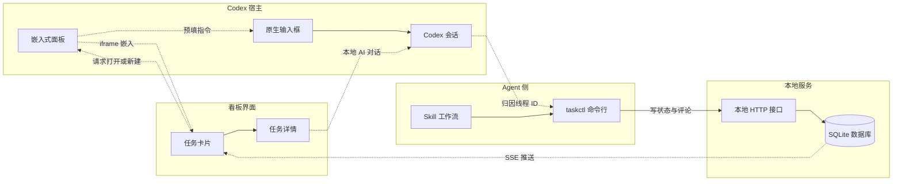
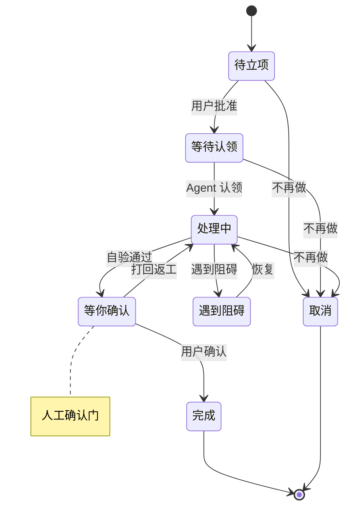

# Codex Taskboard 参考分析与 demo 截图判读

> 分析对象：`chuspeeism/dashi-taskboard`（Codex Taskboard），克隆于 `/tmp/dashi-probe/dashi-taskboard`，commit `723c400`，`git ls-files` 241 个文件，版本 1.1.26（`package.json:3`）。
> **证据口径**：下文 `路径:行号` 均相对参考仓库根目录，已按该 commit 逐条核对；demo 截图指本工作区 `docs/assets/reference-demo/` 下三张 JPG，参考项目截图指 `docs/assets/reference-project/codex-taskboard.png`。
> **重要前提**：三张 demo 截图**不是** Codex Taskboard 的截图，而是另一套 "Agents / Agent inbox" 版式的设计稿；参考项目源码中不存在搜索数、工具调用数、卡片工时、Reject/Approve 审批卡这些元素。两者必须分开判读：第 6 节讲参考项目，第 7 节讲 demo，第 9 节做合并结论。

## 0. 结论速览

1. 参考项目本质是**本地优先的议题看板 + 同一 HTTP API 驱动的 CLI/Skill**；看板是 Codex 会话的"索引与验收单"，不持有执行过程（`README.md:5,62`）。
2. 任务与会话**弱耦合、可追溯**：写操作时把 `CODEX_THREAD_ID`/五字段绑定归因到任务或评论；读操作时把任务字段、评论字段、本地 AI 会话三路聚合成 `conversationRefs`（`shared/task-records.mjs:56-163`、`web/src/taskConversations.ts:60-156`）。
3. 参考项目有 7 状态 + 5 视图，主看板只展示 4 个状态列，其余收进"其他任务"面板（`web/src/issueBoardStatuses.ts:3-14`、`web/src/App.tsx:3874-3900`）。
4. Agent 编排有两条车道：交互式会话（Skill 七步工作流）与自动化车道（Codex cron 自动化 + 控制器提示词派发远程会话）（`skills/manage-taskboard/SKILL.md:30-38`、`shared/taskboard-automation.mjs:95-133`）。
5. demo 截图补上了参考项目缺的三类信息：**运行计量**（工时、搜索数、工具调用数）、**审批卡**（Reject/Approve）、**展开时间线**——正是 DSH 版本要新增的卡片要素。
6. **Q3 结论：用户对"卡片核心摘要"的理解正确**，公式与五层信息见 §9；需收窄三点：工时是 agent 运行时长、搜索/工具数是运行计量而非任务属性、待决策不止二选一。

## 1. 产品定位与运行形态

Codex Taskboard 是本地优先（local-first）的议题看板：Node 进程在本机起 HTTP 服务（默认 `127.0.0.1:47823`，SQLite 落在 `.data/taskboard.sqlite`），浏览器打开同一个 React 单页应用；同一套 HTTP API 同时被 `taskctl` CLI 调用，而 CLI 又被随附的 Codex Skill 使用，于是"人点看板"和"agent 改任务"走同一条数据通路（`README.md:3-5,23,31,43-51`）。它还能以三种方式贴进 Codex：CDP 注入脚本给 Codex 侧边栏加"任务面板"入口并用 iframe 铺满主工作区；Tauri 桌面 App 自带 Node 运行时、服务、前端、Skill、CLI 和注入脚本；或部署到 Cloudflare（Worker 静态资源 + D1 + R2 + Durable Object 实时）供两名受信任协作者共享（`README.md:64-114,193-199`、`wrangler.jsonc`）。仓库另附 DSH 插件，作用只是把 DSH 侧栏入口 307 跳转到当前运行的看板运行时（`integrations/deepseek-harness/index.js:22-45`）。

| 形态 | 载体与入口 | 数据/端口 | 关键证据 |
| --- | --- | --- | --- |
| 本地服务 + Web UI | `npm start` → `http://127.0.0.1:47823`；开发态 Vite `:5173` 代理 API | SQLite `.data/taskboard.sqlite` | `README.md:17-31`、`server/app.mjs:2476-2511` |
| CLI + Codex Skill | `taskctl`（读 `.data/launcher-runtime.json` 或 `CODEX_TASKBOARD_URL`）；Skill 软链到 `~/.agents/skills/manage-taskboard` | CLI 走 HTTP API；Skill 教 Codex 用 `taskctl` 走七步流程 | `README.md:33-62,95`、`cli/taskctl.mjs:352-505`、`skills/manage-taskboard/SKILL.md:30-38` |
| CDP 注入 | `npm run codex` 或 `codex:inject --port 9231`，注入侧栏入口 + 全宽 iframe | 复用当前 Codex 进程，不修改 app.asar | `README.md:64-95,161-175`、`inject/codex-taskboard.user.js:1-60` |
| Tauri 桌面 App | macOS/Windows/Linux 安装包，托盘启动，内嵌 Node/服务/UI/Skill/CLI | 数据在 `~/Library/Application Support/Codex Taskboard` | `README.md:97-114,148-159`、`src-tauri/tauri.conf.json:3-13` |
| 云端协作 | Cloudflare Worker + D1 + R2 + Durable Object，Basic Auth | 每台设备保留本地路径映射，不回写 SQLite | `README.md:193-199`、`cloud/src/index.mjs:1-40`、`wrangler.jsonc` |
| DSH 插件 | `pnpm dsh plugin --profile web add integrations/deepseek-harness` | iframe 跳到活动看板运行时 | `integrations/deepseek-harness/README.md:1-11`、`integrations/deepseek-harness/index.js:22-45` |

## 2. 核心功能清单（按域）

| 域 | 功能 | 行为要点 | 证据 |
| --- | --- | --- | --- |
| 项目 | 项目 CRUD、工作区映射、标签与 README | 项目绑定 `workspacePath`，`context current` 按最具体工作区匹配并回退 `local`；项目维护标签目录与可版本化根文档 | `server/app.mjs:2282-2320,2322-2350,2390-2419`、`server/database.mjs:269-277,382-397`、`skills/manage-taskboard/references/cli.md:26-41` |
| 项目 | Codex 项目总结 | 每小时检查到期项目并跑 `codex exec --ephemeral -s read-only`，产出 60-120 字中文总结 | `server/project-summary.mjs:7-15,22-50,96-150` |
| 项目 | 完成度与仪表盘 | 顶层议题加权完成度、累计进度曲线、优先级/关注/运行中/标签面板 | `web/src/components/DashboardView.tsx:660-700,752-1010` |
| 任务 | 任务 CRUD 与归档 | REST `/api/tasks` + CLI `issue create/update/delete`；删除仅限已归档任务 | `server/app.mjs:2476-2503,2851-2935`、`cli/taskctl.mjs:358-433` |
| 任务 | 7 状态 / 5 优先级 | `backlog·todo·in_progress·in_review·blocked·done·canceled`；`none·urgent·high·medium·low` | `shared/domain.mjs:1-10`、`server/database.mjs:285-288` |
| 任务 | 属性（标签/负责人/排期/重复） | 标签 ≤20 个去重，负责人可在"当前用户/Codex Agent"间切换；`startDate`/`dueDate` + `interval+unit` 重复规则，重复必须带截止日期 | `shared/api-fields.mjs:49-95,128-134`、`shared/task-input.mjs:172-178`、`web/src/actors.ts:3-16`、`web/src/components/TaskCard.tsx:263-283` |
| 任务 | 开发上下文 | 一条任务只绑一个分支或一个 worktree；可选项从 Codex 项目仓库扫描 | `web/src/types.ts:26-28`、`web/src/components/TaskEditor.tsx:614-640`、`cli/taskctl.mjs` 开发上下文参数 |
| 任务 | 关系 | `parent`（唯一父）、`blocks`/`blocked_by`、`related`（对称）；同项目约束 + 父环检测触发器 | `shared/task-relations.mjs:3-55`、`server/database.mjs:639-688` |
| 任务 | 乐观锁 | 所有写操作带 `version`，冲突返回 409 `VERSION_CONFLICT` 并附最新 version | `server/database.mjs:1908-2022,2849-2875`、`server/app.mjs:2857-2870` |
| 看板 | 5 视图切换 | `readme·dashboard·issues·list·gantt`，按项目记住上次视图 | `web/src/App.tsx:151-154,2407-2413,3580-3622` |
| 看板 | 主看板 4 列 + 其他任务面板 | 主列 `todo·in_progress·blocked·in_review`；`backlog/done/canceled/archived` 收进右侧面板标签页；列头有计数与 `+` 新建 | `web/src/issueBoardStatuses.ts:3-14`、`web/src/App.tsx:3874-3900`、`web/src/components/BoardColumn.tsx:100-134`、`web/src/components/OtherTasksPanel.tsx:169-260` |
| 看板 | 显示设置与搜索筛选排序 | 封面/正文/创建时间开关；关键字与状态/优先级/标签/关联筛选，默认/名称/优先级排序，筛选写进 URL | `web/src/components/BoardCardDisplayMenu.tsx:18-29,175-233`、`web/src/taskFilters.ts:15-27`、`web/src/App.tsx:3624-3648` |
| 看板 | 拖拽换列与列内排序 | `dataTransfer` 传 task id，按落点插入并持久化 `sortOrder` | `web/src/components/BoardColumn.tsx:91-111`、`web/src/useTaskCardDragPreview.ts` |
| 看板 | 列表与甘特视图 | 列表按状态分组、组头可折叠；甘特用 dhtmlx-gantt 支持日/周/月缩放、隐藏已完成、跳今天 | `web/src/components/IssueListView.tsx:13,62-182`、`web/src/components/GanttView.tsx:2-11,141-160,210-240,496-520` |
| 详情 | 即时编辑与属性侧栏 | 标题/描述（Markdown + 内嵌附件 + 提及任务）就地编辑；右侧属性栏含状态/优先级/负责人/标签/开发上下文/日期/重复/复制动作 | `web/src/components/TaskDetail.tsx:1072-1300,1664-1900`、`README.md:209-211` |
| 详情 | 活动时间线 | 字段变更与评论合并成一条时间线，逐条显示操作者与相对时间 | `web/src/components/TaskDetail.tsx:1050-1070,1291-1370` |
| 会话 | 任务↔会话绑定、聚合与外部会话溯源 | 任务/评论存 `threadId`、五字段 `threadBinding`、`agentSession`；读时聚合成 `conversationRefs` 并给卡片入口；外部 Claude/Pi/AGY/Grok 会话记录 sessionId 与恢复命令 | `shared/task-records.mjs:15-30,56-163`、`shared/task-input.mjs:9-30`、`web/src/taskConversations.ts:60-156`、`skills/manage-taskboard/references/cli.md:55-95` |
| 会话 | 本地 AI 对话与 Composer | Codex app-server `thread/start`、`turn/start`，事件落库并经 SSE 推送；Composer 支持 `@` 技能、`/` 命令、附件、模型/推理/沙箱 | `server/ai-chat.mjs:140-180,368-460`、`server/codex-app-server.mjs:19-56`、`server/database.mjs:407-463`、`web/src/components/AiChat.tsx:1230-1260` |
| 会话 | 事件流与进度 | `/api/local/ai/threads/:id/events` SSE；`todo_list` 事件折算"完成/总数"给卡片进度条 | `server/app.mjs:2173-2185`、`server/database.mjs:50-68,1401-1437` |
| 自动化 | Codex 定时自动化 | 通过宿主桥创建 Codex cron 自动化（`RRULE:FREQ=MINUTELY`），提示词即任务规范 | `shared/taskboard-automation.mjs:6-7,95-133,147-159`、`web/src/App.tsx:1327-1370` |
| 自动化 | 自动认领流程 | 只挑依赖已完成的 `todo` → claim → `in_progress` → 实现验证 → 评论 → `in_review`；`done` 仍由人确认，队列空即暂停 | `shared/taskboard-automation.mjs:99-133` |
| 协作 | 共享：局域网与云协作 | LAN 模式无账号，变更经 SSE 广播、重连全量刷新；云端 D1 权威库/R2 附件/Durable Object 实时 + Basic Auth，全局 revision 变化后刷新 | `README.md:181-199`、`server/app.mjs:2504-2511`、`cloud/src/index.mjs:1-40`、`wrangler.jsonc` |
| 协作 | Jira 同步 | Jira 项目以同步方式进入看板，写操作受约束（只读字段/不可删除） | `server/app.mjs:1994-2048,2874-2935`、`server/jira-integration.mjs` |
| 集成 | Codex 面板注入与"在对话中打开" | 注入侧栏入口并用 iframe 铺满主工作区；从卡片新建原生会话并预填 `[$manage-taskboard](skill) 议题 ID：X`，由 Skill 隐式接管 | `README.md:161-175`、`inject/codex-taskboard.user.js:1-60,930-985,1248-1320`、`web/src/App.tsx:3082-3085,3145-3161` |
| 集成 | 桌面壳与 DSH 插件 | Tauri 桌面 App 自带运行时/托盘/更新器；DSH 插件侧栏入口 + 活动运行时跳转 | `README.md:97-114,148-159`、`integrations/deepseek-harness/index.js:22-45`、`integrations/deepseek-harness/client.js:151-156` |

## 3. 数据模型

### 3.1 任务字段全表

存储层以 SQLite `tasks` 表为根（`server/database.mjs:279-320`），API 返回时补齐计算字段（`web/src/types.ts:419-456`）。

| 字段 | 类型 | 说明 | 证据 |
| --- | --- | --- | --- |
| `id` / `identifier` / `projectId` | string | UUID 主键；`identifier` 为项目前缀 + 自增序号（如 `LOCAL-128`）；`projectId` 外键 | `server/database.mjs:280-282`、`shared/task-records.mjs:215-222` |
| `title` / `description` | string | 标题 ≤240 字；描述 ≤10 万字，支持 GFM + mermaid | `shared/task-input.mjs:161-162`、`README.md:211` |
| `status` | enum | 7 状态，DB 层 CHECK 约束 | `server/database.mjs:285-287`、`shared/domain.mjs:1-9` |
| `priority` | enum | 5 级，DB 层 CHECK 约束 | `server/database.mjs:288`、`shared/domain.mjs:10` |
| `labels` / `sortOrder` | string[] / number | 标签 JSON 存储，≤20 个、去重、每个 ≤64 字；列内排序权重（REAL） | `server/database.mjs:289-290`、`shared/api-fields.mjs:70-95` |
| `threadId` + `threadBinding` | object | 原生 Codex 会话绑定：`threadId` 加项目四元组（projectId/kind/hostId/workspacePath），共五字段 | `web/src/types.ts:331-340`、`shared/task-input.mjs:40-88` |
| `legacyLocalThreadId` | string\|null | 旧数据只有 threadId 的降级形态，新流程禁止产生 | `shared/task-records.mjs:32-42`、`skills/manage-taskboard/SKILL.md:47-49` |
| `agentSession` | object\|null | 外部工具会话 `{platform: claude/pi/agy/grok, sessionId}` | `web/src/types.ts:399-404`、`shared/task-input.mjs:9-30` |
| `conversationRefs` | array | 读时聚合的会话引用（任务级 + 每条评论级），含来源与标题 | `shared/task-records.mjs:94-144`、`web/src/types.ts:406-417` |
| `participants` / `previewImage` | array / object | 参与人去重列表；描述首图作封面 | `shared/task-records.mjs:63-93,148`、`web/src/components/TaskCard.tsx:107-114` |
| `activityKey` / `activityUpdatedAt` | string | 评论 + 变更的指纹与最近活动时间，用于增量刷新 | `shared/task-records.mjs:146-162` |
| `creator*` | actor 四件套 | `creator_type/id/name/avatar_url`，默认"本地用户" | `server/database.mjs:296-299` |
| `assignee` | actor | `type` 仅 user/agent；`assigneeTarget` 只接受 current-user / codex-agent | `server/database.mjs:300-303`、`shared/api-fields.mjs:128-134` |
| `developmentContext` | object\|null | `{type:branch}` 或 `{type:worktree,path,branch}` 二选一 | `web/src/types.ts:26-28`、`server/database.mjs:304-306` |
| `startDate` / `dueDate` | string\|null | YYYY-MM-DD | `shared/api-fields.mjs:49-55` |
| `recurrence` | object\|null | `{interval:1..365, unit:day/week/month/year}`，必须配 dueDate | `shared/api-fields.mjs:57-68`、`shared/task-input.mjs:176-178` |
| `source` / `external*` | string | 本地或 Jira；外部源保留 origin/id/key/url 并建唯一索引 | `server/database.mjs:311-315,568-573`、`web/src/types.ts:447-450` |
| `archivedAt` | string\|null | 归档时间；归档任务不出现在主看板 | `server/database.mjs:316`、`server/app.mjs:2986-3005` |
| `relations` | object | `parent/subIssues/blockedBy/blocks/related` 五字段，读时计算 | `web/src/types.ts:379-397`、`shared/task-relations.mjs:37-55` |
| `attachments`（关联表） | rows | `kind=inline/attachment`、`bodyFallback`、可挂任务或评论；描述/评论用 `api/attachments/<id>/content` 内嵌 | `server/database.mjs:361-372`、`web/src/types.ts:504-514`、`skills/manage-taskboard/references/cli.md:220-251` |
| `version` | number | 乐观锁，每次写 +1，DB CHECK >0 | `server/database.mjs:317,1908-2022` |
| `createdAt` / `updatedAt` | string | ISO 时间戳，服务端生成 | `server/database.mjs:318-319` |

### 3.2 项目字段

| 字段 | 说明 | 证据 |
| --- | --- | --- |
| `id` / `name` | slug 主键 + 展示名；`local` 为默认回退项目 | `server/database.mjs:270-271`、`shared/domain.mjs:12` |
| `workspacePath` | 本地仓库绝对路径，用于 `context current` 匹配与 AI 会话工作目录 | `server/database.mjs:272,469` |
| `labels` / `nextTaskNumber` | 项目级标签目录（迁移时合并任务标签）；生成 `identifier` 的自增序号 | `server/database.mjs:273-274,599-633` |
| `readme` / `summary` / 时间戳 | 项目根文档 + 版本号；Codex 项目总结及生成/尝试/错误状态；`createdAt/updatedAt` | `server/database.mjs:275-276,382-405`、`server/project-summary.mjs:65-78` |
| `issueCount` / `source` | API 投影字段：任务数、本地/Jira 来源 | `web/src/types.ts:342-351` |

### 3.3 会话与执行者概念

| 概念 | 定义 | 关键约束 | 证据 |
| --- | --- | --- | --- |
| `ActorIdentity` | `{type: user\|agent, id, name, avatarUrl}`，不是独立表，冗余在任务/评论/变更行上 | 内置 agent 固定为 `codex-agent / Codex Agent` | `web/src/types.ts:19-24`、`web/src/actors.ts:3-8` |
| `CodexThreadBinding` | `threadId + codexProjectId + codexProjectKind(local/remote) + codexHostId + workspacePath` | 五字段要么全有要么全无；`remote`/`local` 的 host 规则互斥 | `shared/task-input.mjs:40-88` |
| `TaskConversationRef` / `AgentSession` | 会话引用的三种形态：完整绑定、legacy 本地 threadId、外部 `{platform, sessionId}` | 外部 ID 是 opaque，不做 Codex 前缀归一化；sessionId ≤256 字（Pi 路径 ≤4096） | `web/src/types.ts:399-417`、`web/src/taskConversations.ts:63-112`、`shared/task-input.mjs:9-30` |
| `AiChatThread` / `AiChatRun` / `AiChatEvent` | 本地 AI 会话及其回合/事件：origin 可带 issueId，事件含 `web_search`、`mcp_tool_call`、`todo_list`、`turn.completed.usage` | 同一 thread 同时只允许一个 running run；事件只追加 | `server/database.mjs:407-463`、`server/ai-chat.mjs:368-397`、`server/ai-chat-process.mjs:13-21,248-321` |
| `HostContext` | 宿主推给 iframe 的上下文：用户、语言、主题、工作区、线程 ID、项目列表、线程运行中、todo 进度 | iframe 只读，原生能力全部经 postMessage 桥 | `web/src/types.ts:516-537`、`inject/codex-taskboard.user.js:930-975` |

### 3.4 ER 关系说明

**项目 1—N 任务**（`tasks.project_id` 外键）；**任务 1—N 评论 / 变更 / 附件**（均 `ON DELETE CASCADE`）；**任务 N—N 任务** 由 `task_relations` 表达，一张表三种边：`parent`（唯一父，部分唯一索引 + 递归触发器防环）、`blocks`（锚点挡住对方）、`related`（对称，CHECK 强制 `source<target` 去重），并强制同项目（触发器 `CROSS_PROJECT_RELATION`）（`server/database.mjs:639-688`）。**任务 1—N 会话引用**不是独立关系表，而是三处字段的读时合并：任务自身 `thread_id/agent_session`、每条评论的同类字段、`ai_chat_threads.origin_issue_id`；`attachTaskActivity` 把它们拼成 `conversationRefs`（`shared/task-records.mjs:94-144`、`server/database.mjs:407-427`）。**AiChatThread 1—N AiChatRun 1—N AiChatEvent**，`ai_chat_runs` 上有"每线程仅一条 running"的部分唯一索引（`server/database.mjs:432-449`）。执行者不建表，统一冗余成 `type/id/name/avatar` 四列，读时按 key 去重成参与人列表。

## 4. 任务 ↔ Codex 会话：信息架构

### 4.1 五条关键路径

| 路径 | 方向 | 机制 | 证据 |
| --- | --- | --- | --- |
| 嵌入 | Codex 宿主 → 看板 | 注入脚本在侧栏插入入口，点击后创建全宽 iframe；宿主推送用户/主题/工作区/线程上下文，iframe 用 challenge 校验父窗口 | `inject/codex-taskboard.user.js:930-985,1514-1531`、`web/src/App.tsx:1805-1880`、`web/src/embeddedHost.mjs:1-19` |
| 写（归因与回写） | Agent → 任务 | `taskctl` 读取 `CODEX_THREAD_ID` 或显式 `--thread-id`/`--binding-*` 写入绑定；实现+自验后 `comment add` 记录改动/验证/风险，再 `issue move --status in_review`，只有用户确认后才 `done` | `skills/manage-taskboard/SKILL.md:36-49`、`skills/manage-taskboard/references/cli.md:55,166-170`、`server/app.mjs:1446-1451`、`AGENTS.md:149-163` |
| 读取（聚合） | 服务端 → UI | 任务字段 + 评论字段 + 本地 AI 会话三路合并成 `conversationRefs`，前端归一化去重成 `TaskConversationItem`，按"运行中优先、更新时间倒序"排序 | `shared/task-records.mjs:56-163`、`web/src/taskConversations.ts:48-156` |
| 打开/新建 | 看板 → Codex | `taskboard:open-thread` 导航到 `/local/<threadId>`，独立模式退化为 `codex://threads/<id>` 深链；`taskboard:create-thread` 切项目、导航首页并预填 `[$manage-taskboard](skill) 议题 ID：X`，回 `thread-prepared` | `web/src/App.tsx:2937-2976,3082-3085,3145-3161`、`inject/codex-taskboard.user.js:1156,1248-1320,1514-1519` |
| 本地 AI | 看板 → Codex | 看板 AI 面板调 `POST /api/local/ai/threads` 建 `origin.issueId` 指向任务的会话，后续 `turn/start` 事件落 `ai_chat_events` 并 SSE 推送 | `server/ai-chat.mjs:368-397,441-460`、`server/codex-app-server.mjs:47-56`、`web/src/components/AiChat.tsx:1230-1260` |

### 4.2 乐观版本与状态约束

- 每次写都带 `version`；`UPDATE … WHERE id=? AND version=?`，影响行数不为 1 就抛 409 并返回当前 version，客户端重读后最多重试一次（`server/database.mjs:2019-2022,2849-2875`、`skills/manage-taskboard/SKILL.md:34`）。
- 状态机是"约定 + Skill 纪律"而非服务端强校验：`backlog` 未批准不可认领；`in_progress` 只属于一个会话的 claim；`in_review` 是人工确认门；`done` 必须由人确认；已有完整 `threadBinding` 的任务不能被别的会话抢占（`skills/manage-taskboard/SKILL.md:32-49`、`server/database.mjs:2053-2106`、`shared/taskboard-automation.mjs:108-124`）。

## 5. Agent 工作流（Skill + CLI + API）

### 5.1 Skill 教 Codex 做什么

`skills/manage-taskboard/SKILL.md:30-38` 把工作流写成七步，核心是"先读后动、先认领后开工、自验后进审查、用户确认才完成"：

| 步 | 动作 | 约束 |
| --- | --- | --- |
| 1 | `issue get` + `comment list` + `attachment list --task` | 先读描述与最新评论；评论说"等待/暂不执行"就停下不改状态；恢复任务时用 cursor 增量读 |
| 2 | 判断是否可开工并 claim | `backlog` 未批准不认领；可开工则用当前 `version` 从 `todo` 移到 `in_progress`，移动失败不得继续 |
| 3 | 版本冲突处理 | 重读；只有仍为可认领 `todo`、未被他人绑定、未归档、描述与评论未变时，才用最新 version 重试一次，失败即停 |
| 4-5 | 归属确认与执行上下文 | 先 `context current`/`project list` 确认项目并搜重；任务绑了分支/worktree 就在其中执行，避免并行 agent 改同一目录 |
| 6-7 | 验证、写回与收尾 | `comment add` 记录改动/验证/结果/风险，重读后移到 `in_review`；用户明确接受才 `done`，做不下去 `blocked`，不做了 `canceled` |

### 5.2 taskctl 命令面

| 组 | 命令 | 说明 | 证据 |
| --- | --- | --- | --- |
| 上下文/项目/云 + 输出契约 | `context current`、`project list/create/map`、`project readme get/set`、`cloud login/status/logout` | 工作区匹配、项目映射、项目文档、云登录；成功输出一个带 `schemaVersion=2` 的 JSON，退出码 0/2/3/4/5（冲突=5，服务不可用=3） | `skills/manage-taskboard/references/cli.md:26-57` |
| 任务/评论/附件 | `issue list/get/tree/create/update/move/archive/restore`、`issue relation add/remove`、`comment list/add/update/delete`、`attachment list/upload/download` | `tree --depth 1..25` 返回扁平节点 + path；写操作支持 `--thread-id` 归因、`--if-version`，move 另有五字段 `--binding-*`；评论支持 cursor 增量与 `--body-file`；附件 `--task`/`--comment` 二选一 | `skills/manage-taskboard/references/cli.md:97-251` |

### 5.3 状态机与人工确认边界

- **机器能自主做的**：读任务、认领 `todo`、实现、验证、写评论、移到 `in_review`、遇阻转 `blocked`（`skills/manage-taskboard/SKILL.md:32-38`）。
- **必须人做的**：批准 `backlog`、确认 `in_review` 后进 `done`、决定 `canceled`；参考项目没有"审批/方案选择"对象，人机决策只发生在评论与口头确认上（`README.md:62`、`AGENTS.md:149-163`）。
- **参考项目用自动化补"自主推进"**：Codex cron 自动化（最小 5 分钟）按提示词"只挑依赖已完成的 `todo`、一轮处理一个、认领后派发到会话、完成后写回 `in_review`"；队列空了自动暂停，避免空会话（`shared/taskboard-automation.mjs:99-133`）。这正对应用户"阶段移动由 agent 自主完成，只有授权/方案/讨论才由人介入"的目标，但参考项目缺一个显式的"待决策对象"。

## 6. UI 结构

### 6.1 五个视图 + 详情 + 对话

| 界面 | 布局 | 信息密度 | 证据 |
| --- | --- | --- | --- |
| 议题看板（board） | 项目面包屑 + 视图标签 + 搜索/筛选；主体 4 列横排，右侧可开"其他任务"面板 | 卡片纵向排，折叠卡约 3 行文字 + 属性行；一屏约 3-5 张/列 | `web/src/App.tsx:3580-3648,3874-3900`、`web/src/components/BoardColumn.tsx` |
| 列表（list） | 按 7 状态分组，组头可折叠，组内单行宽条目 | 每行 3 段：ID+标题（带未读点）/属性行/创建时间；密度约为看板 2 倍 | `web/src/components/IssueListView.tsx:13,62-182` |
| 甘特（gantt） | 左侧任务树 + 右侧时间轴（日/周/月），可折叠标题区、隐藏已完成、跳今天 | 每行一条甘特条，条内显示负责人头像 + 标题 + 日期 | `web/src/components/GanttView.tsx:141-160,210-240,496-520` |
| 仪表盘（dashboard） | 顶部完成度大数字 + Codex 总结气泡；指标卡一行；下方优先级/关注/运行中对话/角色贡献/贡献图/即将到期/标签面板 | 聚合视图，不显示单卡细节 | `web/src/components/DashboardView.tsx:752-1010`、`server/project-summary.mjs:22-50` |
| 项目 README | 单页 Markdown 文档，可编辑保存 | 低密度、文档型 | `server/database.mjs:382-397`、`web/src/components/ProjectReadmeView.tsx` |
| 任务详情 | 左主栏（标题/描述/父子关系/活动时间线），右属性栏（状态/优先级/负责人/标签/开发上下文/日期/重复/复制动作） | 单任务全景；活动流按时间合并变更与评论 | `web/src/components/TaskDetail.tsx:1072-1120,1291-1370,1664-1900` |
| 对话（AI 面板） | 右侧浮层面板：历史列表 + 消息流 + Composer（模型/推理/沙箱、@技能、/命令、附件） | 消息流按角色与活动事件混排，工具调用单独成行 | `web/src/App.tsx:4232-4247`、`web/src/components/AiChat.tsx:808-823,1230-1260` |

### 6.2 参考项目卡片 anatomy（源码 + 产品截图）

参考项目官方截图 `docs/assets/reference-project/codex-taskboard.png` 是 Codex 内嵌三列看板：等待认领（紫）、处理中（绿）、等你确认（蓝）；卡片带 `ID:` 小字、标题、优先级图标、标签、负责人头像、会话角标，处理中卡片多一条进度条与"正在处理…"。逐项拆解：

| 卡片元素 | 显示什么 | 为什么 | 证据 |
| --- | --- | --- | --- |
| 顶部 ID | `ID: LOCAL-128` 或外部 key | 人和 agent 对话时都用 ID 指代任务，复制/搜索都靠它 | `web/src/components/TaskCard.tsx:494-498` |
| 未读点 | 小圆点 | `in_review`/`blocked` 卡最近有活动且未读 | `web/src/components/TaskCard.tsx:498`、`web/src/App.tsx:2382` |
| 完成按钮 | 仅 `in_review` 卡出现"完成" | 把人工确认门直接做成卡上一步操作，不必进详情 | `web/src/components/TaskCard.tsx:499-519` |
| 标题 + 正文摘要 | h3 标题；描述转纯文本（可选显示） | 第一识别信息 + 快速判断任务内容 | `web/src/components/TaskCard.tsx:63-84,447-450,535-537` |
| 封面图 | 描述首图，超 300px 高裁切 | 视觉类任务可预览 | `web/src/components/TaskCard.tsx:107-165,539-541` |
| 项目 chip / 优先级 | 跨项目视图显示项目 chip；彩色优先级图标可点改 | 多项目混看时保留归属；优先级是排序与注意力分配的第一属性 | `web/src/components/TaskCard.tsx:545-559` |
| 标签 | 最多 2 个 + `+N`，可点改 | 低成本分类，避免卡片变高 | `web/src/components/TaskCard.tsx:560-573` |
| 截止日期 | 有值才显示，可点改 | 时间压力可见 | `web/src/components/TaskCard.tsx:574-583` |
| 参与人头像 | 创建者/负责人/评论者去重叠放 | 知道"这事有谁在跟" | `web/src/components/TaskCard.tsx:241-261,584-594` |
| 会话入口 | 对话图标 + 会话菜单 | 从卡片直接回到执行线程，是 IA 的落点 | `web/src/components/TaskCard.tsx:596-601` |
| 处理进度 + 创建时间 | 仅 `in_progress`：N 段进度条 + "正在处理/已处理 Xs..."；创建时间可选 | 把 agent todo_list 进度直接映射到卡片；老任务排序参考 | `web/src/components/TaskCard.tsx:167-239,605-618`、`server/database.mjs:50-68` |

## 7. demo 截图判读

### 7.1 三张图分别是什么

| 截图 | 版式状态 | 列与计数 | 可见要点 |
| --- | --- | --- | --- |
| `demo-board-collapsed.jpg`（1320×1045） | 看板，NEEDS YOU 列空 | NEEDS YOU 0（空态 `Nothing here`）/ RUNNING 4 / DONE 1 | 完成卡内联展开：`Haiku 5.5`、两条时间线节点、`Open` 按钮 |
| `demo-board-expanded.jpg`（1320×1040） | 看板，"待你确认"卡展开 | NEEDS YOU 2 / RUNNING 2 / DONE 1 | 审批卡展开：`Opus 5.5`、四条节点（含 `Wants to run it on production`）、`Reject`/`Approve`；失败卡 `Failed` 留在 NEEDS YOU 列 |
| `demo-list-running-done.jpg`（1320×1042） | 列表视图 | NEEDS YOU 0 / RUNNING 2 / DONE 3 | 行式条目：标题 + 单行摘要 + `Running · 3m 58s` / `Done in 6m 48s` + 右侧搜索/工具计量 |
| 顶部栏（三张一致） | 面包屑 `Agents / Agent inbox`；右上 `Board`/`List` 分段控件 | — | 说明这是"agent 收件箱"型产品，看板/列表共用同一数据集 |

### 7.2 demo 卡片 anatomy

| 元素 | 显示什么 | 判读 |
| --- | --- | --- |
| agent 星标 / 标题 | 标题左侧四角星（颜色随状态：进行中青、待确认橙、完成绿、失败红）；粗体单行标题 | 用颜色编码"谁在跑/什么状态"；标题是第一识别信息 |
| 一句话摘要 | 1-2 行灰色文本，溢出截断（`...The dr...`） | 折叠态的核心内容，来自 agent 对任务的概述 |
| 计量行（左） | 状态图标 + 时长：运行中 `6m 48s`/`1m 24s`；完成 `4m 12s`；列表里 `Running · 3m 58s` / `Done in 6m 48s`；失败只写 `Failed` | **这就是用户说的"卡片工时"**：agent 本次运行耗时，失败卡没有时长 |
| 计量行（右） | 放大镜 + 数字（搜索次数）、竖分隔线、扳手 + 数字（工具调用次数） | 用户说的"搜索/工具调用数"；与工时同属运行计量 |
| 展开分隔线 + 模型标签 | 1px 细线；`Opus 5.5` / `Haiku 5.5` | 折叠区与详情区分离；模型/版本便于判断质量与成本 |
| 重要节点时间线 | 竖向点线；节点文本 1-2 行；右侧相对时间 `6m ago`~`1m ago`；最后一节点实心黑点，其余灰点 | 用"最近发生了什么"替代长日志；黑点表示当前节点 |
| 动作区 | 待确认：`Reject`（描边）/`Approve`（实心黑）；完成：`Open`（描边） | 决策动作直接放卡上，进详情不是必须 |
| 失败态 | 红色 `!` + `Failed`，星标红色 | 失败即需要人决策，所以停留在"待你确认"列 |

### 7.3 交互线索

- **Board/List 切换与单卡展开**：右上分段控件共用同一批卡片与计数；每张图只有一张展开卡，展开后高度约占列高一半 → 推断为"点击卡片就地展开、同一时间只展开一张"的 accordion（静态图无法确认点击细节）。
- **展开内容分层**：分隔线以上是"折叠态六件套"（星标/标题/摘要/状态计量/搜索/工具），以下才是"展开态三件套"（模型标签/时间线/动作）。
- **列计数与空态**：列头右侧数字随状态变化（NEEDS YOU 0→2、RUNNING 4→2、DONE 1→3 在不同快照）；空列不隐藏而是显示 `Nothing here`。
- **列内排序与"进行中"动画**：RUNNING 首卡在两图中都是最需要注意/最新的（`Review PR #482`）→ 推断按 `updatedAt desc` 或 `startedAt desc`，列表顺序与看板一致，但截图无法唯一确定排序键；进行中用蓝色圆环图标，静态图只能确认图标形态，参考项目用 `loading-16.svg` 做处理中动画，可复用该做法（`web/src/components/TaskCard.tsx:28,218-239`）。

### 7.4 借鉴分级

| 分类 | 条目 | 理由 |
| --- | --- | --- |
| 直接借鉴 | 三/四列"语义桶"结构 + 列头计数；卡片三段式（标题/一句话摘要/计量行）；搜索数与工具调用数徽标；展开后"模型标签 + 重要节点时间线 + 相对时间"；审批卡 `Reject/Approve` 双动作；`Failed` 失败态留待确认列；`Nothing here` 空态；Board/List 切换；单卡就地展开 | 全部能直接映射到 DSH 契约字段（`summary/currentAction/metadata.toolCalls/searches/elapsedMs/approvals/activities`），不引入新概念 |
| 需要改造 | demo 三列 → DSH 四列（待办/进行中/待你确认/已完成）；"工时"→ `elapsedMs` 运行时长并支持暂停累计；`Opus 5.5` → DSH agent/model 显示；相对时间 → i18n；`Waiting for ...` 截断 → 审批标题 + 一句话说明；审批二选一 → 多方案 + 备注；时间线节点 → Activity 类型化（status/progress/approval/artifact） | demo 是英文静态设计稿，状态语义、字段来源、动作承接都要换到 DSH 的会话与审批模型 |
| 不建议照搬 | 固定三列且无"待办/backlog"；卡片不显示任务 ID/项目/负责人/优先级（demo 全没有，DSH 需要）；失败卡不做重试/恢复入口；每列 1-4 张的稀疏布局当默认密度；用截图数据推断排序规则 | 与 DSH 契约 `Card` 字段和"跨会话控制面"定位冲突，照搬会丢任务可追溯性 |

**数据一致性提醒**：三张截图不是同一份连续数据：`Migrate users table` 在 collapsed 图里属 RUNNING（扳手 17），在 expanded 图里已属 NEEDS YOU 且扳手变 14；DONE 计数在 collapsed 图为 1、在 list 图为 3。因此只能把三张图当作"三种状态快照/设计稿"，判读结论以"元素存在性与版式关系"为准，不能据此推断真实状态迁移或计数规则。

## 8. 对 DSH 版本的启示

### 8.1 Codex 与 DSH 的会话模型差异

| 维度 | Codex Taskboard | DSH 版本可行形态 | 影响 |
| --- | --- | --- | --- |
| 执行线程 | Codex thread，五字段绑定（threadId + project 三件套 + workspacePath） | DSH session（`ctx.sessions`，有 id/workspace/agent），会话即执行线程 | 五字段绑定可降为"sessionId + workspaceId"，契约已用 `sessionIds[]` |
| 归因方式 | CLI 进程读 `CODEX_THREAD_ID` 或显式传参 | agent 工具原生调用，actor/sessionId 由工具上下文给出 | 不需要 CLI 子进程与环境变量归因 |
| 打开/新建会话 | CDP 注入原生输入框 + 预填指令 + `codex://` 深链 | 客户端桥 `session.open`/`session.ensure`/`session.create` | 桥契约已覆盖（`docs/contracts/03-client-bridge.md:30-41`） |
| 嵌入方式 | CDP 注入 iframe 铺满 Codex 主工作区 | `sidebar.panellist` + `main` keyed slot 全屏面板 + 同源 iframe | 不需要 CDP CSP 绕过，减少脆弱点 |
| 本地 AI 会话 | 额外一套 `ai_chat_threads`（app-server 起 Codex thread） | DSH 原生会话就是执行线程，无需第二套 | 少一层"看板自建会话"复杂度 |
| 自动化 | Codex cron 自动化 + 控制器提示词派发远程会话 | DSH agent + 工具（Skill 定时或手动触发） | 先做手动/半自动，延后定时 |
| 审批 | 无审批实体，靠评论 + `done` 人工门 | 契约已有 `Approval`（options/status/resolution） | DSH 比参考项目更强 |

### 8.2 DSH 可以更强的四条 IA 关系

1. **agent 工具直接维护卡片**。参考项目让 agent 跑 `taskctl`，本质是"外部进程 + 环境变量归因 + JSON 输出"（`cli/taskctl.mjs:352-505`，Skill 只教模型怎么拼命令，`skills/manage-taskboard/SKILL.md:12`）；DSH 有 `ctx.tools.register`，可把建卡/改卡/移动/评论/审批/绑定做成原生工具，参数天然带会话与 agent 身份。
2. **卡片 ↔ 会话多对一、主会话唯一**。参考项目一张任务只能有一个完整 `threadBinding`，额外的本地 AI/外部工具会话只能并列展示；DSH 契约允许多个 `sessionIds` 且第一个为主会话，回复/打开/回写都走主会话（`docs/contracts/01-data-model.md:11-12,65`），"一个任务换几个会话继续做"成为一等公民，也免掉 legacy/五字段迁移包袱（`shared/task-records.mjs:32-42`）。
3. **审批走卡片**。参考项目人机决策只有"评论里说"与"口头确认后 done"；DSH 把 `Approval` 做成卡片内实体（title/detail/options/resolution），卡片进"待你确认"列，人在卡上选，结果经桥写回主会话（`docs/contracts/01-data-model.md:93-112`、`docs/contracts/03-client-bridge.md:66-71`），正好补上 demo 里 `Reject/Approve` 的位置。
4. **看板作为跨会话控制面**。参考项目已用自动化把看板当调度器：扫 `todo` → 认领 → 派发会话 → 等结果 → 写回 `in_review`（`shared/taskboard-automation.mjs:99-133`）。DSH 可更进一步：任意 agent 会话都能读板、建卡、派生会话、写回结果，看板成为多会话协作的共享状态机，而非只读展示层。

### 8.3 取舍建议

| 参考项目能力 | 建议 | 理由 |
| --- | --- | --- |
| 7 状态 + 4 列语义桶 | 保留（契约已定） | 与参考项目同构，迁移成本低 |
| `version` 乐观锁 + 409 | 保留 | 多会话并发写卡必需 |
| `conversationRefs` 读时聚合 | 保留（简化为 sessionIds） | 卡片必须能回答"这活是谁在跑" |
| 五字段 `threadBinding` / legacy 迁移、CDP 注入 / Tauri 壳 | 裁掉 | DSH 单会话模型不需要五字段；DSH 有原生插槽与面板 |
| 云端协作 / Jira 同步 / 甘特 / 项目 README | 延后 | MVP 单机优先，非用户诉求核心 |
| Codex cron 自动认领 | 延后（先用 Skill 手动触发） | 先把卡片/会话/审批闭环跑通 |

## 9. 结论段：Q1 与 Q3

### Q1：核心功能与"任务 ↔ Codex 会话"的信息架构关系

**一句话**：Codex Taskboard = 本地优先的议题看板 + 同一 HTTP API 驱动的 CLI/Skill；**任务卡片是会话的索引与验收单，会话是执行线程**，两者通过"写入时归因、读取时聚合、打开时桥接"弱耦合在一起。

- **核心功能**：项目/任务 CRUD、7 状态 4 列看板（外加列表/甘特/仪表盘/详情）、评论与活动时间线、任务关系、附件、乐观锁、SSE 实时、CLI + Skill 让 agent 读写任务、CDP 注入/Tauri/云端三种交付形态（§2、§1）。
- **会话 IA 关系**：①绑定写入任务/评论的 `threadId + threadBinding`，或外部工具的 `agentSession`；②回写靠 agent 评论 + 状态 move（`in_review` 是人工门，`done` 必须人确认）；③读取时三路聚合成 `conversationRefs`，卡片显示会话入口；④UI 经宿主桥"打开/新建"会话，新建时用预填指令把 Skill 与任务 ID 一起交给 Codex；⑤本地 AI 会话是独立 `ai_chat_threads` 表，用 `origin.issueId` 挂回任务（§4）。
- **对 DSH 的直接含义**：这套 IA 可以原样成立，但"绑定"可从五字段降为 `sessionId`，"打开/新建"从 CDP 注入降为客户端桥，"本地 AI 会话"可直接复用 DSH 原生会话。

### Q3：卡片核心摘要是否理解正确

**结论：理解正确**——demo 卡片确实是"标题 + 一句话摘要 + 状态/运行计量 + （展开）最近节点 + 待决策动作"的分层结构；需要收窄三点（见下）。公式：

> **卡片摘要 = 状态头（颜色/图标/列） + 标题 + 一句话摘要 + 当前动作或等待项 + 运行计量（工时 · 搜索数 · 工具调用数） + 可选属性（项目/优先级/标签/负责人）**
> **展开后追加 = 执行者标签（agent/model） + 最近节点时间线 + 主操作（Approve / Reject / Open / 回复）**

| 层级 | 折叠态（看板卡） | 展开态（卡片内联） | 列表态（行） | 数据来源（DSH 契约） | 证据 |
| --- | --- | --- | --- | --- | --- |
| 一句话摘要 | 标题下第 1-2 行 | 同折叠态 | 标题下第 2 行 | `summary` | demo 三图；`docs/contracts/01-data-model.md:56,163-165` |
| 当前动作 | 状态行（运行中时长 / `Waiting for …`） | 时间线末尾节点 | `Running · 3m 58s` | `currentAction` + `progress` | demo；契约 `57,67,166` |
| 最近节点 | 不显示 | 竖向时间线（节点文本 + 相对时间） | 不显示 | 最新 Activity（progress/status） | demo；契约 `167` |
| 结果 | 完成卡用时长代替 | `Open` 动作 / 结果段 | `Done in 6m 48s` | `result` | demo；契约 `58,168` |
| 待决策 | 状态行 `Waiting for …` | `Reject` / `Approve` 按钮 | 行内审批徽标（建议补） | 第一个 pending `Approval` | demo；契约 `169` |
| 计量 | 工时 + 搜索数 + 工具调用数 | 同折叠态 | 同折叠态（右对齐） | `metadata.elapsedMs/toolCalls/searches` | demo；契约 `71-77` |

三点需要收窄：

1. **"工时"是 agent 运行时长，不是人工投入**：`6m 48s`、`Done in 6m 48s` 对应一次 agent run 的 elapsed，失败卡没有时长；不要把它当工时填报字段，DSH 用 `elapsedMs` 并支持暂停/恢复累计（demo 无法体现暂停，需自定义规则）。
2. **搜索数/工具调用数是运行计量，不是任务属性**：参考项目只在对话事件层有原始数据（`web_search`、`mcp_tool_call`、`turn.completed.usage`，见 `server/ai-chat-process.mjs:13-21,126-135,273-288`），卡片上不显示；DSH 需要在事件层归集到 `card.metadata`，否则卡片无数据可渲染。
3. **待决策不止 Reject/Approve 二选一**：用户原话包含"授权/方案选择/讨论"三类，DSH 的 `Approval.options` 要支持多方案 + 备注，讨论走卡片内回复而非审批对象（`docs/contracts/01-data-model.md:93-112`、`docs/contracts/03-client-bridge.md:66-71`）。

## 10. 证据索引

### 10.1 源码索引（相对 `/tmp/dashi-probe/dashi-taskboard/`）

| 文件 | 关键行 | 证明什么 |
| --- | --- | --- |
| `README.md` | 3-5、23、31、33-62、64-114、161-199、207-211 | 定位/端口/SQLite、CLI 与 Skill 七步、注入与 App、LAN/云协作、Markdown |
| `shared/domain.mjs`、`shared/task-input.mjs`、`shared/task-relations.mjs` | 1-10、9-88、152-225、3-55 | 7 状态/5 优先级；外部会话与五字段绑定；任务字段；三种关系 |
| `shared/task-records.mjs`、`shared/taskboard-automation.mjs` | 15-30、56-163、178-222、6-7、91-159 | conversationRefs/participants/activityKey；自动化提示词与 cron |
| `server/database.mjs` | 50-68、269-372、382-463、639-688 | 进度解析；项目/任务/评论/变更/附件/AI 会话 schema；关系与触发器 |
| `server/database.mjs` | 1401-1437、1908-2130、2849-2875 | 线程列表与 latestTodo；更新/移动/归档；乐观锁 409 |
| `server/app.mjs` | 1446-1451、1994-2048、2173-2185、2282-2511、2598-3025 | 绑定补全、Jira、AI SSE、项目/任务/评论路由 |
| `server/ai-chat.mjs`、`server/codex-app-server.mjs`、`server/ai-chat-process.mjs` | 140-460、19-56、126-137、13-21、126-135、248-321 | 本地 AI 服务、app-server JSON-RPC、事件与 usage 归一化 |
| `server/project-summary.mjs` | 7-15、22-50、96-150 | 项目总结提示词与生成 |
| `skills/manage-taskboard/SKILL.md`、`skills/manage-taskboard/references/cli.md` | 12、30-49、26-95、97-170、174-251 | 七步工作流、绑定纪律、CLI 命令面 |
| `cli/taskctl.mjs` | 352-505 | 命令分发表 |
| `web/src/types.ts` | 1-33、331-340、399-456、469-537 | 状态/优先级、绑定、Task/Comment/附件/HostContext |
| `web/src/taskConversations.ts`、`web/src/components/TaskCard.tsx` | 48-208、167-348、428-620 | 会话合并去重、卡片 processing 投影、卡片渲染 |
| `web/src/components/BoardColumn.tsx`、`web/src/components/IssueListView.tsx` | 9-20、100-167、13、62-182 | 列头计数、列内列表；列表分组折叠与行结构 |
| `web/src/components/TaskDetail.tsx` | 341-400、1050-1120、1246-1370、1664-1900 | 会话链接、详情布局、活动流、属性栏 |
| `web/src/components/DashboardView.tsx`、`web/src/components/GanttView.tsx` | 660-700、752-1010、2-11、141-160、210-240 | 指标/完成度；甘特依赖与缩放 |
| `web/src/App.tsx` | 151-154、1327-1370、1805-1880、2382、2407-2413、2937-2976、3082-3161、3580-3648、3874-3900、4232-4247 | 视图枚举与切换、自动化请求、宿主消息、打开/新建会话、看板布局、AI 面板 |
| `inject/codex-taskboard.user.js` | 1-60、930-985、1248-1320、1514-1531 | 注入常量、宿主上下文、建会话、打开会话 |
| `integrations/deepseek-harness/index.js`、`integrations/deepseek-harness/client.js`、`AGENTS.md`、`docs/consumer-task-board-chatgpt-pro-review.md` | 1-45、151-156、15-19、149-163、26-33 | DSH 插件跳转与侧栏 slot；交付纪律与 done 边界；三列工作台决定 |

### 10.2 截图索引

| 文件 | 观察点 |
| --- | --- |
| `docs/assets/reference-project/codex-taskboard.png` | 参考项目在 Codex 内嵌的面板：三列（等待认领/处理中/等你确认）、卡片 ID/优先级/标签/头像/会话角标、处理中进度条、顶部 Dashboard/议题看板/列表视图/甘特图、自动化入口 |
| `docs/assets/reference-demo/demo-board-collapsed.jpg` | 看板 + 空 NEEDS YOU + RUNNING 4 + DONE 1（完成卡展开：Haiku 5.5、时间线、Open） |
| `docs/assets/reference-demo/demo-board-expanded.jpg` | 审批卡展开（Opus 5.5、四节点、Reject/Approve）+ 失败卡 Failed |
| `docs/assets/reference-demo/demo-list-running-done.jpg` | 列表行结构：标题/摘要/`Running · 3m 58s`/搜索与工具计量 |
| `docs/assets/reference-project/demo-details/*.png` | demo 局部放大（approval-expanded、done-expanded、running-card、failed-card、list-row），供设计与实现取证 |

### 10.3 术语对照

| 参考项目（中文文案） | 参考项目英文 | demo 列 | DSH 契约状态/列 |
| --- | --- | --- | --- |
| 待立项 | backlog | （无对应） | `backlog` / 待办列 |
| 等待认领 | todo | NEEDS YOU 之外的待处理池（无显式列） | `backlog` 或 `needs_you` 视语义 |
| 处理中 | in_progress | RUNNING | `running` / 进行中列 |
| 等你确认 | in_review | NEEDS YOU | `needs_you` / 待你确认列 |
| 遇到阻碍 | blocked | NEEDS YOU（失败/受阻都归此） | `blocked` / 待你确认列 |
| 完成 / 取消 | done / canceled | DONE / （无对应） | `done` / 已完成列；`canceled` 在已完成列内区分 |
| （无） | — | Failed / Reject / Approve | `failed` 进待你确认列；审批用 `Approval` 实体 |

> 行号核对基准：`/tmp/dashi-probe/dashi-taskboard` commit `723c400`（2026-10-21 读取）；若上游更新，引用行号需重核。demo 截图判读基于本机 `docs/assets/reference-demo/` 三张 JPG 与局部放大图。
