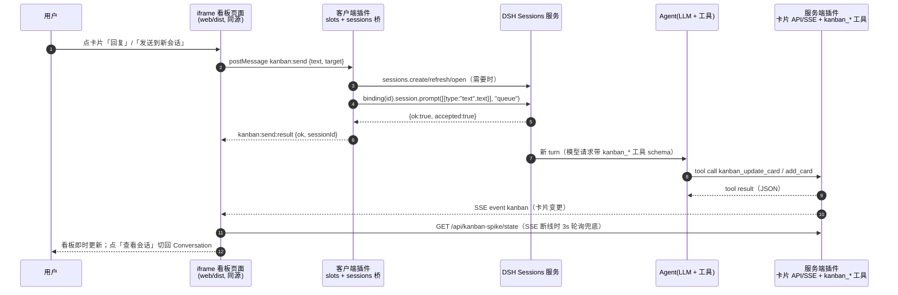

# 02 · DSH 插件集成（Kanban spike 实证）

> 目标：回答「Kanban 如何在 DSH 里做成一个插件」——侧栏入口、全屏面板、iframe 页面、会话桥、
> agent 工具、静态资源、安装与重载。结论全部来自 `spike/dsh-kanban-spike/` 在独立 scratch profile
> 的真实运行，证据在 `docs/assets/dsh-integration/`。
>
> 环境：DSH `0.1.5-rc.2`（`/opt/homebrew/bin/dsh`，Node v22.22.2）；源码
> `/opt/homebrew/lib/node_modules/@deepseek-ai/dsh/node_modules/@deepseek-ai/`；
> scratch profile `~/.dsh/profiles/kanban-spike`（从官方 `web` 模板初始化）。
>
> 结论：**A 安装/目录变化、B 侧栏+main keyed 面板+overlay、C iframe+主题桥、D session.prompt 真发消息、
> E server 路由+工具被真实 agent 调用、F 静态资源、G 加载格式/HMR 全部跑通**；做不到的点见 §14。

## 1. 插件架构总览：三层与两个半边

DSH 插件 = 三层叠加 + 两个运行半边：

| 层 | 位置 | 作用 |
|---|---|---|
| **bundle 层** | 插件包内 `cordis.patch.yml`（`package.json` 的 `dsh.bundle.patch` 指向） | 声明本包在配置树里插哪些行；安装后按 `dsh.profile.bundles` 顺序合并 |
| **cordis patch 层** | `~/.dsh/profiles/<name>/cordis.patch.yml` | 用户/部署的 config 覆盖、disable、insert，在**所有** bundle 层之后应用 |
| **profile 层** | `~/.dsh/profiles/<name>/package.json` | `dependencies` + `dsh.profile.bundles` 决定装什么、按什么顺序叠 |

一个插件包可同时是**服务端半边**（`main` → `lib/index.js`，跑在 DSH 主进程，消费 `ctx.webServer`、`ctx.tools`
等服务）和**客户端半边**（`exports["./client"]` → `lib/client.js`，`dsh-client-modules` 组 boot graph，
浏览器按 `/plugins/??<pkg>/client.js&rev=…` 懒加载）。

```json
{
  "main": "lib/index.js",
  "exports": { ".": "./lib/index.js", "./client": "./lib/client.js" },
  "dsh": {
    "bundle": { "patch": "./cordis.patch.yml" },
    "client": { "platform": "web", "inject": ["@deepseek-ai/dsh-client-ui-layout", "@deepseek-ai/dsh-api-session-controller"] }
  }
}
```

`dsh.client.inject` 是**打包依赖边**（工厂到达/插件组合顺序），不是服务注入；服务注入仍由客户端代码的
`ctx.inject([...])` 声明，两者不能混用。

```mermaid
flowchart LR
  A[profile package.json<br/>dsh.profile.bundles] --> B[合并 bundle patch 层<br/>dsh-base → dsh-web-app → 第三方]
  B --> C[合并 profile cordis.patch.yml<br/>用户覆盖层]
  C --> D[配置树 / Loader 行]
  D --> E[服务端插件 lib/index.js<br/>webServer / tools]
  D --> F[客户端行 dsh.client<br/>dsh-client-modules 组 boot graph]
  F --> G[/plugins/??pkg/client.js&rev=…]
  G --> H[浏览器 window.__ModuleLoader__.load]
  H --> I[factory materialize<br/>apply(ctx) 注册 slots]
```

实测：boot graph 里本插件行 `url=/plugins/??dsh-kanban-spike/client.js&rev=a5226925041a3138-44`，
响应 `text/javascript; charset=utf-8`、`cache-control: public, max-age=31536000, immutable`。

## 2. 服务端插件：`ctx.inject(["webServer","tools"])`

```js
export const name = "dsh-kanban-spike";
export const inject = ["webServer", "tools"];      // 服务可用后才 apply
export function apply(ctx) {
  ctx.effect(() => ctx.webServer.register({ kind: "exact",  path: "/kanban-spike", handler }));
  ctx.effect(() => ctx.webServer.register({ kind: "prefix", path: "/kanban-spike-static", handler }));
  ctx.effect(() => ctx.webServer.register({ kind: "prefix", path: "/api/kanban-spike", handler }));
  ctx.tools.register({ name, description, parameters, output, execute });
}
```

- `inject` 任一服务缺失时插件停在 pending，不会带 `undefined` 跑 `apply`；`register()` 返回 disposer，用 `ctx.effect(() => …)` 包住，fibre 卸载时路由自动摘除。
- **不要**抢 `registerFallback()`：那是 `dsh-host-frontend-static` 的单人座位（二次注册直接抛错）。插件用 exact/prefix 命名路由，未命中的请求自然落到官方 SPA。
- 匹配顺序：全表 exact → **最长 prefix** → fallback。`/api/kanban-spike` 比 `client-connection` 的 `/api` 长，会先命中插件——**同时绕过了官方 `/api` 的 cookie 认证与 Host/Origin 校验**，必须自建检查（§10）。

## 3. 客户端插件：slot 表与两条全屏路线

客户端 `apply(ctx)` 前先 `exports.inject = ["slots"]`；注册形态
`ctx.slots.inject(slot, () => ctx.slots.register({...}, Component))`（声明感知：slot 未声明时等待，
声明出现后执行；返回 disposer 随 fibre 卸载级联）。实测可用座位：

| slot | kind | scope | 用途 | 看板适用性 |
|---|---|---|---|---|
| `root` | single | root | 整棵树的根，官方 AppFrame 占着 | ❌ 注册会顶掉整个框架 |
| `sidebar.panellist` | list | root | 侧栏全局面板入口（icon+label+order） | ✅ 侧栏「看板」入口 |
| `main` | keyed | root | 中央面板，`key` 由 `layout.selectPanel(id)` 选中；`conversation` 为保留 key | ✅ 全屏看板主方案 |
| `sidebar.footer.action` | list | root | 侧栏底部动作行 | ✅ 「看板浮层」入口 |
| `shell.overlay` | list | root | 覆盖整个 frame 的浮层（click-through 直到组件接 pointer-events） | ✅ 真·覆盖全窗 fallback |
| `rightbar` / `rightbar.session` | single | root/session | 右栏（`openRightbar(track, fullscreen)` 可全屏） | 备选（辅助信息/会话详情） |
| `conversation.view` | list | session | 会话内视图页签 | 备选（看板绑定会话时） |
| `tool.call.toolview` | keyed | session | 按工具名渲染工具调用卡 | ✅ 工具结果卡 |
| `conversation.chat.turnTail` | 注入 | session | 会话轮次尾部 | ✅ 回复摘要卡 |
| `settings.section` / `settings.plugin.item` | list/keyed | root | 设置页 | 备选（看板配置） |
| `sidebar.brand.*`、`sidebar.settings`、`sidebar.workspaces` | single | root | 已被官方占据 | ❌ |

服务端/客户端职责边界：页面与静态资源、模型工具、持久化真源在**服务端**；侧栏/面板/浮层、会话交互
（`ctx.sessions`）、展示与 i18n 在**客户端**。客户端不持有业务真源，避免多窗口不一致。

### 3.1 `main` keyed 面板 vs `shell.overlay` 浮层（两者都实测）

| 维度 | `main` keyed 面板（主方案） | `shell.overlay` 浮层（fallback） |
|---|---|---|
| 实测尺寸 | `x=280,y=0, 1160×900`（只占中心列，侧栏仍可见） | `0,0 1440×900`（真覆盖全窗口） |
| 布局关系 | 官方布局的一部分：`selectPanel(id)` 切换，`selectPanel(null)` 回 Conversation | 叠在 `.overlayLayer` 上，与主布局无关 |
| 侧栏联动 | 高亮当前面板（`usePanelInfo`）；点任意会话自动 `selectPanel(null)` | 无选中态；要自建关闭按钮/遮罩 |
| 焦点/键盘 | 内联面板，Tab 顺序自然 | 无官方焦点陷阱/Esc，要自己实现（video-companion 即如此） |
| 状态 | 切走卸载组件（React state/iframe 页面状态丢失） | 关闭即卸载 |
| 结论 | **主看板用它**：有侧栏选中态、与官方导航一致 | 临时全屏/浮层查看；做模态必须补焦点管理 |

keyed slot 用 `key`（不是 `id`）；`sidebar.panellist` 的组件只负责**图标**（父传 `{size, active}`），
外层渲染 label 与选中态；`label` 可为字符串或 thunk（locale 切换后 sidebar 重新解析）：

```js
ctx.slots.inject("main", () => ctx.slots.register({ name: "main", key: "kanban-spike" }, KanbanPanel));
ctx.slots.inject("sidebar.panellist", () => ctx.slots.register(
  { name: "sidebar.panellist", id: "kanban-spike", order: 20, label: () => t("panel.title") }, KanbanIcon));
```

## 4. 客户端 bundle 格式、CSS、locale、错误上报

- 格式固定：`window.__ModuleLoader__.load({ id: "<包名>", factory: (require) => { …; return module.exports; } })`。 执行 bundle **只注册工厂**；`factory` 在首次 materialize 时运行，副作用（CSS 注入、slot 注册）必须在 factory 闭包内。
- 只能 require 平台种子模块：`react`、`react/jsx-runtime`、`react-dom`、`react-dom/client`、`@deepseek-ai/cordis`、 `dsh-client-store`、`dsh-client-ui-slots`、`dsh-client-ui-primitives`、`dsh-client-ui-dockkit`； 其他动态包用 `dsh.client.external` 声明（写 `<pkg>/client`，会归一化到包名）。
- CSS：`ctx.effect(() => { const el=document.createElement("style"); …; return () => el.remove(); })`；颜色/圆角/阴影一律用 `--dsw-*` 设计令牌（本插件全部用 `--dsw-alias-*` / `--dsw-font-*`）。
- locale：`ctx.inject(["locale"], c => c.effect(() => c.locale.register(ns, { zh: {...}, en: {...} })))`；也支持 `(ns, "ja", {...})` 单语言形式。命名空间 TS 类型是编译期约束，运行时按字符串合并。
- 错误上报：客户端没有统一 toast API；spike 用 `console.error` + `window.__DSH_KANBAN_SPIKE__.errors` 供自动化断言 （E2E 结束 `client_errors=[]`、`console_errors=[]`）。

## 5. 主题令牌桥（为什么必须有）

ThemePresenter 把令牌写成 **body 上的内联 CSS 变量**（`body[data-ds-dark-theme]`、`--dsw-alias-*`、
`--dsh-content-font-size`）。iframe 是独立文档，**不继承**这些变量，所以：

1. iframe 脚本末尾发 `kanban:ready`；
2. 父页面校验 `origin` + `event.source === iframe.contentWindow` 后，发 `kanban:theme`（mode+23 个令牌）和 `kanban:host-info`；
3. 父页面用 `MutationObserver` 监听 body 的 `data-ds-dark-theme`/`data-ds-theme`/`style`，防抖 50ms 重发；
4. iframe `:root.style.setProperty("--dsw-alias-bg-base", …)`，CSS `var(--dsw-alias-bg-base, #fff)` 自然跟随。

实测：父页面 body 背景 `rgb(255,255,255)`，iframe body 同为 `rgb(255,255,255)`；令牌 23 个、`mode=light`
（`02-main-panel-iframe.png`）。

## 6. 会话桥：精确签名与限制

```js
exports.inject = ["slots"];
ctx.inject(["sessions", "workspaces"], (c) => c.effect(() => { sessions = c.sessions; workspaces = c.workspaces; }));
```

| API | 签名 | 备注 |
|---|---|---|
| 列表快照 | `ctx.sessions.list: ObservableSnapshot<SessionListState>`（`.getSnapshot()`/`.subscribe()`） | 字段 `ids`、`byId`（`SessionSummary`: `id/title/displayTitle/cwd/running/blank/updatedAt/…`）、`current`、`phase`、`subagentsByParent`、`jobsBySession`、`currentAddress` |
| 当前会话 | `ctx.sessions.list.getSnapshot().current` | `undefined` = 无选中（新建空白页） |
| 新建 | `create(opts?: {workspaceId?, cwd?, sessionId?}): Promise<SessionId>` | 失败抛 `SessionCreateError`；成功后要 `refresh()` 才保证列表可见 |
| 选中/刷新 | `open(id): void` / `refresh(): Promise<void>` | `open` 未知 id 直接抛；选中驱动 stage 与事件流 |
| 绑定 | `binding(id): SessionBinding \| undefined` | 未列出/未 stage 时为 `undefined`，**必须轮询等待**；`{sessionId, session, eventSource, ctx}` |
| 发消息 | `binding.session.prompt(content: PromptContentPart[], mode: "queue"\|"steer", signal?, requestId?): Promise<RemoteResult<{accepted:true}>>` | `PromptContentPart = {type:"text",text} \| {type:"image",…} \| {type:"file",receiptId}`；返回 `{ok:true,value}` 或 `{ok:false,error:{code,message}}` |
| 其它 | `clear()` / `fork({sessionId,atSeq?,increaseTitle?})` / `search(query,signal)` / `scope/scopeOf/sessionOf` | — |

最小可用序列（spike 的「发送到新会话」）：

```js
const cwd = currentCwd();                       // 当前会话 cwd → workspace.path → 兜底
const id = await sessions.create({ cwd });
await sessions.refresh(); sessions.open(id);
let binding;
for (let i = 0; i < 60 && !binding; i++) { binding = sessions.binding(id); if (!binding) await sleep(50); }
const r = await binding.session.prompt([{ type: "text", text }], "queue");
if (!r.ok) throw new Error(r.error.message || r.error.code);
```

实测（`e2e-results.json`）：创建 `session-bebf8bb9-…` → prompt 被接受 → agent 调用
`kanban_spike_add_card` → 卡片 3→4；会话列表/标题/会话页全部正常。

限制：`prompt` 只表示**已接受**，不代表 agent 完成（要订阅 session 事件 / 看 `list.running` / 间接观察业务状态）；
`binding` 不是同步可用；会话持久化在 `$DSH_HOME/sessions`，scratch profile 会看到主 profile 的会话（实测当前会话
就是共享的 `session-4b3bfc0d…`）；归档会话不能 prompt。`ctx.workspaces.list.getSnapshot()` 的 `items[].path` +
`sessionIds` 是拿 cwd 的可靠来源。

## 7. 工具注册（agent 可见性证据）

```js
ctx.tools.register({
  name: "kanban_spike_add_card",
  description: "在 DSH Kanban spike 看板上新增一张卡片……",
  parameters: { type: "object", additionalProperties: false,
    properties: { title: { type: "string" }, column: { type: "string", enum: ["todo","doing","done"] } },
    required: ["title"] },
  output: { schema: { type: "string" },                       // 必须与 execute 返回类型一致
    render(_args, value) { return [{ type: "text", text: String(value) }]; } },
  async execute(args, exec) { return JSON.stringify({ ok: true, count: cards.length, card: addCard(args) }); },
});
```

实测证据（`session-tool-evidence.json`，解压 `~/.dsh/sessions/<cwd>/session-<id>/session.v3.jsonl.zstd`）：

- 模型请求 `request/header.header.tools` **共 29 个工具，含 `kanban_spike_add_card`、`kanban_spike_cards`**；
- 日志 `tool/call {name:"kanban_spike_add_card", arguments:{"title":"看板冒烟：iframe 触发","column":"todo"}}`；
- `tool/result` 内容 `{"ok":true,"card":{"id":"card-101",…},"count":4}`。

工具名建议带业务前缀（`kanban_*`），description 写清「何时用/不用」；`exec.signal` 必须转发与尊重。

## 8. 路由与静态资源

| 路由 | 形态 | 用途 | 实测 |
|---|---|---|---|
| `/kanban-spike` | exact | iframe 页面 | 200 `text/html; charset=utf-8`、`no-store` |
| `/kanban-spike-static/*` | prefix + 自建 handler | JS/CSS/图 | 200 `application/javascript; charset=utf-8` |
| `/api/kanban-spike/state` | prefix | JSON 快照 | 200 JSON |
| `/api/kanban-spike/cards` | prefix | 新增卡片（POST，自建 Origin 校验） | 正常 201；`Origin: http://evil.example` → 403 |
| `/api/kanban-spike/events` | prefix | SSE 推送 | `event: hello` → 变更时 `event: kanban` |
| `/plugins/events` | 官方 `dsh-client-hmr` | 客户端热重载 SSE | `: connected` + `graph`/`rebuilt` 帧 |

静态 handler 自己负责四件事（spike 均实现）：MIME 表；`cache-control`（spike `no-store`，带 hash 的产物可长缓存）；
路径穿越拒绝（校验原始前缀 → decode → `normalize` → `startsWith(STATIC_ROOT + sep)`，实测
`%2e%2e%2f..%2findex.js` → 403）；未知路径 404（不要 SPA fallback，别抢官方 seat）。

## 9. 安装 / 卸载 / 更新 与重载

```bash
# 1) 初始化 scratch profile（仅首次；从官方 web 模板拿到 base+web-app 两层）
dsh --profile kanban-spike --from-default-profile web --dump-default-config > /dev/null
# 2) 安装本地插件（路径可含空格，加引号）
dsh plugin --profile kanban-spike add "/Users/roxor/Desktop/dsh/dsh kanban/spike/dsh-kanban-spike"
# 3) 查看 / 组合树 / 更新 / 卸载
dsh plugin --profile kanban-spike list --depth 0
dsh --profile kanban-spike --dump-config | grep -A2 kanban-spike
dsh plugin --profile kanban-spike up dsh-kanban-spike
dsh plugin --profile kanban-spike remove dsh-kanban-spike
# 4) 启动（--port 0 由 OS 分配，打印带 token 的 URL）
dsh --profile kanban-spike --port 0 --no-open
```

`dsh plugin` 的真实行为（读 `lib/plugin-*.js` + 实测）：profile 不存在先按模板初始化（`kanban-spike` 不是官方
模板名 → 手动 `--from-default-profile web`，否则只有 `dsh-base`、没有 web 应用）；其余参数**原样转发给 pnpm**
（cwd=profile 目录；绝对路径 → `"<pkg>": "link:/abs/path"`，相对路径以调用目录为锚）；pnpm 成功后 reconcile：
解析安装后的包是否声明 `dsh.bundle.patch`，是则把**真实包名**追加进 `dsh.profile.bundles`，删除后自动移除。

目录变化（实测）：`package.json` 的 `dependencies` 增加 `link:…`、`dsh.profile.bundles` 追加 `dsh-kanban-spike`；
`node_modules/dsh-kanban-spike` 为指向插件目录的符号链接；`.plugin-manager/logs/operation-*/pnpm.log` 记录输出；
插件自带 `cordis.patch.yml` 作为 bundle 层合并，`dump-config` 出现 `# == dsh-kanban-spike` 与 `- id: kanban-spike`。

**重载矩阵（实测）**：

| 改动 | 是否热生效 | 结论 |
|---|---|---|
| `lib/client.js` | ✅ 自动热替换 | `dsh-client-hmr` 轮询 bundle；实测 `__DSH_KANBAN_SPIKE__.version` 1→2，页面未刷新（导航标记仍在），回滚后 1 再次生效 |
| `lib/index.js`（服务端） | ❌ 必须重启 `dsh` | bundle 只在进程启动时执行；本次修静态 handler 就是重启后生效 |
| `cordis.patch.yml` / 包内 config | ❌ 随进程启动 | 需重启；profile `patchReload: live` 只监听 profile 的 patch 文件，不监听插件源码 |
| `package.json` / 依赖 | ❌ | 重新 `dsh plugin add` 后重启 |
| HMR 失败 | 不回滚 | 旧 bundle 不恢复，entry 变 FAILED，下一次 rebuilt 重试（官方明确） |

HMR 边界：React state 会丢（组件重挂），connection/session 数据层保留；生产插件若用 tsdown/vite，还要同时跑
`pnpm run dev:web` 之类 watch 写产物，否则没有 rebuilt 帧。

## 10. 安全与隔离

- 自定义 `/api/kanban-spike/*` 是**最长前缀**，不进入 `client-connection` 的 `/api` handler：没有 cookie 认证、没有 Host/Origin 栅栏。插件自建：`Host` 存在、`Origin`（若有）必须等于 `http://<Host>`、`sec-fetch-site: cross-site`
  拒绝；SSE 是 GET，同源请求不带 Origin，无法只靠 Origin 鉴别——敏感数据加一次性 ticket/同源 referer 校验，且
  **不要**把敏感数据放进公开静态页面。
- 官方 `/api`：`GET /?token=…` → 303 + `HttpOnly; SameSite=Strict` cookie；静态资源公开、index 需 cookie。
- `$DSH_HOME/sessions`、`settings.yaml`、`.credentials.yaml` 被所有 profile 共享：新 profile 里 `ctx.sessions.list` 能看到主 GUI 的会话，`sessions.open` 也能切过去。隔离测试用 `DSH_HOME=/tmp/…`（但模型凭据需另配，否则只能验证 UI/路由）。

## 11. 实测证据（spike）

启动：`dsh --profile kanban-spike --port 0 --no-open` → `http://127.0.0.1:<port>/?token=<token>`；E2E（Playwright +
Chrome）结果：`docs/assets/dsh-integration/e2e-results.json`。

| 验证点 | 实测结果 |
|---|---|
| 侧栏入口 | 1 个 `button[aria-label="看板"]`，rect `12,120 256×36` → `01-sidebar-entry.png` |
| main 面板 | `[data-kanban-spike-panel="main"]` rect `280,0 1160×900` → `02-main-panel-iframe.png` |
| 主题桥 | `bridgeReady=true`、`tokens=23`、`mode=light`，父/iframe body 背景均 `rgb(255,255,255)` |
| 会话 create+prompt | `created=true`，`sessionId=session-bebf8bb9-16c7-4b3c-aada-ec9d74dc8ace` |
| 工具调用 | 卡片 3→4（`card-101 · source=agent-tool`），SSE+轮询更新 → `03-prompt-and-tool-updated.png` |
| Conversation | 可见「1 次工具调用」与工具结果 → `04-session-opened.png` |
| shell.overlay | `[data-kanban-spike-overlay="open"]` rect `0,0 1440×900` → `05-overlay-fallback.png` |
| 客户端错误 | `client_errors=[]`、`console_errors=[]` |
| HMR | 版本 1→2→1，导航标记始终 `first-load`（无刷新）→ `hmr-result.json` |
| curl | `/` 303+cookie、页面 200、JS 200、state JSON、SSE hello、穿越 403、跨源 POST 403 → `curl-verification.txt` |

复现命令与消息协议见 [`spike/README.md`](../spike/README.md)。

## 12. 推荐的生产架构



生产建议：

1. **主入口用 `sidebar.panellist` + `main` keyed 面板**；要「盖住整个窗口」才用 `shell.overlay`，并补焦点陷阱/Esc。
2. **UI 与持久化分离**：看板数据放服务端插件（JSON/SQLite），对外只暴露同源 JSON+SSE；客户端不持业务真源。
3. **会话交互走客户端 `ctx.sessions`**（官方语义，自动出现在侧栏与工作区）；只有「无浏览器触发」时才用服务端 `ctx.sessionController`。
4. **工具即 API**：让 agent 通过 `kanban_*` 工具改卡片；per-tool 用 `tool.call.toolview` 注册工具卡；变更统一走 SSE。
5. **客户端保持纯展示**：把 iframe 换成 React slot 组件可省掉主题桥，但失去 web/dist 独立构建与热更便利；spike
   选 iframe 是为了复用已有页面，生产二选一。
6. **开发循环**：客户端改动用 HMR；服务端改动重启进程；独立 profile +（可选）`DSH_HOME` 隔离，避免污染用户 GUI。

## 13. 风险与坑清单

| # | 坑 | 影响 | 对策 |
|---|---|---|---|
| 1 | 自定义 `/api/<plugin>` 绕过官方认证 | 数据暴露风险 | 自建 Host/Origin 校验 + 不公开敏感数据 + 必要时 ticket |
| 2 | profile 共享 `$DSH_HOME` | 看到/改动用户会话、设置、凭据 | 测试用 `DSH_HOME` 隔离；生产只碰自己的会话 |
| 3 | 服务端代码/依赖变化无热更新 | 改一行或装包就得重启 | 频繁改动放客户端；服务端留 `--port 0` 快速重启脚本，依赖变化后必重启 |
| 4 | `binding(id)` 可能 undefined | 直接 `.prompt` 崩溃 | 轮询等待（spike 60×50ms） |
| 5 | `prompt` 只表示 accepted | 误以为 agent 已完成 | 订阅会话事件 / 看 `list.running` / 让工具回写业务状态 |
| 6 | `main` 选中态是瞬态 store | 刷新后回 Conversation | 需要持久化就记 localStorage 并 `selectPanel` 恢复 |
| 7 | `selectPanel(unknown)` 抛错 | 注册未就绪时点侧栏报错 | 面板与入口同时注册；或 `try/catch` + 提示 |
| 8 | `shell.overlay` 无焦点陷阱/Esc | 模态可访问性差 | 自建 Tab 循环/Esc/还原焦点 |
| 9 | iframe 不继承主题变量 | 明暗色错乱 | 主题桥；令牌清单随 DSH 升级维护 |
| 10 | `remove` 残留 `link:` 符号链接 | 误以为没卸干净 | 以 `dump-config`/`bundles` 为准，或手动清理 |
| 11 | 新 profile 首次有「内测声明」模态 | 自动化点击被 mask 拦截 | 测试脚本先点「继续」 |
| 12 | 工具 `output.schema` 与返回值不符 | 运行时校验失败 | schema `{type:"string"}` 就返回字符串 |
| 13 | HMR 失败无回滚 | 入口 FAILED、页面可能缺 UI | 保留手动重启兜底；不要依赖 HMR 发布 |
| 14 | locale key 未命中显示 key 本身 | UI 露 `panel.title` | label thunk 回退到中文常量 |

## 14. 做不到 / 需要妥协的点

1. **没有「主面板真·全屏覆盖整个窗口」的官方 API**：`main` keyed 面板只占中心列（实测 1160×900），官方全窗覆盖只有
   `shell.overlay`。折衷：主看板用 `main`（保留侧栏与选中态），沉浸式时切 `shell.overlay`；或用
   `layout.openRightbar(..., fullscreen)` 的全屏右栏。
2. **服务端插件不支持热更新**：只能重启。折衷：服务端只放路由/工具/持久化等低频改动，UI 与交互放客户端吃 HMR。
3. **没有「插件自建后端 → 自己的前端」的官方推送通道**：只能 `webServer` 自建 SSE/WebSocket 或客户端轮询。
   spike 用 SSE + 3s 轮询兜底；生产建议 SSE 为主、轮询降级。
4. **iframe 内拿不到 DSH 的 React 组件/上下文**：只能 postMessage 桥接。想要「原生感」（焦点、快捷键、选择器、
   右键菜单）就得把看板重写成 React slot 组件，放弃独立 web/dist 构建。
5. **客户端插件不能直接读服务端进程内存**（跨 HTTP 边界）：spike 用同源 `/api` 读真源；生产同理。
6. **无法在 scratch profile 完全隔离用户数据又保留模型凭据**：`DSH_HOME` 可隔离 sessions/settings，但模型调用需要
   凭据；要测真实 agent 就得接受共享凭据，或手动把 `.credentials.yaml` 复制进隔离 home。
7. **`prompt` 没有「等待 agent 完成」的返回值**：只能事件/轮询观察。
8. **`dsh plugin remove` 不清理 profile 层的手工 patch**：若在 profile `cordis.patch.yml` 里按 id 覆盖过插件行，remove
   不会删那些条目，需人工清理（本 spike 全用 bundle 层内 patch，故无此问题）。
