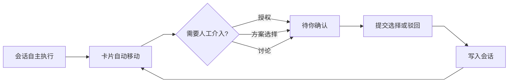

# DSH 看板 · 设计系统（v2，2026-10-21）

> 交付：`design/mockup.html`（单文件可交互高保真）、`design/screens/01–16`（状态截图）、`design/lint/`（组件样式抽取与令牌 lint）。
> 锚定 DSH `dsh-v0.1.5-rc.2` 设计令牌与 `dsh-ui-spec`；产品决定见 §10.3「已拍板」。

## 1. 设计目标与原则

看板是 **Agent 工作状态的可视化控制面**，不是传统任务管理工具：会话自主推进，人只在授权、方案选择、讨论三类节点介入。界面要安静、可扫读，把「需要人」的卡片推到眼前。

| # | 原则 | 落地 |
|---|---|---|
| 1 | 克制 | 一屏最多两种强调色（待你确认琥珀、会话活动蓝）；除审批与主按钮外不出现大面积填充色；动效只用于状态变化与浮层进入 |
| 2 | 发丝线 | 卡片、列、分隔线一律 `0.5px` 中性实线；状态色边框保持 `1px`；不用粗边框划分层级 |
| 3 | 浮层用阴影 | 菜单、筛选浮层、抽屉、底部弹层、Toast、Modal、二次确认全部 `border: 0` + `--dsw-elevation-*`，不叠加描边 |
| 4 | 主按钮黑 | 主操作（提交选择、新建、保存）用 `--dsw-alias-button-primary-fill`，不用业务蓝 |
| 5 | 密度优先 | 13px 正文 + 11px 元信息；折叠卡片承载 80% 信息；审批选项例外——必须完整展开 |
| 6 | 状态不只靠颜色 | 每个状态点有中文状态词；受阻/失败有原因文案；审批有图标、问题与每个选项说明 |
| 7 | 会话是主体 | 运行中的实体是「会话」；DSH Agent 只出现在时间线 actor 与消息发送者语境 |

## 2. 信息架构

### 2.1 术语

| 术语 | 含义 | 界面位置 |
|---|---|---|
| 会话（Session） | 执行卡片的工作单元；一个卡片可绑定多个会话，其中一个是主会话 | 运行中计数、会话列表、回复目标、时间线 actor |
| Agent | 会话内的执行者，仅作为 actor（谁写的/谁做的） | 时间线节点、消息 meta |
| 卡片（Card） | 看板最小单位；承载状态、摘要、动作、审批、素材与会话绑定 | 四列 |
| 审批（Approval） | 需要人选择的问题：单选/多选 + 选项说明 + 备注 | 待你确认卡片、详情 |
| 未归档卡片 | 未归档的卡片总数（`archived=false`），头部计数口径 | 顶栏 |
| 待你确认 | 包含 `needs_you`、`blocked`、`failed` 三种状态所在列（4 列制，不单独开列） | 第三列 |

### 2.2 四列与卡片五层

四列固定：**待办 Backlog / 进行中 Running / 待你确认 Needs you / 已完成 Done**。`blocked`、`failed` 状态归入「待你确认」列，就地用状态点 + 原因表达；`done` 与 `canceled` 归入「已完成」。

卡片信息分五层：

| 层 | 字段 | 位置 |
|---|---|---|
| 身份 | 状态点、标题 | 首行 |
| 意图 | 一句话摘要（2 行截断，竖屏 3 行） | 标题下 |
| 现在 | 当前动作 / 最近节点 + 耗时 | 摘要下 |
| 属性 | 优先级、项目、标签；状态、耗时、工具调用、搜索、会话入口 | 属性行 + 页脚 |
| 结果 / 决策 | 审批问题、全部选项与说明、备注、提交/驳回；失败卡的重试 | 卡片底部（仅待你确认） |

### 2.3 三档信息密度

| 档位 | 触发 | 显示 | 高度预算 |
|---|---|---|---|
| 折叠 | 默认 | 状态点 + 标题 + 摘要 + 当前动作 + 属性行 + 页脚；审批卡显示完整问题、全部选项、备注和提交按钮 | 审批卡约 360–520px，普通卡 144–190px |
| 展开 | 点卡片 / 箭头 / Enter | 折叠态 + 最近 3 条重要节点 +“加载更早” + 紧凑媒体行 + 内联回复 | 展开区最大高度 360px（竖屏 46dvh），内部滚动 |
| 详情 | 详情入口 / O / 会话图标 | 完整属性（含执行会话、执行目录）、全量节点、会话列表与线程、回复目标、审批、编辑 | 右抽屉 `clamp(380px,34vw,460px)`；竖屏底部弹层 ≤92dvh |

> 折叠态必须能完成“看懂问题 + 提交选择”，不得把选项或说明藏进展开层。

### 2.4 自主移动与人工介入



- 提交选择：按所选选项的 `outcome` 落到进行中 / 待办 / 已完成；驳回固定回待办。结果写入会话（全文），看板只追加摘要节点。
- 每次列变更、审批、回复都追加时间线节点；时间线是追溯依据。
- 人工把卡从其他列拖进「待你确认」时，自动生成通用确认请求（标题「需要你确认：{卡片标题}」、选项「继续 / 停止」），并弹出可编辑的确认请求弹窗。

### 2.5 审批模型

对齐 DSH `user-questions` / `kanban_request_approval`：

```ts
{
  title: string, detail: string, multiSelect: boolean,
  options: [{ id, label, description?, tone: 'primary'|'danger'|'ghost', outcome?: 'running'|'backlog'|'done' }]
}
```

- **所有选项与说明在卡片内完整展示**（不折叠、不截断）；单选用 radio，多选用 checkbox。
- 备注可选；提交后完整文字写入会话，看板只留摘要节点。
- 驳回是“选择 danger 选项”的快捷路径；有 danger 选项才显示驳回。
- 多选至少选 1 项，否则内联 toast 并聚焦第一个选项。
- 审批通过后卡片按 outcome 回到 `进行中`（默认），不直接进入已完成；由会话完成后自行移动到已完成。

#### 2.5.1 多问题审批（对齐 DSH `ask_user_question`）

一个审批可包含多个问题；结构与 DSH `ask_user_question` 对齐：

| DSH 字段 | 看板 UI | 说明 |
|---|---|---|
| `questions[]` | 卡片内按题分组，全部展示 | 不折叠、不分页；一屏放不下时随列/抽屉滚动 |
| `header` | 题目标签（11px caption，如「发布渠道」） | 可空；空则只显示问题 |
| `question` | 问题正文（12px 500） | 每题一个 fieldset，带序号「1 / 3」 |
| `multi_select` | `单选` / `多选` 徽标 + radio/checkbox | 多选至少选 1 项 |
| `options[]` | 全部选项 + description | 与单问题审批同款选项卡片，不截断 |

- **统一提交**：所有题共用一个备注输入 + 一个「提交全部回答」按钮；提交前校验每题都有选择，缺哪题就聚焦哪题并 toast 提示。
- **回答序列化**：`answers[questionIndex] = optionId[]`；写入会话的消息按「题目标签：选项、选项」拼接为全文，看板节点只写摘要。
- **列表动作区**：多问题审批行不提供快捷批准，动作列只显示「详情 >」，进入卡片/详情逐题回答。
- 多问题审批不提供「编辑确认请求」（人工编辑仅适用于单问题模板）；拖入待你确认生成的是单问题默认模板。
- 问题数量建议 ≤4、每题选项 2–4 个；超过时拆卡或改用多张审批卡。

### 2.6 会话与同步

- 详情抽屉展示卡片绑定的全部会话：主会话徽标、运行中状态、`设为主会话`、`打开`。
- 回复目标下拉默认主会话；可切换后回复。
- 同步粒度（已拍板）：
  - **看板 → 会话**：用户提交审批、回复时发送全文。
  - **会话 → 看板**：Agent 只通过工具写摘要节点（界面上节点带「摘要」标记），不镜像全文，避免卡片变成聊天记录。
- 同义同步文案只保留在 Composer 下方一处：`全文写入所选会话；Agent 工具写回看板的只是摘要节点。`
- deep link 提案 `dsh://session/<sessionId>#<cardId>` 需宿主支持，v1.1 前以“面板内打开会话 + 卡片 URL hash”兜底。

### 2.7 重要节点、素材、已完成

- 时间线默认最近 3 条，提供「加载更早的 N 条」；展开区限高内部滚动，详情抽屉展示全量。
- 非文字素材不内联大图，使用紧凑媒体行：缩略图 + 数量（截图/录屏/报告/文件）+「在会话中查看」。
- 已完成列看板只渲染最近 5 张 +「查看全部 N 张 / 收起」；列表视图已完成分组默认折叠，展开后先显示 5 条 +「加载更多（剩余 N 张）」。
- 卡片菜单的删除语义为**归档**（可从撤销 Toast 恢复），对应头部“未归档”计数。
- **动作文案统一**：所有详情入口固定为「详情 >」（卡片展开区、列表展开区、卡片菜单），不再混用「详情」「打开详情」「查看详情」；chevron 属于文案的一部分，不单独再加图标。

## 3. 令牌映射

### 3.1 颜色：看板语义 → DSH alias

只消费 `--dsw-alias-*`；组件内以 `--kb-*` 做语义别名；不得定义 `--dsw-*`。

| 看板语义 | 真实令牌 | 亮色 | 暗色 |
|---|---|---|---|
| 应用底 / 主区 | `--dsw-alias-bg-base` | `#ffffff` | `#151517` |
| 列底 | `color-mix(in srgb, var(--dsw-alias-label-primary) 3%, var(--dsw-alias-bg-base))` | ≈`#f7f7f8` | ≈`#1c1c1e` |
| 卡片底 | `--dsw-alias-bg-layer-1` | `#ffffff` | `#232324` |
| 卡片 / 输入描边 | `--dsw-alias-border-l2` | `rgba(0,0,0,.10)` | `rgba(255,255,255,.12)` |
| 悬停 / 按下 | `--dsw-alias-interactive-bg-hover` / `-active` | `rgba(38,49,72,.06/.10)` | `rgba(255,255,255,.08/.14)` |
| 主 / 次 / 弱文字 | `label-primary` / `label-secondary` / `label-tertiary` | `#0f1115` / `#61666b` / `#81858c` | `#f9fafb` / `#cfd3d6` / `#adb2b8` |
| 最弱 / 角标 | `--dsw-alias-label-caption` | `#adb2b8` | `#81858c` |
| 主按钮 | `--dsw-alias-button-primary-fill` + `label-primary-foreground` | 黑底白字 | 近白底黑字 |
| 浮层底 | `--dsw-alias-bg-layer-3` / `--dsw-specific-menu` | `#ffffff` | `#353638` |
| 浮层阴影 | `--dsw-elevation-panel` / `-prominent` / `-soft` | 首层 0.5px 发丝线 | 同亮色 |
| 遮罩 | `--dsw-alias-bg-mask-2` + `--dsw-mask-blur` | `rgba(0,0,0,.12)` | `.20` |
| 待办 | `--dsw-alias-label-caption`（空心环） | `#adb2b8` | `#81858c` |
| 进行中 / 会话活动 | `--dsw-alias-state-business-primary` | `#4176e6` | `#679efe` |
| 待你确认 | `--dsw-alias-state-warn-primary`；文字 `state-warn-label` | `#f59e0b` / `#dd8629` | 同亮色 |
| 受阻 | `--dsw-alias-state-error-primary`（按契约与失败同色） | `#ec1313` | `#f25a5a` |
| 失败 | `--dsw-alias-state-error-primary` | `#ec1313` | `#f25a5a` |
| 已完成 | `--dsw-alias-state-success-primary` | `#22c55e` | 同亮色 |
| 审批块底 | `--dsw-alias-state-warn-tertiary` | `#fef5e7` | `#27241f` |
| 主会话徽标 / 同步底 | `--dsw-alias-state-business-tertiary` + `-primary` | `#e4edfd` | `#34415b` |
| 链接 / 会话入口 | `--dsw-alias-link` | `#4176e6` | `#679efe` |
| 骨架 | `--dsw-alias-bg-skeleton` | `rgba(0,0,0,.04)` | `rgba(255,255,255,.08)` |

### 3.2 派生色公式

| 用途 | 公式 |
|---|---|
| 待你确认列底 | `color-mix(in srgb, var(--dsw-alias-state-warn-primary) 5%, var(--kb-surface-column))` |
| 进行中列底 | `color-mix(in srgb, var(--dsw-alias-state-business-primary) 3%, var(--kb-surface-column))` |
| 拖拽目标列 | `color-mix(in srgb, var(--dsw-alias-state-business-primary) 9%, var(--kb-surface-column))` |
| P0 / P1 徽章 | `color-mix(in srgb, var(--dsw-alias-state-error-primary) 12%, transparent)` / `warn 14%` |
| 选中选项 | `color-mix(in srgb, var(--dsw-alias-state-business-primary) 5%, bg-layer-1)` + 42% 业务蓝描边 |
| 失败卡片描边 | `color-mix(in srgb, var(--dsw-alias-state-error-primary) 26%, var(--dsw-alias-border-l2))`，宽度仍 0.5px |
| 同步错误条 | `color-mix(in srgb, var(--dsw-alias-state-error-primary) 7%, bg-base)` + 24% 错误色下边框 |

## 4. 字体、间距、圆角、阴影、动效

### 4.1 字体层级

| 角色 | 令牌 | 规格 | 用例 |
|---|---|---|---|
| 页面 / 卡片 / 抽屉标题 | `font-l-20` / `font-s-strong-14` / `font-base-strong-16` | 500 20/28；500 14/22；500 16/24 | 竖屏标题；卡片标题；抽屉 |
| 摘要 / 正文 | `font-xxs-12` / `font-xs-13` | 12/18；13/20 | 摘要、选项说明、输入 |
| 列头 / 按钮 | `font-xs-strong-13` / `font-xxs-strong-12` | 500 | 列名、Tab、按钮 |
| 元信息 | `font-xxxs-11` + tabular-nums | 11/14 | 耗时、工具/搜索数、标签、徽标、计数 |
| 等宽 | `font-markdown-code-block` + `--ds-font-family-code` | 11/19 | 会话 ID、路径、迁移号 |

### 4.2 间距、控件、动作区

- 间距阶梯 `4 / 6 / 8 / 10 / 12 / 16 / 20 / 24`；卡片内 gap 4–10，区块 16–20。
- 控件高度：icon 24–28；次级按钮 28；工具栏 32；主按钮 34–36；审批按钮桌面 30 / 竖屏 40；触控主决策热区 ≥44。
- **列表动作区（默认右置）**：批准/驳回/重试固定宽 64px（紧凑档 56px，竖屏 72px×32px 高）；同一行内右对齐成簇，放在指标与详情入口之间；竖屏换行到行尾并左对齐。动作区不参与省略与收缩，标题/摘要先让位。
- **列表动作区（左置变体 `?listActions=left`）**：动作列固定在状态点与标题左侧，宽 76px（竖屏 64px），按钮 36×24（宽按钮 64px），只占动作列、不横通栏；没有动作的行保留同宽空列，保证所有标题左对齐。默认仍为右置，左置仅用于对比/高密度评审。
- **三态主题控件**：顶栏右侧按钮按「跟随系统 → 亮色 → 暗色」循环，图标 + 文字标签（跟随/亮色/暗色）；`T` 同效。跟随系统时监听 `prefers-color-scheme` 与宿主 themeMode；手动选择覆盖当前主题，正式版持久化到 localStorage，embedded 默认跟随宿主。
- 看板列：列宽 ≥280（宽屏）/ ≥240（紧凑）/ 300（横向滚动）；列间距 16 / 12；列内卡片间距 10–12。
- 抽屉宽度 `clamp(380px, 34vw, 460px)`；底部弹层最大高 92dvh，`min-height: 42dvh`。

### 4.3 圆角

列 14；卡片/列表组 12；浮层 10；Modal 16；底部弹层 16（上两角）；控件 8；徽标 5。全圆（`50%` / `99px`）必须配 `corner-shape: round`；普通圆角由全局 `superellipse(1.5)` 平滑。

### 4.4 阴影与动效

- 卡片不用阴影，只用发丝线 + 悬停底色；菜单/浮层 `elevation-panel`；抽屉/Modal/确认框 `elevation-prominent`；唯一的 `shadow-lv1` 用于分段控件选中指示。
- 时长：hover/颜色 100ms；展开、Toast、抽屉淡入 200ms；抽屉/底部弹层滑入 300ms；`prefers-reduced-motion` 下全部压到 0.01ms，呼吸点静默。
- 展开区内部滚动不触发页面滚动；抽屉/弹层打开时焦点圈定。


### 4.5 紧凑规格（builder-web 可执行）

目标：给 builder-web 一份可直接执行的收紧规格；mockup v2 保留当前演示密度。下表的「mockup 现值 → builder 目标」差异是实施清单，不要求 mockup 再改。

| 项 | mockup v2 现值 | builder-web 目标 | 实现要点 |
|---|---|---|---|
| 顶栏 | 56px | **52px**（竖屏 48px + 计数最多 2 行） | 图标 28、水平 padding 16；看板名 + 计数 |
| 工具栏 | 50px | **48px** | 上下 padding 8；搜索/筛选控件 32；列表新建按钮 32 |
| 列头 | 40px | 40px | 列名 13/18 500；计数胶囊 18px |
| 列间距 | 16（宽屏）/ 12（紧凑） | **12px**（≥1440 可 16） | grid gap |
| 列内 padding | 10px | 8–10px | 列体 `0 10px 4px` |
| 卡片 padding | 10×10 | **10×12**（紧凑 10×10） | 圆角 12；卡片间距 8 |
| 卡片内部 gap | 6px | 6px | 标题→摘要→动作→属性→页脚 |
| 卡片标题 | 14 / 22 | **14 / 20，500** | `--dsw-font-s-strong-14` + `line-height: 20px` |
| 摘要 / 当前动作 | 12 / 18 | **13 / 20；动作 12 / 17** | 摘要用 `--dsw-font-xs-13`；动作可 12px |
| meta / 工具 / 耗时 | 11 / 14 | **12 / 16** | 数字 `tabular-nums`；徽标仍 11px |
| 列表行 | 约 11px 上下 padding | **min-height 44，padding 8×12** | 摘要单行省略；动作按钮 24px 高 |
| 列表组头 | 40px | **36px** | 与列头同密度 |
| 区块间距 | 16px | **12px** | 卡片间 8、区块间 12、页面 padding 16–20 |
| 按钮 | 次级 28；主 34–36；行内 26 | 次级 28；主 32；行内 24；审批 30（竖屏 40） | icon 24–28；触控主决策热区 ≥44 |
| 审批选项 | padding 6×8，行高 17 | padding 5×7，行高 17 | 全部题与选项保持完整展示，不因密度压缩截断 |

建议用组件局部变量落地（不占用 `--dsw-`）：

```css
.kb-app {
  --kb-topbar-h: 52px;
  --kb-toolbar-h: 48px;
  --kb-col-head-h: 40px;
  --kb-card-pad: 10px 12px;
  --kb-card-gap: 8px;
  --kb-col-gap: 12px;
  --kb-row-min-h: 44px;
}
.kb-card { padding: var(--kb-card-pad); gap: 6px; }
.kb-card__title { font: var(--dsw-font-s-strong-14); line-height: 20px; }
.kb-card__summary { font: var(--dsw-font-xs-13); }
.kb-card__meta { font: var(--dsw-font-xxs-12); font-variant-numeric: tabular-nums; }
```

验收：同一 1440×900 视口截图与 mockup 对照，允许顶栏 ±2px、卡片高度 ±8px、列间距一致；暗色与嵌入宿主各截一张；不得通过隐藏审批选项/动作来换密度。

## 5. 组件规范

| 组件 | 规范 |
|---|---|
| **顶栏** | 看板名 + 未归档卡片数 + 待你确认数 + 会话运行中数；计数之间 0.5px 分隔；无「Agents /」面包屑；右侧 Board/List、主题、帮助 |
| **列** | 列内独立滚动；列头 40px：状态图标 + 中文名 + 英文副标 + 计数 + 折叠 + 新建；待你确认列有 5% 琥珀底；受阻/失败不另开列 |
| **卡片** | `0.5px` l2、圆角 12、padding 10；标题 + 摘要 + 当前动作 + 属性行 + 页脚；hover 提亮 1.5%；选中 inset 2px 业务蓝；失败卡描边偏红 |
| **状态点** | 8px（页脚 6px）；待办空心环、进行中蓝 + 呼吸、待你确认琥珀、受阻/失败红、已完成绿；必须配状态文字 |
| **徽章** | 优先级 P0/P1/P2（5px 圆角、18px 高、11px）；标签中性；项目 + 文件夹图标；均只读 |
| **审批卡** | 问题标题 + 来源/时间 + 影响说明；全部选项（radio/checkbox，含说明）完整展示；备注输入；`驳回`（次级）与 `提交选择`（主按钮）；多选有“可多选，至少 1 项”提示；所有选项不折叠 |
| **审批编辑器** | 拖/移到待你确认时自动生成默认问题并弹窗；可改标题、影响说明、两个选项名、是否多选；保存后展示在卡片内；脏草稿关闭二次确认 |
| **时间线** | 竖线 + 7px 节点；done/current/pending/error 四态；右侧相对时间；会话摘要节点带「摘要」标记；最近 3 条 + 加载更早；展开区限高滚动，详情全量 |
| **媒体行** | 缩略图（26px 方块）+ 类型数量 + `在会话中查看`；不内联大图；只出现在展开区/详情 |
| **多会话选择器** | 会话行：标题、主会话徽标、运行中状态、session id、设为主会话、打开；回复目标下拉；回复目标决定消息落到哪个会话 |
| **已完成折叠** | 看板：最近 5 张 + 查看全部 N / 收起；列表：分组默认折叠 + 展开已完成（N）+ 加载更多（剩余 N）/ 收起 |
| **列表行** | 状态点 + 标题 + 摘要 + 指标 + 动作簇 + 详情/菜单；行可展开显示节点与审批；批准/驳回/重试固定宽度右对齐，窄屏换行左对齐 |
| **分组切换** | 列表视图工具栏的 `按状态 / 按项目 / 按优先级`；状态为默认；分组头含计数与折叠；完成组有特殊折叠 |
| **分段控件** | Board/List、抽屉 Tab；`specific-selector` 容器 + 选中项 `button-ghost-active-fill` + lv1 |
| **输入 / 按钮** | 输入 32（竖屏 40），focus-visible 2px 业务蓝；主按钮黑、次按钮白底发丝线、危险红字；按钮中文优先 |
| **抽屉 / 底部弹层** | 桌面右侧、竖屏上滑；`role=dialog aria-modal`、焦点圈定、Esc/蒙层关闭；关闭后焦点回卡片；脏草稿弹二次确认 |
| **确认框** | `role=alertdialog`；标题「放弃未保存的修改？」+ 说明 + 继续编辑 / 放弃修改；Esc/蒙层=继续编辑 |
| **SSE 状态与错误条** | 状态栏/工具栏显示「SSE 实时同步 · N 个会话运行中」；**不提供全局刷新按钮**；断连时出现错误条，手动重试只放在错误条内 |
| **多问题审批** | 对齐 `ask_user_question`：每题 fieldset（header + 序号 + question + 单选/多选徽标），全部选项与说明完整展示；统一备注 + 「提交全部回答」；逐题校验；列表快捷动作仅「详情 >」；回答按题序列化 |
| **列表动作区左置（`?listActions=left`）** | 固定 76px 动作列在状态点/标题左侧，按钮 36×24（宽按钮 64px），不横通栏；无动作行保留空列对齐标题；竖屏 64px、按钮堆叠；默认仍右置 |
| **三态主题切换** | 跟随系统 / 亮色 / 暗色；顶栏按钮显示图标 + 当前模式标签，点击或 T 循环；auto 监听系统/宿主变化；不写死暗色配色；正式版 localStorage 记住手动选择 |
| **空 / 加载 / Toast / 菜单** | 空态说明“这里会出现什么”并给下一步；骨架卡只在首次加载；Toast 反色面板，可带撤销；菜单无 border + elevation |

## 6. 响应式

断点按应用窗口宽；看板在 DSH 主区内按容器自适应（`ResizeObserver` 写 `data-layout`，尺寸与下表一致）。

| 断点 | 列布局 | 列宽 / 间距 | 卡片密度 | 详情 | 触控 / 动作区 |
|---|---|---|---|---|---|
| **≥1440** | 4 列并排 | 280–340 / 16 | 完整：项目 + 2 标签，列英文副标可见 | 右抽屉 380–460 | icon 24–28；动作固定 64px |
| **1100–1440** | 4 列压缩 | ≥240 / 12 | 隐藏第 2 个标签、列英文副标；项目保留 | 右抽屉 | icon 28；动作 56px |
| **720–1100** | 4 列横向滚动 + scroll-snap，一屏约 2–3 列 | 300 / 12 | 摘要 2 行；列表隐藏项目文本；状态栏隐藏 | 右抽屉 | icon 28–32；动作 56px |
| **<720 竖屏** | 顶部分段控件（4 列 + 计数）+ 单列 | 全宽 / 12 | 摘要 3 行；审批选项与按钮全宽；列头保留 | **底部弹层** ≤92dvh | 主决策热区 ≥44（视觉 40）；动作 72×32 |

- 桌面 shell：侧栏 52px + 主区；主区 padding 20–24；列内滚动、看板不整页滚动。
- 竖屏：隐藏 DSH 侧栏与状态栏；顶栏换为看板名 + 计数（最多两行）。软键盘：抽屉/弹层使用 `dvh` + `env(safe-area-inset-bottom)`，**需真机验收**。
- 动作区规范：宽屏右对齐、固定宽度；窄屏换行左对齐；不允许用省略号隐藏批准/驳回。

```text
≥720（横屏，四列）                               <720（竖屏）
┌──┬──────────────────────────────┐            ┌───────────────────────┐
│侧│ 看板  18 张未归档 · 6 待确认 │            │ 看板  18 · 6 · 3      │
│栏│ [搜索] [筛选]   3 会话运行中 │            │ [搜索…]               │
│52│ ┌────┬────┬────┬────┐        │            │ [筛选] (状态分组) [+新建]│
│  │ │待办│进行│确认│完成│        │            │ (待办)(进行)(待确认)(完成)│
│  │ │卡  │卡  │审批│卡  │        │            │ ┌───────────────────┐ │
│  │ └────┴────┴────┴────┘        │            │ │ 待你确认 · 6      │ │
│  │ SSE 实时 · 最后更新          │            │ │ 卡片 / 审批 / 节点 │ │
└──┴──────────────────────────────┘            │ 详情 = 底部弹层 ↑     │
                                               └───────────────────────┘
```

## 7. 交互规范

### 7.1 新建入口（收敛）

- 看板视图：**只有列头 `+` 与列底「新建卡片」**；顶栏不提供新建。
- 列表视图：**只有工具栏「新建卡片」**；分组头不提供新建。
- 新建弹窗解释三类信息：**项目**=逻辑分组、**标签**=自由筛选、**执行目录 workspaceId/cwd**=执行上下文；默认继承当前会话与工作区，可在详情中更换。

### 7.2 拖拽与换列

- 桌面 HTML5 拖拽：卡片 45% 透明、目标列 9% 业务蓝底、插入位置 2px 蓝线；松手写入状态、列变更节点与 Toast。
- 折叠列是合法投放目标，投放后展开；筛选状态下按当前可见顺序计算。
- 人工拖进「待你确认」→ 生成默认确认请求 → 弹出审批编辑器。
- 键盘替代：`Alt + ←/→` 换列、`Alt + ↑/↓` 列内排序；`aria-live` 播报。
- 批准结果：按所选选项 `outcome` 落到进行中/待办/已完成；驳回回待办；受阻/失败保持原状态直到人处理。

### 7.3 列表分组与已完成

- 分组：按状态（默认）/ 项目 / 优先级；切换后保留筛选、搜索与展开状态。
- 已完成：看板列只渲染最近 5 张 + 查看全部 N / 收起；列表完成组默认折叠，展开后 5 条 + 加载更多（剩余 N）+ 收起。
- 列表动作区：默认批准/驳回/重试固定宽、右对齐；窄屏换行左对齐；行内快速批准使用默认主选项，完整选项仍在展开区/详情。
- 左置变体（`?listActions=left`）：动作列移到标题左侧，宽度固定、按钮紧凑，不横通栏；无动作行保留空列以对齐标题；只改变布局，不改变动作语义与快捷批准规则。
- 多问题审批行只显示「详情 >」，不提供一键批准（必须逐题回答）。
- 所有详情入口统一「详情 >」。

### 7.4 展开、节点、素材

- 点卡片非交互区 / 箭头 / Enter 展开最近 3 条节点；「加载更早的 N 条」每次 +5；展开区最大高度内部滚动。
- 素材只显示紧凑媒体行，点击「在会话中查看」跳到会话 tab；不在卡片内嵌大图。
- 列表行与卡片同构：点击展开，按钮不触发展开。

### 7.5 会话

- 会话图标 / 「会话」按钮打开详情会话 tab；会话列表显示主会话、运行状态、`设为主会话`、`打开`。
- 回复目标选择默认主会话；`设为主会话`立即更新卡片页脚会话入口与回复默认目标。
- 看板→会话全文；会话→看板摘要节点（带「摘要」标记）；同一 Composer 一处解释。

### 7.6 关闭、草稿与焦点

- 弹窗/抽屉支持蒙层点击与 Esc 关闭；关闭前检查脏草稿：新建表单、审批编辑器、详情编辑、未发送回复、审批备注。
- 有脏草稿 → 确认框「放弃未保存的修改？」；`继续编辑`保留内容，`放弃修改`关闭；确认框本身 Esc/蒙层=继续编辑。
- 焦点：抽屉打开聚焦关闭按钮并圈定，关闭后回原卡片；`:focus-visible` 2px 业务蓝 outline；Toast/操作通过 `aria-live` 播报。

### 7.7 SSE 与错误

- 实时更新走 SSE，**没有手动刷新按钮**；工具栏显示会话运行中数量与 SSE 状态。
- 断连时顶栏下方出现错误条：「实时同步中断…」+ `重试` + 关闭；重试成功后状态恢复。任务失败卡的重试只在卡片/详情，不与全局刷新混淆。
- 移除了「Agent 自主推进」演示开关：自主性属于会话层，不是全局开关；如需暂停应走 DSH 会话控制。

### 7.8 快捷键

`⌘K` / `/` 搜索；`N` 新建；`B` / `L` 看板/列表；`T` 明暗；`Enter` 展开；`O` 详情；`Alt+←/→` 换列；`Alt+↑/↓` 列内排序；`Esc` 关闭当前浮层（确认框 → 菜单 → 弹窗 → 抽屉）。

### 7.9 主题（跟随 / 亮 / 暗）

- 顶栏主题按钮三态循环：跟随系统（默认）→ 亮色 → 暗色；点击或 `T` 切换，显示当前模式图标与文字。
- 跟随系统：读取 `prefers-color-scheme`；embedded 下默认跟随宿主 `themeMode`；系统/宿主变化时即时更新。
- 手动选择覆盖当前主题；正式版写入 localStorage，下次启动恢复；mockup 用 `?themeMode=auto|light|dark`（`?theme=dark` 为旧别名），不持久化。
- 主题只切换 alias 令牌解析，不出现硬编码暗色表；所有浮层、状态色、阴影同步跟随。

### 7.10 加载 / 空 / 错误

- 首次加载骨架卡；SSE 断连错误条；空列/空分组说明“这里会出现什么”并给下一步；筛选无结果提供清除筛选。
- 受阻/失败在待你确认列显示原因和重试；禁止只靠颜色表达状态。

## 8. 无障碍与国际化

- 文案全部走 locale 字典（含 `aria-label`、placeholder、Toast、空态、计数标签）；建议 key：`kanban.header.unarchived`、`kanban.header.needsCount`、`kanban.session.runningCount`、`kanban.approval.*`、`kanban.approval.submitAll`、`kanban.approval.questionIndex`、`kanban.session.primary`、`kanban.list.groupBy.*`、`kanban.done.showAll`、`kanban.dirty.confirm`、`kanban.theme.follow|light|dark`、`kanban.action.details`。
- 不用本地化文本做逻辑判断：状态、列、分组、优先级用稳定枚举。
- 图标按钮必须有 `aria-label`；装饰图标 `aria-hidden`；选项 fieldset/legend、备注有 label；抽屉/弹层 `role=dialog aria-modal aria-labelledby`。
- 状态不只颜色；审批按钮/选项有文字；计数有 title；卡片 `aria-label` 汇总标题、状态、优先级、项目。
- 焦点可见、焦点圈定与归还、reduced-motion、触控热区（主决策 ≥44）必须保留。

## 9. 设计验收 checklist

| # | 检查项 | 通过标准 |
|---|---|---|
| D-01 | 四列与状态归属 | 待办/进行中/待你确认/已完成；受阻、失败在待你确认列，不另开列 |
| D-02 | 头部计数 | 未归档卡片数、待你确认数（含受阻/失败）、会话运行中数正确且分开标注 |
| D-03 | 审批完整 | 卡片内展示全部选项与说明；单选/多选 + 备注；多选至少 1 项；提交后写入会话 |
| D-04 | 审批编辑 | 拖/移到待你确认生成「需要你确认：{标题}」+ 继续/停止，并可弹窗修改 |
| D-05 | 列表动作区 | 批准/驳回/重试固定宽度、右对齐；窄屏换行左对齐；不遮挡标题 |
| D-06 | 已完成 | 看板最近 5 + 查看全部；列表分组默认折叠 + 加载更多 + 收起 |
| D-07 | 时间线 | 默认最近 3 条 + 加载更早；展开区限高内部滚动；会话节点带「摘要」 |
| D-08 | 素材 | 紧凑媒体行（缩略图 + 数量 + 在会话中查看），无内联大图 |
| D-09 | 会话选择 | 主会话徽标、设为主会话、回复目标、打开；多会话卡片可切换 |
| D-10 | 新建入口 | 看板仅列内 +；列表仅工具栏新建；表单解释项目/标签/执行目录并继承上下文 |
| D-11 | 术语 | 运行实体称会话；Agent 只出现在时间线 actor / 消息发送者 |
| D-12 | 无冗余控件 | 无全局刷新按钮、无「Agent 自主推进」开关；断连重试只在错误条 |
| D-13 | 同步文案 | 同义说明只在 Composer 一处；卡片/页脚/Toast 不重复“同步到会话” |
| D-14 | 脏草稿 | 弹窗/抽屉蒙层、Esc、关闭按钮在有草稿时弹二次确认；继续编辑保留内容 |
| D-15 | 分组 | 列表按状态/项目/优先级切换；禁用与当前一致的排序 |
| D-16 | 看板/列表 | 视图切换保留筛选与展开；列表行可展开；卡片展开显示节点 |
| D-17 | 拖拽 | 跨列更新状态与计数；折叠列可投放；Alt+方向键等价 |
| D-18 | 搜索/筛选 | 组合生效，无结果有空态与清除筛选 |
| D-19 | 明暗 | 所有表面/文字/状态色跟随 alias 令牌，无写死色值 |
| D-20 | 边线与浮层 | 中性实线 0.5px；浮层 border:0 + elevation；全圆配 corner-shape:round |
| D-21 | 响应式 | 1440 / 1100 / 720 / 390 四档无横向溢出；<720 分段控件 + 单列 + 底部弹层 |
| D-22 | 触控 | 竖向审批按钮 ≥44 热区；卡片菜单常显；无仅 hover 主操作 |
| D-23 | 焦点与播报 | 抽屉焦点圈定、Esc 归还；操作有 aria-live；reduced-motion 生效 |
| D-24 | 单文件 | `design/mockup.html` 零网络依赖，`file://` 直接打开 |
| D-25 | 令牌 lint | `design/lint` 抽取组件样式后 0 error / 0 warning |
| D-26 | 截图 | `design/screens/01–16` 与当前 mockup 一致，包含多选审批、多问题审批、审批编辑、多会话、列表分组、已完成折叠、错误条、左置动作区 |
| D-27 | 列表动作区左置 | `?listActions=left` 时动作列固定在标题左侧、宽 76px、不横通栏；无动作行标题仍对齐；默认右置不受影响 |
| D-28 | 多问题审批 | `questions[]` 每题 header/question/multi_select/options 全部展示；统一备注与「提交全部回答」；缺题校验；回答序列化写入会话全文、看板摘要 |
| D-29 | 三态主题 | 跟随/亮/暗三态循环；跟随模式随系统/宿主变化；T 生效；无首帧闪色与写死暗色 |
| D-30 | 紧凑密度 | builder-web 采用 §4.5 数值：工具栏 48、卡片 padding 10–12、标题 14/20、正文 13、meta 12、区块间距 12；同视口截图对照通过 |
| D-31 | 动作文案 | 所有详情入口均为「详情 >」；不再出现「打开详情」「查看详情」等变体 |

## 10. 交付、复跑与已拍板

### 10.1 交付物

| 文件 | 说明 |
|---|---|
| [`design/mockup.html`](../design/mockup.html) | 单文件零依赖；覆盖 12 条反馈、拍板项与追加项（左置动作区 / 多问题审批 / 三态主题 / 紧凑规格 / 详情 >） |
| [`design/screens/`](../design/screens/) | 16 张设计稿截图（01–16）；新增 `15-list-actions-left-1440.png`（左置动作区）、`16-multi-question-drawer-1440.png`（多问题审批详情）；`web-*.png` 为 builder 产物，本次未改动 |
| `design/lint/extract.mjs` | 抽取 `<style id="kanban-styles">`（排除主题替身） |
| `design/lint/mockup-component.module.css` | 抽取结果，供 lint 机械核对 |
| `docs/03-design-system.md` | 本文档 |

### 10.2 URL 预览参数

`?themeMode=auto|light|dark`（三态主题，`?theme=dark` 为旧别名）、`?view=list`、`?group=project|priority`、`?listActions=left`（动作区左置）、`?expanded=c-301`、`?approval=multi-question`（多问题审批；`?multi=1` 为展开同一张卡片的旧别名）、`?drawer=c-201&tab=thread`（多会话）、`?sessions=1`、`?done=all`（看板已完成全量）、`?listDone=expanded|all`、`?syncError=1`（SSE 错误条）、`?col=running`。

### 10.3 已拍板（用户决定，实现对照）

| # | 议题 | 决定 | 理由 / 影响 | mockup 落地 |
|---|---|---|---|---|
| 1 | 受阻/失败是否独立成列 | **不独立，保持 4 列，归入待你确认** | 横屏密度优先；受阻/失败本质是需人处理的子状态 | 状态 `blocked/failed` 在待你确认列；状态点红色 + 原因；`待你确认` 计数包含它们 |
| 2 | 审批超时 | **不做 15 分钟升级，不暂停会话计时** | 与 DSH 宿主一致，宿主本来没有该机制 | 卡片只显示耗时与来源；不出现倒计时/超时提示 |
| 3 | 批量选择 | **v1.1** | 与拖拽手势冲突，v1 不引入 | 未实现；文档保留为后续项 |
| 4 | 人工拖进待你确认 | **允许**；生成通用确认问题（标题「需要你确认：{卡片标题}」，选项 继续/停止），弹窗可编辑 | 人也能发起确认，不必等 Agent | `moveCard` 触发审批编辑器；默认题名/选项可直接保存 |
| 5 | 会话同步粒度 | **看板→会话全文；会话→看板仅摘要节点** | 避免卡片变聊天记录 | 用户消息全文进会话线程；节点带「摘要」；Composer 一处解释 |
| 6 | deep link | **`dsh://session/<sessionId>#<cardId>` 为提案**；DSH 已注册 scheme 但只处理 `dsh://open`，v1.1 前用面板内打开 + 卡片 URL hash 兜底 | 宿主暂不支持 | 复制链接给出提案；打开走面板内会话 + toast（演示） |
| 7 | 竖屏软键盘 | **dvh + env(safe-area-inset-bottom)**；标注需真机验收 | 浏览器/宿主键盘行为差异大 | 底部弹层/Modal 使用 dvh 与 safe-area；文档写风险 |
| 8 | 列表分组 | **增加按状态（默认）/项目/优先级切换** | 看板横向、列表纵向，分组切换提升复盘效率 | 工具栏分组下拉；三种分组均已实现；已完成组特殊折叠 |

### 10.4 仍待验证 / 非 v1 范围

1. 底部弹层在真实桌面应用窗口 + 系统软键盘下的高度与焦点行为（真机验收）。
2. deep link 需宿主支持；当前为演示 toast。
3. 批量选择（v1.1）。
4. 大数据量（>500 卡）与高频 SSE 的滚动/渲染性能。
5. 屏幕阅读器对复杂审批多选的真实朗读顺序（需人工测试）。

### 10.5 复跑 lint

```bash
node design/lint/extract.mjs
node ~/.dsh/skills/dsh-ui-spec/scripts/lint-tokens.mjs design/lint
# 组件样式：0 errors / 0 warnings（主题替身块不参与 lint）
```
