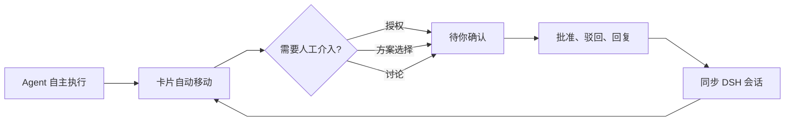

# DSH 看板 · 设计系统（v1）

> 对应交付：`design/mockup.html`（单文件可交互高保真）、`design/screens/*.png`（6 张状态截图）、`design/lint/`（可复跑的样式抽取与 lint）。
> 锚定 DSH `dsh-v0.1.5-rc.2` 设计令牌；样式规范以 `dsh-ui-spec` 为准。

## 1. 设计目标与五条原则

看板是 **Agent 工作状态的可视化控制面**，不是传统任务管理工具：Agent 自主推进，人只在授权、方案选择、讨论三类节点介入。因此界面要「安静、可扫读、把需要人的卡片推到眼前」。

| # | 原则 | 在看板里的落地 |
|---|---|---|
| 1 | **克制** | 一屏最多两种强调色（待你确认琥珀、Agent 活动蓝）；除审批与主按钮外不出现填充色块；动效只用于状态变化与浮层进入 |
| 2 | **发丝线** | 卡片、列、分隔线一律 `0.5px` 中性实线；状态色边框保留 `1px`；禁止用粗边框划分层级 |
| 3 | **浮层用阴影** | 菜单、筛选浮层、抽屉、底部弹层、Toast、Modal 全部 `border: 0` + `--dsw-elevation-*`，不叠加描边 |
| 4 | **主按钮黑** | 主操作（批准、新建卡片、保存）用 `--dsw-alias-button-primary-fill`（亮色 `#0f1115` / 暗色近白），不用业务蓝 |
| 5 | **密度优先** | 13px 正文 + 11px 元信息 + 紧凑行高；折叠卡片承载 80% 信息，详情才展开长内容；保证 11 张卡片在 1440×900 内可扫读 |

补充两条看板特有的约束：

- **状态不只靠颜色**：每个状态点都有中文状态词、每个审批块有图标与文案；列头同时有计数与图标。
- **人只看三件事**：卡片的「当前动作」「最近节点」「待决策」必须在一屏内可见，历史明细退到展开与详情。

## 2. 卡片信息架构

### 2.1 五层内容

| 层 | 字段 | 位置 | 作用 |
|---|---|---|---|
| 身份 | 状态点、标题 | 卡片首行 | 3 秒扫读「是什么、什么状态」 |
| 意图 | 一句话摘要（≤60 字，2 行截断） | 标题下 | 说明目标与边界，不写过程 |
| 现在 | 当前动作 / 最近节点（一行） | 摘要下 | Agent 正在做什么、卡在哪；运行中显示耗时 |
| 属性 | 优先级、所属项目、标签；状态、耗时、工具调用、搜索、会话链接 | 属性行 + 页脚 | 过滤与判断成本；数值用 tabular-nums |
| 结果 / 决策 | 结果句、审批问题与风险、Reject/Approve、内联回复 | 卡片底部或展开区 | 只在「待你确认」与「失败」时出现 |

### 2.2 三档信息密度

| 档位 | 触发 | 显示内容 | 高度预算 |
|---|---|---|---|
| 折叠态（默认） | 初始 / 收起 | 状态点 + 标题 + 摘要 2 行 + 当前动作 + 属性行（优先级/项目/≤2 标签）+ 页脚（状态·耗时/工具/搜索/会话）+ 审批块的决策问题与 Reject/Approve | 144–190px |
| 展开态（内联） | 点卡片、点箭头、Enter/Space | 折叠态 + 「重要节点」时间线（3–5 条：完成/当前/待定/错误）+ 失败重试 + 内联回复框 + 「详情」入口 | +120–220px |
| 详情态 | 卡片「详情」、列表行、`O`、会话图标 | 完整属性 10 项、节点全量、DSH 会话线程与同步状态、回复、编辑（标题/摘要/状态/优先级/项目/标签）、审批操作 | 右抽屉 380–460px / 竖屏底部弹层 ≤92dvh |

> 折叠态必须能完成「批准/驳回」，不得把决策藏在展开层；展开态不重复审批按钮与属性行；详情态才允许编辑与查看完整会话。

### 2.3 哪些卡片需要人



规则：**Agent 自主移动列，人只决定三类事**。批准 → 已完成；驳回 → 待办；讨论回复 → 进行中并同步会话。拖动列、编辑状态也会追加一条「列变更」节点，保证时间线可追溯。

## 3. 令牌映射

### 3.1 颜色：看板语义 → DSH alias

所有颜色只消费 `--dsw-alias-*`（文字、底色、描边、状态）；`--dsw-static-*` 禁止直引。看板组件内可用 `--kb-*` 局部变量做语义别名，但不得定义 `--dsw-*`。

| 看板语义 | 真实令牌 | 亮色 | 暗色 |
|---|---|---|---|
| 应用底 / 主区 | `--dsw-alias-bg-base` | `#ffffff` | `#151517` |
| 列底（主题感知） | `color-mix(in srgb, var(--dsw-alias-label-primary) 3%, var(--dsw-alias-bg-base))` | ≈`#f7f7f8` | ≈`#1c1c1e` |
| 卡片底 | `--dsw-alias-bg-layer-1` | `#ffffff` | `#232324` |
| 卡片 / 输入描边 | `--dsw-alias-border-l2` | `rgba(0,0,0,.10)` | `rgba(255,255,255,.12)` |
| 悬停 / 按下 | `--dsw-alias-interactive-bg-hover` / `-active` | `rgba(38,49,72,.06/.10)` | `rgba(255,255,255,.08/.14)` |
| 主文字 / 次文字 | `--dsw-alias-label-primary` / `-secondary` | `#0f1115` / `#61666b` | `#f9fafb` / `#cfd3d6` |
| 元信息 / 最弱 | `--dsw-alias-label-tertiary` / `-caption` | `#81858c` / `#adb2b8` | `#adb2b8` / `#81858c` |
| 主按钮 | `--dsw-alias-button-primary-fill` + `--dsw-alias-label-primary-foreground` | `#0f1115` + 白字 | 近白 + `#0f1115` 字 |
| 浮层底 / 菜单 | `--dsw-alias-bg-layer-3` / `--dsw-specific-menu` | `#ffffff` | `#353638` |
| 浮层阴影 | `--dsw-elevation-panel` / `-prominent` / `-soft` | 首层即 0.5px 发丝线 | 同亮色 |
| 遮罩 | `--dsw-alias-bg-mask-2` + `--dsw-mask-blur` | `rgba(0,0,0,.12)` | `rgba(0,0,0,.20)` |
| 待办状态点 | `--dsw-alias-label-caption`（空心环） | `#adb2b8` | `#81858c` |
| 进行中 / Agent 活动 | `--dsw-alias-state-business-primary` | `#4176e6` | `#679efe` |
| 待你确认 / 受阻 | `--dsw-alias-state-warn-primary`；文字用 `state-warn-label` | `#f59e0b` / `#dd8629` | 同亮色 |
| 审批块底 | `--dsw-alias-state-warn-tertiary` | `#fef5e7` | `#27241f` |
| 已完成 | `--dsw-alias-state-success-primary` | `#22c55e` | 同亮色 |
| 失败 | `--dsw-alias-state-error-primary` | `#ec1313` | `#f25a5a` |
| 会话同步底 / 文字 | `--dsw-alias-state-business-tertiary` / `-primary` | `#e4edfd` | `#34415b` |
| 链接 / 会话入口 | `--dsw-alias-link` | `#4176e6` | `#679efe` |
| 骨架 / 加载 | `--dsw-alias-bg-skeleton` | `rgba(0,0,0,.04)` | `rgba(255,255,255,.08)` |

### 3.2 派生色公式（不新增色值）

| 用途 | 公式 |
|---|---|
| 待你确认列底 | `color-mix(in srgb, var(--dsw-alias-state-warn-primary) 5%, var(--kb-surface-column))` |
| 进行中列底 | `color-mix(in srgb, var(--dsw-alias-state-business-primary) 3%, var(--kb-surface-column))` |
| 拖拽目标列 | `color-mix(in srgb, var(--dsw-alias-state-business-primary) 9%, var(--kb-surface-column))` |
| P0 / P1 徽章底 | `color-mix(in srgb, var(--dsw-alias-state-error-primary) 12%, transparent)` / `color-mix(in srgb, var(--dsw-alias-state-warn-primary) 14%, transparent)` |
| 当前时间线节点光晕 | `color-mix(in srgb, var(--dsw-alias-state-business-primary) 18%, transparent)` |
| 失败卡片描边 | `color-mix(in srgb, var(--dsw-alias-state-error-primary) 26%, var(--dsw-alias-border-l2))`，宽度仍 0.5px |
| 悬停提亮卡片 | `color-mix(in srgb, var(--dsw-alias-label-primary) 1.5%, var(--dsw-alias-bg-layer-1))` |

> 禁止：硬编码 `#rrggbb`/`rgb()`、直引 `--dsw-static-*`、在组件 CSS 写 `data-ds-dark-theme`、为"看板状态色"新造一组色值。`--kb-*` 只能引用 DSH 令牌或做布局/尺寸变量。

## 4. 字体、间距、圆角、阴影、动效

### 4.1 字体层级

| 角色 | 令牌 | 规格 | 用例 |
|---|---|---|---|
| 页面标题 | `--dsw-font-l-20` | 500 / 20px / 28px | 竖屏「看板」标题（桌面用 14px 面包屑当前项） |
| 抽屉标题 | `--dsw-font-base-strong-16` | 500 / 16px / 24px | 详情标题 |
| 卡片标题 | `--dsw-font-s-strong-14` | 500 / 14px / 22px | 卡片、列表行标题 |
| 正文 / 摘要 | `--dsw-font-xxs-12` | 12px / 18px | 一句话摘要、当前动作、时间线正文 |
| 基础 UI / 输入 | `--dsw-font-xs-13` | 13px / 20px | 搜索、正文、按钮（正文级） |
| 按钮 / 列头 | `--dsw-font-xxs-strong-12` / `--dsw-font-xs-strong-13` | 500 | 分段控件、按钮、列名 |
| 元信息 | `--dsw-font-xxxs-11` + `font-variant-numeric: tabular-nums` | 11px / 14px | 耗时、工具调用、搜索数、标签、列英文副标 |
| 等宽 | `--dsw-font-markdown-code-block` + `--ds-font-family-code` | 11px / 19px | 会话 ID、迁移号、键帽 |

字号只用 11/12/13/14/16/20 六档；行高由复合角色自带，不手拼 `font-size + line-height`。

### 4.2 间距与尺寸

- 间距阶梯：`4 / 6 / 8 / 10 / 12 / 16 / 20 / 24`（组件内 gap 用 4–10，区块间距 16–20）。
- 控件高度：icon 按钮 24–28；次按钮 28；工具栏按钮 32；主按钮 34–36；审批按钮桌面 30 / 竖屏 40；触控主决策 ≥44（视觉可 40，热区扩到 44）。
- 列内卡片间距 10（宽屏 10–12）；列间距 16（宽屏）/12（紧凑、横向滚动）；主区左右 padding 24/20/16/12。
- 卡片 padding 10×10，竖屏 12×12；列头高 40；工具栏高 50；顶部栏 56（竖屏 52+）。

### 4.3 圆角

| 元素 | 半径 | corner-shape |
|---|---|---|
| 列 | 14px | 全局超椭圆默认 |
| 卡片 / 列表组 | 12px | 全局超椭圆默认 |
| 抽屉（桌面） | 0 | — |
| 底部弹层 / Modal | 16px（弹层仅上两角） | 默认 |
| 输入 / 按钮 / 菜单项 | 8px / 6px | 默认 |
| 菜单 / 浮层 | 10px | 默认 |
| 状态点 / 头像 / 会话点 | `50%` | **必须 `corner-shape: round`** |
| 计数胶囊 / 抓手 | `99px` | **必须 `corner-shape: round`** |
| 标签 / 优先级 | 5px | 默认 |

全圆必须配对 `corner-shape: round`，否则超椭圆会把圆点压成方圆角、把胶囊削平。

### 4.4 阴影

- 卡片**不用阴影**，只用 `0.5px` 发丝线 + 悬停底色；避免"卡片浮起来"。
- 菜单 / 筛选浮层 / Toast：`--dsw-elevation-panel`；抽屉 / Modal：`--dsw-elevation-prominent`；HoverCard：`--dsw-elevation-soft`。
- 唯一例外：分段控件选中指示用 `--dsw-shadow-lv1`（无边框叠加）。

### 4.5 动效

| 场景 | 时长 | 曲线 |
|---|---|---|
| hover / 焦点 / 颜色 | `--ds-transition-duration-fast`（100ms） | `--ds-ease-in-out` |
| 卡片展开、Toast 进入、抽屉淡入、焦点环 | `--ds-transition-duration`（200ms） | `--ds-ease-in-out`（位移用 `cubic-bezier(.22,1,.36,1)`） |
| 抽屉 / 底部弹层滑入 | `--ds-transition-duration-slow`（300ms） | `cubic-bezier(.22,1,.36,1)` |
| 状态点呼吸 / 加载 | 1.4–1.8s 循环 | 低对比透明度变化 |

`prefers-reduced-motion: reduce` 下所有动画/过渡压到 0.01ms、呼吸点静默；不以动画表达状态。

## 5. 组件规范

> 通用前提：能复用 `ui-primitives` 就复用——`Button`、`Input`、`Menu`、`Modal`、`Pill`、`Tag`、`StateDot`、`DisclosureRow`、`Toast`、`Tooltip`；看板特有组件（列、卡、时间线、审批块、右抽屉）自建，但视觉参数向官方控件对齐。

| 组件 | 规范 |
|---|---|
| **列** | 高撑满主区、列内独立滚动（`min-height: 0`）；圆角 14、底色主题感知、`0.5px` hairline；列头 40px：状态图标 + 中文名 + 英文副标 + 计数胶囊 + 折叠/新建；折叠后保留计数与「拖入可移入」提示；「待你确认」列用 5% 琥珀底提示注意力 |
| **卡片** | 底色 layer-1、`0.5px` 描边 l2、圆角 12、padding 10；首行状态点 + 标题 + 展开箭头 + 更多（hover 显现）；摘要 2 行截断；当前动作一行（等宽数字）；属性行 wrap；页脚 hairline 分隔；hover 提亮 1.5%、描边 l3；选中（详情打开）用 inset 2px 业务蓝，不加外阴影 |
| **状态点** | 8px（页脚 6px）；待办=1.5px 空心环；进行中=实心蓝 + 1.8s 呼吸环；待确认/受阻=琥珀实心；已完成=绿；失败=红。必须配状态文字；`aria-hidden` 的点旁边要有可读文案 |
| **徽章** | 优先级 5px 圆角、18px 高、11px 500：P0 红 12%、P1 琥珀 14%、P2 中性 6%；标签 neutral 5%、11px；项目「文件夹图标 + 文本」弱化；全部只读，不可点击 |
| **属性行** | 优先级 → 项目 → 标签（≤2，第二枚在 720–1100 隐藏）；页脚左侧状态+耗时、右侧工具/搜索/会话；数值 `tabular-nums`；会话入口是唯一蓝色链接 |
| **时间线节点** | 左侧 0.5px 竖线 + 7px 圆点；四态：done 绿、current 蓝 + 18% 光晕 + 加粗、pending 空心、error 红；每行「文本 + 相对时间」，错误节点可加一行 detail；默认展示 3–5 条，全量进详情 |
| **审批卡** | 仅在「待你确认」列出现；琥珀 tertiary 底、10px 圆角；问题 12px 500 + 风险 11px；按钮右对齐「驳回 Reject」「批准 Approve」（中文主、英文副，11px 低透明度）；批准=黑主按钮，驳回=白底 hairline；竖屏两按钮等宽 40px 高 |
| **分段控件** | 容器 `--dsw-specific-selector`、内 padding 2、圆角 10；选中项 `button-ghost-active-fill` + lv1 阴影、文字 label-primary；用于 Board/List、桌面/抽屉 tab，不用于筛选多选 |
| **抽屉 / bottom sheet** | 桌面：右侧 `clamp(380px,34vw,460px)`、全高、无圆角、`elevation-prominent`；竖屏：底部上滑、上两角 16px、`max-height: 92dvh`；`role="dialog" aria-modal`、焦点圈定、Esc 关闭、关闭后焦点回到卡片；遮罩 `bg-mask-2` + blur(2px) |
| **输入** | 高 32（竖屏搜索 40）；底色 `specific-input-major`；`0.5px` l2；placeholder 用 label-caption；`:focus-visible` 2px 业务蓝 outline +1px offset；搜索框常驻 ⌘K 键帽与清除按钮 |
| **按钮** | 主按钮黑底反白字；次按钮白底 hairline；幽灵按钮仅文字；危险操作红字 + 危险 hover 底；focus 环 2px 业务蓝、offset 2；文案中文优先，英文副标 11px 且不参与无障碍名 |
| **空态** | 虚线 1px 中性描边（唯一允许虚线处）+ 圆形图标 + 标题 + 一句引导（写明"这里会出现什么"）；筛选空态给「清除筛选」，真空白给「新建卡片」 |
| **骨架屏** | 卡片级骨架：3 条 10px 圆角条 + 呼吸动画（reduced-motion 关闭）；刷新时保留列头与计数，只替换卡片区；800–1000ms 内完成 |
| **Toast** | 顶部居中（竖屏底部）；反色表面（主按钮填充 + 前景色）；无边框 + panel 阴影；单行 ≤2 行；可带「撤销」动作；4s 自动消失，新消息替换旧消息 |
| **菜单 / 筛选浮层** | `specific-menu` 底 + `elevation-panel`；项高 30、圆角 6；危险项红字 + 危险 hover；筛选浮层用 checkbox 分组，改动即时生效并同步工具栏 chips |

## 6. 响应式

断点按**应用窗口宽**定义（看板在 DSH 主区内按容器宽自适应，用 `ResizeObserver` 写 `data-layout`，尺寸与下表一致）。

| 断点 | 列布局 | 列宽 / 间距 | 卡片密度 | 详情呈现 | 触控目标 |
|---|---|---|---|---|---|
| **≥1440** | 4 列并排，整屏可见 | 280–340 / 16 | 完整：项目 + 2 个标签；列头含英文副标 | 右侧抽屉 380–460 | 鼠标为主：icon 24–28、按钮 28–36 |
| **1100–1440** | 4 列并排压缩 | ≥240 / 12 | 精简：项目保留、只显示 1 个标签；隐藏列英文副标 | 右侧抽屉 | icon 28、按钮 28–36 |
| **720–1100** | 4 列横向滚动 + scroll-snap，一屏约 2–3 列 | 300 / 12 | 精简：摘要 2 行；列表视图隐藏项目文本 | 右侧抽屉；状态栏隐藏 | icon 28–32、按钮 32 |
| **<720（竖屏）** | 顶部分段控件（4 列 + 计数）+ 单列列表；侧栏收起 | 全宽 / 12 | 摘要 3 行；属性行保留优先级/项目/2 标签；审批按钮等宽 | **底部弹层**（上滑，≤92dvh）；列表行内联展开 | 主决策 ≥44（视觉 40）、次级 36–40 |

栅格与容器：

- 桌面 shell：侧栏 52px + 主区；主区 padding 左右 20–24，顶部栏 56，工具栏 50。
- 看板列：`grid-template-columns: repeat(4, minmax(280px, 1fr))`；紧凑档 min 240；横向滚动档 min 300；列内滚动、行高撑满。
- 竖屏：隐藏 DSH 侧栏；主区全宽；断点切换由容器宽度驱动（缩窗或嵌入窄面板都会生效）。

横屏 / 竖屏布局示意：

```text
≥720（横屏，四列并排）                       <720（竖屏，单列 + 底部弹层）
┌──┬───────────────────────────────┐        ┌───────────────────────┐
│侧│ Agents / 看板      [看板|列表] │        │ 看板        [▦|☰] ☾ ＋│
│栏│ [搜索…] [筛选]  3 Agent 运行中 │        │ [搜索…]               │
│52│ ┌────┬────┬────┬────┐          │        │ [筛选]   3 Agent 运行中│
│  │ │待办│进行│确认│完成│          │        │ (待办)(进行)(确认)(完成)│
│  │ │卡  │卡  │卡  │卡  │          │        │ ┌───────────────────┐ │
│  │ │    │    │    │    │          │        │ │ 待你确认 · 3      │ │
│  │ └────┴────┴────┴────┘          │        │ │ 卡片（展开/收起）  │ │
│  │  DSH 已连接 · 最后同步          │        │ └───────────────────┘ │
└──┴───────────────────────────────┘        │ 详情：底部弹层 ↑      │
                                             └───────────────────────┘
```

## 7. 交互规范

### 7.1 拖拽换列

- 桌面：HTML5 drag；拖动中卡片 45% 透明，目标列 9% 业务蓝底，插入位置在目标卡片上沿显示 2px 蓝线；松手后写入 `状态 + 列变更节点 + 更新时间`，并 Toast「已移到 X · 已同步 DSH 会话」。
- 折叠列是合法投放目标，投放后自动展开；筛选/搜索状态下拖拽仍按当前可见位置计算。
- **键盘替代**：卡片聚焦后 `Alt + ←/→` 换列、`Alt + ↑/↓` 列内排序；每次操作通过 `aria-live` 播报「卡片已移到进行中第 2 位」。触屏用卡片菜单「移到…」完成换列。
- 失败时不产生半移动：先计算插入索引再改数据，一次性重渲染。

### 7.2 展开 / 收起与详情

- 点卡片任意非交互区、点展开箭头、或 Enter/Space 切换内联展开；`aria-expanded` + `aria-controls` 同步；展开后焦点留在触发点。
- 展开区「详情」、列表行右侧箭头、卡片菜单「打开详情」、快捷键 `O` 打开抽屉/弹层；Esc 关闭，关闭后焦点回到原卡片。
- 列表视图按列分组，行内展开与卡片同构；分组可整体折叠，计数同步。
- 批量选择（可选，未进 v1）：建议 hover/长按出现 checkbox，Shift 连选，批量移动/删除；需与拖拽手势分离，默认关闭。

### 7.3 快捷键

| 键 | 行为 | 范围 |
|---|---|---|
| `⌘K` / `Ctrl+K` / `/` | 聚焦搜索 | 全局 |
| `N` | 新建卡片 | 全局（非输入态） |
| `B` / `L` | 看板 / 列表 | 全局 |
| `T` | 明暗切换 | 全局 |
| `Enter` / `Space` | 展开 / 收起卡片 | 卡片聚焦 |
| `O` | 打开详情 | 卡片聚焦 |
| `Alt+←/→` | 移到相邻列 | 卡片聚焦 |
| `Alt+↑/↓` | 列内上移/下移 | 卡片聚焦 |
| `Esc` | 关闭当前浮层（菜单 → 弹窗 → 抽屉） | 全局 |

### 7.4 焦点与无障碍行为

- 全部可点元素用 `:focus-visible` 2px 业务蓝 outline（offset 1–2），不写 `:focus` 兜底；不出现"移除 outline 但无替代"。
- 抽屉 / 弹窗 / 底部弹层：打开后焦点进入（关闭或标题），Tab 圈定，Esc 关闭，关闭后回到触发卡片；`role="dialog"` + `aria-modal="true"` + `aria-labelledby`。
- 状态不只靠颜色：状态点旁有中文状态；审批块有图标 + 问题 + 风险；计数有 `aria-label` / `title`。
- 拖拽、批准、驳回、删除、新建、刷新均经 `aria-live="polite"` 播报；Toast 同时 `role="status"`。
- 装饰性图标 `aria-hidden`；图标按钮必须有 `aria-label`；英文副标不进入无障碍名。

### 7.5 加载 / 空 / 错误

| 态 | 规范 |
|---|---|
| 加载 | 骨架卡（每列 2 张）+ 列头计数保留；刷新中禁用重复触发；reduced-motion 下静态灰块；≤1s 完成 |
| 空 | 列内虚线空态：图标 + 「这一列还没有卡片」+ 引导（拖入/新建）；筛选无结果时提示换关键词或清除筛选；搜索命中 0 时列计数为 0 |
| 错误 | 失败卡：红点 + 「失败 · 原因」+ 边界发丝线偏红 + 展开后「重试任务」；受阻卡：琥珀点 + 「受阻 · 等待谁」；审批失败 Toast 需可重试，不用仅颜色表达 |
| 部分失败 | 卡片保留已完成节点，失败节点写 detail（如 429 限流 + 建议并发），重试从断点继续 |

## 8. 无障碍与国际化

- **文案走字典**：所有可见文案（含 `aria-label`、tooltip、placeholder、Toast、空态）走 locale 字典；建议 key：`kanban.column.{backlog,running,needs,done}`、`kanban.card.action.{approve,reject,openDetail,reply}`、`kanban.toast.{approved,rejected,moved,synced,deleted}`、`kanban.empty.*`、`kanban.shortcut.*`。英文副标也属于字典（`en` 语言包），不是硬编码装饰。
- **不用本地化文本做逻辑**：状态、列、优先级全部用稳定枚举（`todo/running/needs/done/blocked/failed`、`P0/P1/P2`），渲染时查字典。
- **控件必须有 label**：搜索框有 `<label>`/`sr-only`；图标按钮传 `aria-label`；控件复用 `ui-primitives` 时按其必填 label props 传入。
- 对比度：正文 label-primary/secondary 在亮暗底上均满足 4.5:1；11px 元信息仅承载辅助信息，不单独承担关键判断。
- 键盘可达：拖拽、审批、换列、删除、撤销均有键盘路径；触控目标 ≥44（主决策）或 ≥36（次级）。
- 语言：中文优先，英文作为列副标/按钮副标；数字用 `tabular-nums` 并在时间、计数处统一单位（`m s`、`次`）。

## 9. 设计验收 checklist（可机械核对）

| # | 检查项 | 通过标准 |
|---|---|---|
| D-01 | 四列齐全 | 待办/进行中/待你确认/已完成，均有列头、计数、折叠按钮 |
| D-02 | 计数正确 | 拖拽、批准、驳回、新建、删除、筛选后列头与顶部计数同步更新 |
| D-03 | 状态可读 | 每个状态点旁有中文状态词，不只靠颜色；失败/受阻有原因文案 |
| D-04 | 卡片信息 | 标题、摘要、当前动作、优先级、项目、标签、状态+耗时、工具数、搜索数、会话入口 10 项齐全 |
| D-05 | 审批动作 | 折叠态即可见 Reject/Approve，且批准后卡片进入已完成、驳回回到待办 |
| D-06 | 展开时间线 | 点卡片/箭头/Enter 展开「重要节点」，至少含 3 条节点，箭头 `aria-expanded` 变化 |
| D-07 | 详情入口 | 展开区「详情」、列表行、`O` 都能打开右抽屉；竖屏自动变为底部弹层 |
| D-08 | 视图切换 | Board/List 切换保持筛选与展开状态，列表按列分组 |
| D-09 | 搜索/筛选 | 搜索与项目/优先级筛选可组合，无结果显示空态与「清除筛选」 |
| D-10 | 新建/编辑/删除 | 新建卡出现在所选列首位；状态改动会换列；删除可撤销 |
| D-11 | 拖拽 | 跨列拖拽更新状态与计数；折叠列可投放；键盘 Alt+←/→ 等价 |
| D-12 | 明暗 | 切换明暗后所有表面/文字/状态色跟随 alias 令牌，无写死色值 |
| D-13 | 发丝线与圆角 | 中性实线均 0.5px；全圆均配 `corner-shape: round` |
| D-14 | 浮层 | 菜单/筛选/抽屉/Modal/Toast 均 `border: 0` + elevation，无 border + shadow 叠加 |
| D-15 | 响应式 | 1440 / 1100 / 720 / 390 四档均无横向溢出；<720 出现分段控件与底部弹层 |
| D-16 | 触控 | 竖屏审批按钮 ≥44 热区，卡片菜单常显，无仅 hover 可用的主操作 |
| D-17 | 焦点 | Tab 可达全部操作；抽屉焦点圈定；Esc 关闭并归还焦点 |
| D-18 | 动效 | 开启 reduced-motion 后无位移/呼吸动画，状态仍可读 |
| D-19 | 播报 | 批准/驳回/移动/删除/刷新有 `aria-live` 播报 |
| D-20 | 令牌 lint | `node ~/.dsh/skills/dsh-ui-spec/scripts/lint-tokens.mjs design/lint` → 0 error / 0 warning |
| D-21 | 单文件 | `design/mockup.html` 无网络依赖、`file://` 直接打开可用 |
| D-22 | 文案 | 组件内无散落文案逻辑；关键动作中文主文案 + 可选英文副标 |

## 10. 交付物、复跑方式与决策边界

### 10.1 交付物

| 文件 | 说明 |
|---|---|
| [`design/mockup.html`](../design/mockup.html) | 单文件零依赖可交互 mockup；顶栏面包屑「Agents / 看板」、Board/List 切换、搜索/筛选、新建；4 列折叠、卡片展开时间线、拖拽、审批、回复同步、抽屉/底部弹层、明暗切换、空/加载态 |
| [`design/screens/`](../design/screens/) | 6 张状态截图：宽屏亮/暗、列表、390 竖屏、390 底部弹层、1024 紧凑档 |
| `design/lint/extract.mjs` | 从 mockup 抽取组件样式（排除主题替身块） |
| `design/lint/mockup-component.module.css` | 抽取结果，供 lint 机械核对 |
| `docs/03-design-system.md` | 本文档 |

mockup 的 URL 参数便于评审与截图：`?theme=dark`、`?view=list`、`?expanded=c-301`、`?drawer=c-301&tab=thread`、`?col=running`。

### 10.2 边界与复跑

- mockup 顶部 `<style id="dsh-token-shadow">` 只是**单文件演示的主题替身**（亮/暗 token 取值抄自 `dsh-tokens.md`）；真实插件由 `ui-theme` 注入，组件 CSS 不得复制该块。lint 只抽取 `<style id="kanban-styles">`。
- 真实插件接入：宿主侧栏 / 主区通过插槽注册；组件复用 `ui-primitives`；样式写 CSS Modules，局部变量用 `--kb-` 前缀；不新增全局样式、不占用 `--dsw-` 命名空间。
- 复跑 lint：

```bash
node design/lint/extract.mjs
node ~/.dsh/skills/dsh-ui-spec/scripts/lint-tokens.mjs design/lint
# 结果：扫描 1 个 CSS 文件，0 个错误、0 个警告
```

### 10.3 需要产品拍板的开放问题

1. **受阻/失败是否独立成列**：现按状态收进「进行中/已完成」，保持 4 列；若列数到 5，横屏密度与拖拽成本都会上升。
2. **审批超时策略**：等待人工的卡片是否 15 分钟后升级提醒、是否暂停 Agent 计时？影响卡片排序与状态色。
3. **批量选择是否进 v1**：拖拽与批量选择手势需分离，建议 v1.1。
4. **人工能否主动把卡拖进「待你确认」**：现在允许（生成通用确认问题）；也可能只允许 Agent 发起。
5. **会话同步粒度**：卡片内回复目前全文写入会话并追加一条节点；长回复是否只同步摘要，需要与 DSH 会话侧约定。
6. **deep link 协议**：`dsh://session/<sessionId>#<cardId>` 为设计占位，需宿主确认真实协议。
7. **竖屏软键盘**：底部分层 composer 在键盘弹起时的避让高度（`dvh` + `env(safe-area-inset-bottom)`）需真机验收。
8. **列表视图分组**：当前按列分组；是否增加「按项目 / 按优先级」分组切换，影响工具栏控件密度。
