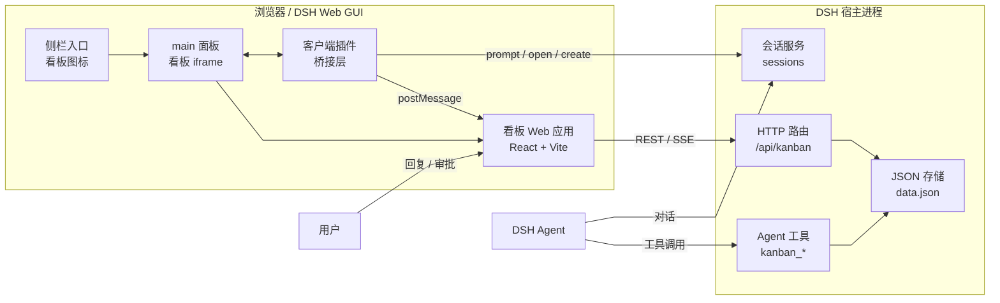
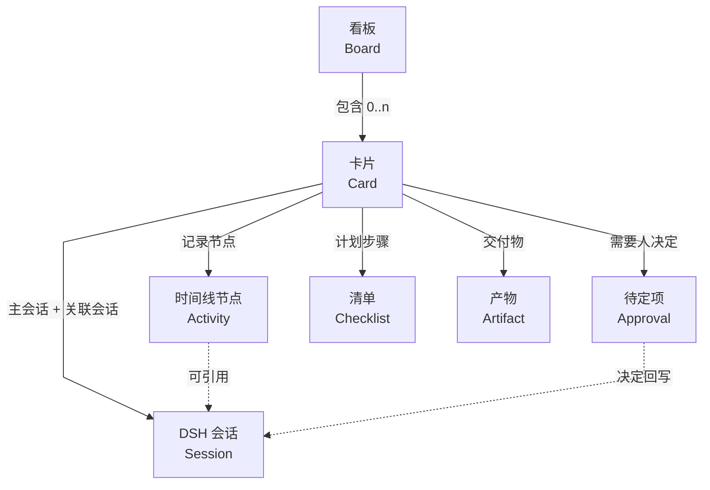
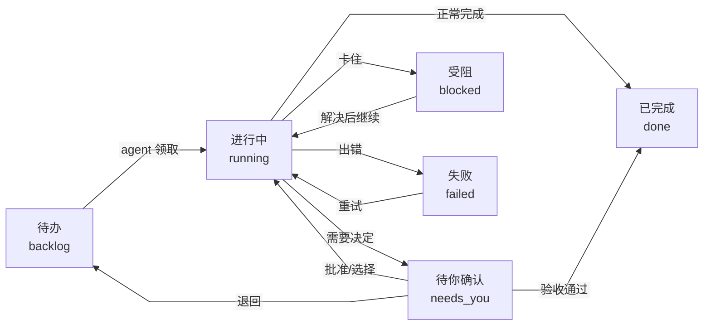
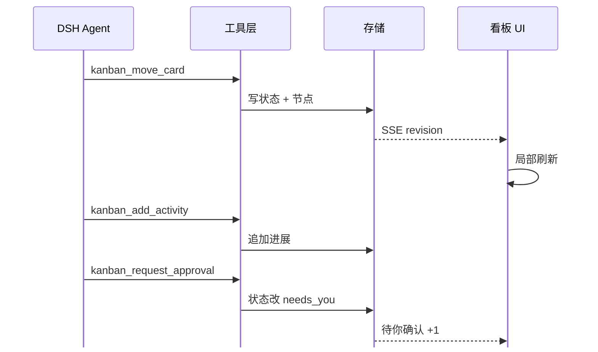
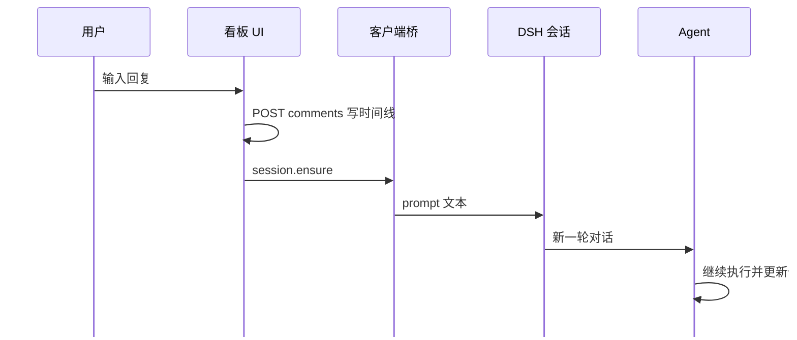
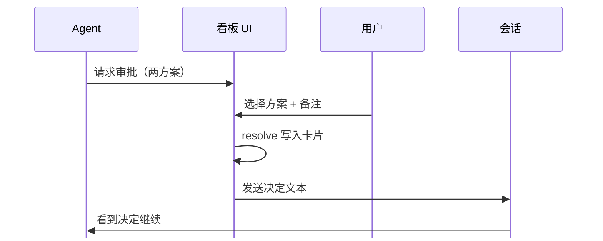

# dsh-kanban 架构与信息架构（v0.1）

> 本文回答两个问题：**看板在 DSH 里怎么搭**，以及**看板和 DSH 会话之间是什么关系**。
> 契约细节见 `docs/contracts/`，参考项目分析见 `docs/01-reference-analysis.md`，DSH 插件机制见 `docs/02-dsh-integration.md`，设计规范见 `docs/03-design-system.md`。

## 1. 一句话定位

**看板是控制面（control plane），DSH 会话是执行面（execution plane）。**
卡片承载"要做什么、现在到哪了、需要你决定什么"；会话承载"agent 具体怎么干、说了什么、跑了哪些工具"。两者多对多绑定：一张卡片可以先后/并行绑定多个会话，一个会话也可以服务多张卡片（例如一个会话里连续推进三张卡）。看板不复制会话内容，只保留**可读的进度节点**与**指向会话的入口**。

## 2. 系统架构

三条关键边界：

| 边界 | 走什么 | 为什么 |
| --- | --- | --- |
| 看板 UI ↔ 宿主数据 | 同源 HTTP + SSE | UI 可以是独立页面、可测试、可截图；宿主只做 JSON 存储 |
| 看板 UI ↔ DSH 原生能力 | postMessage 桥（白名单方法） | iframe 拿不到 DSH 的 React 服务，桥是最小暴露面 |
| Agent ↔ 看板 | `kanban_*` 工具 | agent 不需要学 HTTP，工具描述即工作流入口 |

## 3. 信息架构：Board → Card → Session → Activity

### 3.1 与参考项目（Codex Taskboard）的 IA 对照

| 维度 | Codex Taskboard | dsh-kanban | 判断 |
| --- | --- | --- | --- |
| 执行单元 | Codex task（对话线程） | DSH session | 对齐 |
| 任务实体 | Issue/Task（SQLite，7 状态） | Card（JSON，7 状态 + 4 列） | 精简 |
| 任务↔会话 | 任务详情里开 Codex 对话；skill 教 Codex 操作 issue | 卡片主会话 + 工具直接维护卡片 | 更强：无需 skill 先学 HTTP |
| agent 写回 | CLI/HTTP + 乐观版本 | 原生工具 + 卡片时间线 | 更强：工具即 API |
| 人工介入 | 状态 `in_review` 等用户确认 | `needs_you` 列 + Approval 实体 + 决定回写会话 | 更强：决策有结构 |
| 看板入口 | CDP 注入 Codex 侧栏 / Tauri App | DSH 原生 `sidebar.panellist` + `main` 面板 | 原生集成 |
| 实时性 | 轮询/SSE | SSE revision + 事件时间线 | 对齐 |
| 数据位置 | SQLite + 云端协作 | 本地 JSON（可迁移 SQLite） | MVP 取舍 |

### 3.2 为什么以"卡片"而不是"会话"为主对象

- 会话是**执行细节**，数量会膨胀、生命周期短；卡片是**意图与验收**，生命周期长。
- 用户的管理动作（优先级、依赖、验收、阻塞）天然属于卡片；agent 的执行动作（读文件、跑测试、改代码）天然属于会话。
- 一个会话可以推进多张卡片，一张卡片也可以多轮会话；如果用会话当主对象，就退化成"聊天记录列表"，失去"今天该决定什么"的控制面价值。

## 4. 卡片状态机

规则：

1. **agent 自主移动**：`backlog → running → done`、`running → blocked/failed` 均由 agent 通过工具完成，不需要人点。
2. **人只处理 `needs_you`**：进入该列必须带一个 pending `Approval`（或明确的待讨论问题）；解决后 agent 继续。
3. **用户拖拽**只用于"人工纠偏"：拖到某列 = 写该列代表状态，会记录一条 `status` 节点。
4. `done` 之后仍可被 agent 写结果、补产物；归档由用户或 agent 显式操作。

## 5. 三条核心时序

### 5.1 Agent 推进卡片（工具写回）

### 5.2 用户在卡片内回复（回复进会话）

### 5.3 用户审批

## 6. 代码地图

| 文件 | 职责 |
| --- | --- |
| `lib/client.js` | 客户端插件：侧栏入口、`main` 全屏面板、iframe 桥（主题/会话/面板切换） |
| `lib/index.js` | 服务端插件入口：数据目录、路由注册、工具注册、SSE 广播 |
| `lib/store.js` | `~/.dsh-kanban/data.json` 原子写、串行队列、乐观锁、revision |
| `lib/domain.js` | 状态/列映射、默认看板、种子数据、节点/审批构造 |
| `lib/routes.js` | REST API、SSE、同源校验、静态资源（`/dsh-kanban/*`） |
| `lib/tools.js` | 10 个 `kanban_*` agent 工具 |
| `web/` | 看板 UI（React + Vite），构建产物 `web/dist` 由服务端直接服务 |
| `skills/manage-kanban/` | 教 agent 使用看板的工作流技能 |
| `scripts/dev-server.mjs` | 不依赖 DSH 的联调服务器 |
| `docs/contracts/` | 冻结契约（数据模型 / HTTP / 桥） |

## 7. 安全与权限

| 面 | 措施 |
| --- | --- |
| HTTP | 仅同源；校验 `origin`/`sec-fetch-site`；JSON only；256 KiB 上限；ID 白名单格式 |
| 静态资源 | 只服务 `web/dist`，拒绝 `..`、绝对路径、符号链接逃逸；`nosniff` |
| 桥 | method 白名单；只接受同源 `postMessage`；不透传任意函数 |
| 工具 | 工具名固定；文本截断；`action` 需审批才能继续；工具不能替用户 resolve 审批 |
| 数据 | 存 `~/.dsh-kanban`；损坏文件先备份再重建；不写插件目录 |
| 会话 | 只发文本；不读取会话内容回写卡片（agent 自己选择写什么进展） |

## 8. 失败与恢复

| 场景 | 行为 |
| --- | --- |
| DSH 重启 / 插件卸载 | 卡片数据在 `~/.dsh-kanban/data.json`，重启后恢复 |
| data.json 损坏 | 备份为 `data.corrupt-<ts>.json`，用种子重建，UI 提示 |
| SSE 断线 | 指数退避重连；期间用 5s 轮询兜底；页面隐藏暂停 |
| 会话被归档/删除 | 卡片保留绑定，打开会话报 `SESSION_NOT_FOUND`，提示重新绑定 |
| 桥不可用（旧 DSH） | 会话操作降级为"复制文本"，看板 CRUD 不受影响 |
| 并发写冲突 | 卡片 `version` 乐观锁，409 返回最新卡片，UI 合并后重试 |

## 9. 扩展路线

| 阶段 | 内容 |
| --- | --- |
| M1（本次） | 单看板、4 列、卡片 CRUD、审批、会话绑定、回复、SSE、双布局、响应式 |
| M2 | 多看板 / 每 workspace 一个看板；卡片依赖与阻塞关系；批量操作；卡片模板 |
| M3 | 会话事件自动回填（工具调用计数、耗时、搜索结果数）；审批结果自动同步到 DSH 原生审批；定时/周期卡 |
| M4 | 团队协作（远端同步）、Jira/GitHub 集成、看板仪表盘（吞吐/阻塞时长）、导出 Markdown/JSON |
| 暂不做 | 甘特图、看板内嵌对话全文、云端账号体系（参考项目有，但对个人工作流是负担） |

## 10. 未决问题（需要产品决策）

1. **多会话 vs 单会话**：MVP 用 `sessionIds[0]` 作主会话，回复只进主会话；多会话并行推进同一张卡时，回复进哪个？建议 M2 做"选择会话"下拉。
2. **done 的确认权**：agent 可自行把卡移到 done，还是必须用户验收？参考项目要求用户确认；建议规则"agent 可完成，但 `needs_you` 里的 done 候选需要用户点验收"（M2 再收紧）。
3. **看板与 workspace 的关系**：默认单看板跨项目；若用户希望"一个 workspace 一个看板"，需要在 config 里加 `perWorkspace` 开关。
4. **审批与 DSH 原生审批的关系**：原生审批用于工具执行授权（bash 等），看板审批用于方案选择与业务确认；两者是否合并到同一收件箱，需要 UI 层评估。
5. **卡片是否展示会话全文**：当前只展示手动/工具写入的节点，避免变成聊天客户端；若用户想在看板里读全文，建议"打开会话"跳转而不是内嵌。
