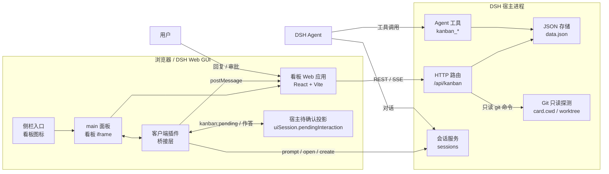
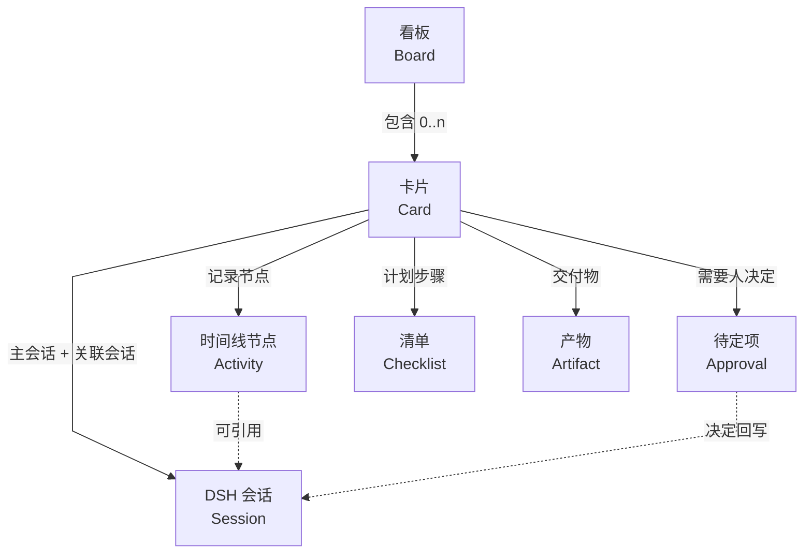
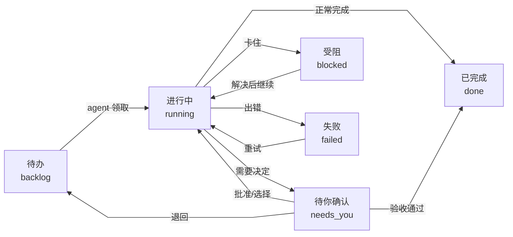
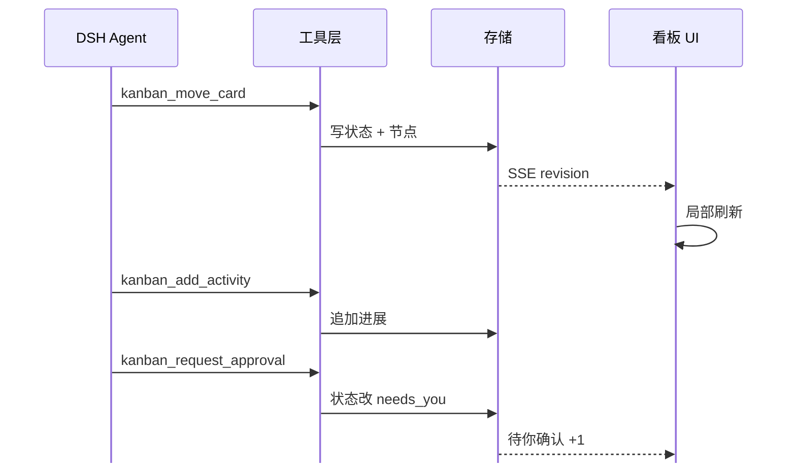
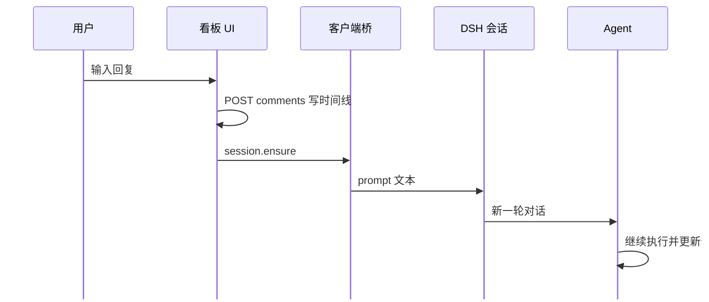
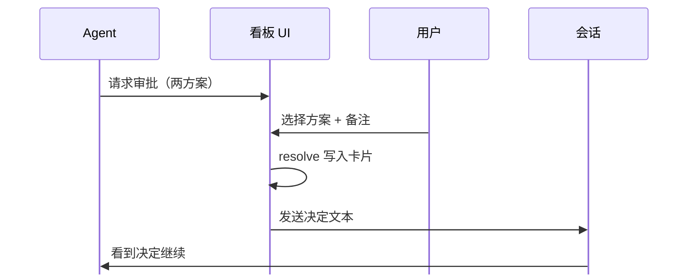
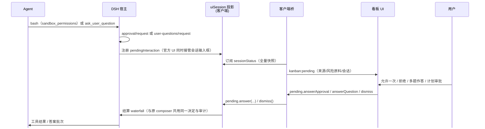

# dsh-kanban 架构与信息架构（v0.1）

> 本文回答两个问题：**看板在 DSH 里怎么搭**，以及**看板和 DSH 会话之间是什么关系**。
> 契约细节见 `docs/contracts/`，参考项目分析见 `docs/01-reference-analysis.md`，DSH 插件机制见 `docs/02-dsh-integration.md`，设计规范见 `docs/03-design-system.md`。

## 1. 一句话定位

**看板是控制面（control plane），DSH 会话是执行面（execution plane）。**
卡片承载"要做什么、现在到哪了、需要你决定什么"；会话承载"agent 具体怎么干、说了什么、跑了哪些工具"。两者多对多绑定：一张卡片可以先后/并行绑定多个会话，一个会话也可以服务多张卡片（例如一个会话里连续推进三张卡）。看板不复制会话内容，只保留**可读的进度节点**与**指向会话的入口**。

## 2. 系统架构

三条关键边界：

| 边界 | 走什么 | 为什么 |
| --- | --- | --- |
| 看板 UI ↔ 宿主数据 | 同源 HTTP + SSE | UI 可以是独立页面、可测试、可截图；宿主只做 JSON 存储 |
| 看板 UI ↔ DSH 原生能力 | postMessage 桥（白名单方法） | iframe 拿不到 DSH 的 React 服务，桥是最小暴露面 |
| 看板 UI ↔ 宿主待确认 | 客户端插件读 `uiSession` 投影 → 桥推送；作答回传宿主 pending 对象 | 原生审批/提问不复制状态、不新增审计路径，只多一个作答入口 |
| Agent ↔ 看板 | `kanban_*` 工具 | agent 不需要学 HTTP，工具描述即工作流入口 |

## 3. 信息架构：Board → Card → Session → Activity

### 3.1 与参考项目（Codex Taskboard）的 IA 对照

| 维度 | Codex Taskboard | dsh-kanban | 判断 |
| --- | --- | --- | --- |
| 执行单元 | Codex task（对话线程） | DSH session | 对齐 |
| 任务实体 | Issue/Task（SQLite，7 状态） | Card（JSON，7 状态 + 4 列） | 精简 |
| 任务↔会话 | 任务详情里开 Codex 对话；skill 教 Codex 操作 issue | 卡片主会话 + 工具直接维护卡片 | 更强：无需 skill 先学 HTTP |
| agent 写回 | CLI/HTTP + 乐观版本 | 原生工具 + 卡片时间线 | 更强：工具即 API |
| 人工介入 | 状态 `in_review` 等用户确认 | `needs_you` 列 + Approval 实体 + 决定回写会话 | 更强：决策有结构 |
| 看板入口 | CDP 注入 Codex 侧栏 / Tauri App | DSH 原生 `sidebar.panellist` + `main` 面板 | 原生集成 |
| 实时性 | 轮询/SSE | SSE revision + 事件时间线 | 对齐 |
| 数据位置 | SQLite + 云端协作 | 本地 JSON（可迁移 SQLite） | MVP 取舍 |

### 3.2 为什么以"卡片"而不是"会话"为主对象

- 会话是**执行细节**，数量会膨胀、生命周期短；卡片是**意图与验收**，生命周期长。
- 用户的管理动作（优先级、依赖、验收、阻塞）天然属于卡片；agent 的执行动作（读文件、跑测试、改代码）天然属于会话。
- 一个会话可以推进多张卡片，一张卡片也可以多轮会话；如果用会话当主对象，就退化成"聊天记录列表"，失去"今天该决定什么"的控制面价值。

## 4. 卡片状态机

规则：

1. **agent 自主移动**：`backlog → running → done`、`running → blocked/failed` 均由 agent 通过工具完成，不需要人点。
2. **人只处理 `needs_you`**：进入该列必须带一个 pending `Approval`（或明确的待讨论问题）；提交即按选项 `outcome` 落列（未声明时批准→进行中、驳回→待办），agent 继续。
3. **用户拖拽**只用于"人工纠偏"：拖到某列 = 写该列代表状态，会记录一条 `status` 节点。
4. `done` 之后仍可被 agent 写结果、补产物；归档由用户或 agent 显式操作。

## 5. 三条核心时序

### 5.1 Agent 推进卡片（工具写回）

### 5.2 用户在卡片内回复（回复进会话）

### 5.3 用户审批

### 5.4 原生待确认收件（工具授权 / Agent 提问 / 计划审批）

要点：

- 只看得到宿主投影里的**每会话最高优先级一项**（审批 0 → 提问 1 → 计划审批 2），与原生 composer 的单槽行为一致；
- 原生 composer 不删除：两处都能作答，先答先得；别处作答后看板项随投影消失；
- 计划审批的「同意执行」等价于提交 `approve` 选项，「要求修改」走宿主 `dismiss()`；
- 旧版宿主没有 `uiSession` 服务时不推送，收件区不渲染，业务审批卡片不受影响。

## 6. 代码地图

| 文件 | 职责 |
| --- | --- |
| `lib/client.js` | 客户端插件：侧栏入口、`main` 全屏面板、iframe 桥（主题/会话/面板切换/原生待确认聚合） |
| `lib/index.js` | 服务端插件入口：数据目录、路由注册、工具注册、SSE 广播、决策日志首次回填 |
| `lib/store.js` | `~/.dsh-kanban/data.json` 原子写、串行队列、乐观锁、revision；决策日志写入顺序的编排 |
| `lib/decisions.js` | 决策日志：`decisions.jsonl` 的只追加读写、派生状态、分页/筛选、回填与导出（v0.10） |
| `lib/domain.js` | 状态/列映射、默认看板、种子数据、节点/审批构造；审批请求/提交/未决事件收集；v0.21.0 增 `isTerminalCardStatus`（done/canceled 终态判定，清理占用与会话归档共用） |
| `lib/session-archive.js` | 宿主会话归档适配器：包装 DSH `workspaceRegistry` 的可逆归档、能力探测与错误码（v0.11） |
| `lib/session-sync.js` | 会话运行失败同步：监听宿主 `session/event` 的 `turn/end`，失败/恢复回写卡片（v0.11） |
| `lib/git.js` | 卡片 Git 上下文：详情完整上下文、批量摘要、工作区聚合；v0.17 增工作副本清理判定字段与 `cleanupWorktree`（回收站 + prune + 可选删分支） |
| `lib/routes.js` | REST API、SSE、同源校验、静态资源（`/dsh-kanban/*`）、决策日志、会话归档与卡片 Git 上下文接口；v0.21.0 起工作副本清理占用只数**未完成**卡片（`done`/`canceled` 终态不占用，探测允许集合不变） |
| `lib/tools.js` | 11 个 `kanban_*` agent 工具 |
| `web/` | 看板 UI（React + Vite），构建产物 `web/dist` 由服务端直接服务 |
| `web/src/lib/nativeInbox.ts` | 原生待确认的纯函数：风险分档、文案解析、计划审批派生、会话/卡片关联、排序 |
| `web/src/components/NativeInbox.tsx` | 「待你确认」列顶部的收件区（来源徽标/风险/作答入口） |
| `web/src/components/NativeAnswerModal.tsx` | 多题作答表单与计划审批弹窗 |
| `web/src/lib/forkGraph.ts` | Fork 风格多泳道布局纯函数：refs 种子泳道、lane 状态机、合并提交多父出弯 / 多泳道汇入、主干颜色稳定、8 色调色板、路径省略（v0.14；替代 v0.13 gitGraph.ts） |
| `web/src/lib/useCardGit.ts` | 打开卡片时按需拉取 Git 上下文；`?cwd=` 候选会话执行目录 + 4s LRU 缓存；失败静默隐藏（v0.13） |
| `web/src/components/ForkGraph.tsx` | 多泳道提交图渲染：图例（颜色 + ↑↓ + 当前/工作树）、SVG 曲线 / 合并双环 / HEAD 外环、ref 徽标、320px 内滚动（v0.14） |
| `web/src/lib/worklineSummary.ts` | 「工作线」结论纯函数：`buildWorklineStatus`（位置 / 与主线 / 与线上）供详情与徽标共用 + `buildWorklineSummary`（含图计数）（v0.14.1/v0.15） |
| `web/src/lib/useWorklineStatuses.ts` | 看板批量拉取工作线摘要：cwd 去重、400ms 防抖、≤32/批、15s 缓存、20s 可见刷新、失败静默未知（v0.15） |
| `web/src/components/WorklineBadge.tsx` | 卡片/列表行「工作线」徽标：彩点 + 分支 + 关系/线上短语，仅非主线 feature 显示（v0.15） |
| `web/src/lib/useWorkspaces.ts` | 「工作区」视图数据：cwd 去重批量拉取、15s 缓存、20s 可见刷新；`groupCardsByWorktree` 按服务端 `dirs[]` 精确归组；v0.21.0 增 `findWorktreeForCwd`、会话 cwd 兜底归组（`sessionAttributed`）、清理判定过滤终态卡片（v0.16/v0.21.0） |
| `web/src/components/WorkspaceView.tsx` | 「工作区」视图：按仓库分块、工作副本行（分支/Phase A 合并/远端/改动状态/清理按钮/路径/卡片 mini 列表/会话数）、未指定组；v0.21.0 新 props `sessions` / `onRebindCard`，「按会话归属」标签与「未指定」块重新绑定入口（v0.16/v0.17/v0.21.0） |
| `web/src/components/CleanupWorktreeDialog.tsx` | 工作副本清理两段式确认（普通确认 + 脏/未合并危险确认），软删除说明与删分支选项（v0.17） |
| `web/src/components/ForkGraph.tsx` | Fork 风格多泳道提交图渲染；v0.16 增加 hover 高亮同色泳道（行/图例双向联动）（v0.14/v0.16） |
| `web/src/components/GitBranchSection.tsx` | 详情抽屉「工作线」区块：人话总结 + 关键事实表 +「提交图」折叠区（ForkGraph + 多工作树列表，默认收起）（v0.13→v0.14→v0.14.1） |
| `web/src/components/DetailDrawer.tsx` | 卡片详情抽屉：元信息 / 时间线 / 会话 / 审批 / 回复；v0.21.0 新 props `cwdState` / `onRebindDir`——「工作目录」行常显（无目录=未设置、失效=警示标签）+ 重新绑定入口 |
| `web/src/lib/rebindDir.ts` | 「重新绑定工作目录」纯函数：`buildRebindCandidates`（会话目录 → 主工作副本 → linked worktree，排除 prunable / 按 path 去重）、`cardCwdState`（`ok`/`missing`/`invalid`）、`formatRebindComment`（时间线留痕文案）（v0.21.0） |
| `web/src/components/RebindDirDialog.tsx` | 「重新绑定工作目录」对话框：候选列表 + 搜索过滤 + 当前项标记禁用 + 提交中 / 空候选 / 无匹配 / 错误（`role=alert`）态（v0.21.0） |
| `web/src/lib/worktreeCleanupNudge.ts` | 完成卡片时的可清理提示判定（纯函数 `buildCleanupNudge`）：卡片 `done` + 非主副本 / 未锁定 / 未失效 + 已并入主线且干净、无未完成卡片与运行中会话才提示（v0.21.0） |
| `web/src/components/Toast.tsx` | 反色 toast 区；v0.21.0 支持行内动作按钮（`ToastAction`，带按钮的 toast 停留 10s） |
| `skills/manage-kanban/` | 教 agent 使用看板的工作流技能 |
| `scripts/dev-server.mjs` | 不依赖 DSH 的联调服务器 |
| `scripts/demo-git-repo.mjs` | 造「有分叉 / 远端 / linked worktree」的演示仓库，用于手工复跑「分支 / 工作树」可视化（v0.13） |
| `scripts/verify-session-sync.mjs` | 宿主库级验证：用真实 0.2.1 `cordis` + `dsh-session` 驱动插件，验证会话失败/恢复同步（v0.11） |
| `docs/contracts/` | 冻结契约（数据模型 / HTTP / 桥 / 原生待确认收件 / 决策日志 / 卡片 Git 上下文） |

决策日志的写入顺序（v0.10）：`store.update()` 在同一个事务里**先追加 `decisions.jsonl`（`fsync`）、再原子写 `data.json`**。因此日志可能领先数据（数据写失败时多一条未完成操作的记录），但不会少记；日志写失败会中止本次操作（`DECISION_LOG_IO`），`data.json` 不提交。首次启用（日志文件不存在 / 为空 / 没有 `log_initialized` 标记）由 `lib/index.js` / `scripts/dev-server.mjs` 在启动时从 `data.json` 回填一次，已有标记则跳过（回填按确定性 id 去重、收口感知，不重复补已有关闭事件）。回填与「历史遗留 pending 审批静默置 dismissed」放在**同一个 `store.update` 事务**里执行：store 写队列天然串行，启动窗口内的 live 写不会与回填交错；若没有回填与遗留需要处理则跳过该次写，避免无谓 revision 变更。字段与事件语义见 `docs/contracts/05-decision-log.md`。

## 7. 安全与权限

| 面 | 措施 |
| --- | --- |
| HTTP | 仅同源；校验 `origin`/`sec-fetch-site`；JSON only；256 KiB 上限；ID 白名单格式 |
| 静态资源 | 只服务 `web/dist`，拒绝 `..`、绝对路径、符号链接逃逸；`nosniff` |
| 桥 | method 白名单；只接受同源 `postMessage`；不透传任意函数 |
| 工具 | 工具名固定；文本截断；`action` 需审批才能继续；工具不能替用户 resolve 审批 |
| 原生待确认 | 父页面只读宿主 `uiSession` 投影；作答只经 pending 对象的 `answer()/dismiss()`，不新增审计路径、不伪造结果；`key` 不落盘；计划正文只传宿主本来就展示给用户的内容 |
| 数据 | 存 `~/.dsh-kanban`；损坏文件先备份再重建；不写插件目录 |
| 会话 | 只发文本；不读取会话内容回写卡片（agent 自己选择写什么进展） |
| Git 探测（v0.13/v0.14） | 只对卡片 `card.cwd`（及同仓库 linked worktree 的会话执行目录候选）跑**只读** git 命令：`execFile` 不拼 shell、`GIT_OPTIONAL_LOCKS=0`、单条 2s / 整次 4s 超时、`maxBuffer=4MiB`；不 fetch、不写索引、不碰工作区；跨仓库候选一律拒绝；失败只回 `available:false` / `graph:null`；`graph` 只读取前 10 条引用与 48 条提交 |
| 工作副本清理占用（v0.17/v0.21.0） | 只允许清理由未归档卡片 cwd 推导出的**非主**工作副本；占用判定只数**未完成**卡片（`done`/`canceled` 终态不占用，v0.21.0），但探测允许集合仍含全部未归档卡片 cwd（终态卡片的工作区地图可见）；脏或未合并需 `confirmLoss` 二次确认；目录移入 `~/.dsh-kanban/trash`（保留 7 天）而非强删 |

## 8. 失败与恢复

| 场景 | 行为 |
| --- | --- |
| DSH 重启 / 插件卸载 | 卡片数据在 `~/.dsh-kanban/data.json`，重启后恢复 |
| data.json 损坏 | 备份为 `data.corrupt-<ts>.json`，用种子重建，UI 提示 |
| SSE 断线 | 指数退避重连；期间用 5s 轮询兜底；页面隐藏暂停 |
| 会话被归档/删除 | 卡片保留绑定，打开会话报 `SESSION_NOT_FOUND`，提示重新绑定 |
| 桥不可用（旧 DSH） | 会话操作降级为"复制文本"，看板 CRUD 不受影响 |
| 宿主无 `uiSession`（旧版 DSH） | 原生待确认区不渲染（`pendingSupport=false`），业务审批卡片正常 |
| 原生项已在别处作答 / 宿主撤回 | 下一次推送自动消失；看板作答返回 `PENDING_NOT_FOUND` / `PENDING_UNANSWERABLE`，提示"已在别处处理"并保留 toast |
| 原生提问回答通道未就绪（`channel=none`） | 看板禁用提交并提示去会话内作答，不伪造结果 |
| 并发写冲突 | 卡片 `version` 乐观锁，409 返回最新卡片，UI 合并后重试 |
| 会话某一轮运行失败（断网 / 模型错误 / 进程中断 / 退出账号） | 监听宿主 `session/event` 的 `turn/end`：时间线写 `error` 节点（轮次/原因/错误码）；卡片「进行中」自动置「失败」进「待你确认」；同一会话下一轮正常完成自动回「进行中」并保留失败记录（v0.11）；手工置失败不自动恢复 |
| 插件启动前已发生的失败 | 不追溯回填（事件订阅只覆盖运行期）；如需历史以 `sessionQuery` 按需读取（后续可加） |

## 9. 扩展路线

| 阶段 | 内容 |
| --- | --- |
| M1 | 单看板、4 列、卡片 CRUD、审批、会话绑定、回复、SSE、双布局、响应式 |
| M2（进行中） | 多会话回复目标（**v0.12 完成**：Composer 上方「回复/审批目标」下拉、主会话切换写 `session_primary` 时间线、默认目标跟随）、handoff 交接摘要（v0.8）、**审批收件箱合并（v0.10：原生工具授权/提问/计划审批进「待你确认」列）**；剩余：卡片依赖与阻塞、每 workspace 一个看板 |
| M3 | 会话事件自动回填（工具调用计数、耗时、搜索结果数）；原生待确认的持久策略（always allow）入口；定时/周期卡 |
| M4 | 团队协作（远端同步）、Jira/GitHub 集成、看板仪表盘（吞吐/阻塞时长）、导出 Markdown/JSON |
| 暂不做 | 甘特图、看板内嵌对话全文、云端账号体系（参考项目有，但对个人工作流是负担） |

## 10. 产品决策记录（2026-10-21 已拍板）

| # | 议题 | 决定 | 说明 |
| --- | --- | --- | --- |
| 1 | 受阻/失败是否独立成列 | 不独立 | 保持四列；blocked/failed 归入「待你确认」并警示 |
| 2 | 审批超时升级 | 不做 | 不做 15 分钟提醒，不暂停 agent 计时；与 DSH 宿主现有行为一致 |
| 3 | 批量选择 | v1.1 | 拖拽与批量选择手势需分离，v1 不做 |
| 4 | 人工拖卡进「待你确认」 | 允许 | 拖入时弹窗生成通用确认（标题预填「需要你确认：{卡片标题}」，选项 继续/停止，可编辑后提交） |
| 5 | 会话同步粒度 | 双向非对称 | 看板→会话发全文；会话→看板只由 agent 工具写摘要节点，不镜像全文。长回复在时间线内可折叠/展开 |
| 6 | deep link | **不做（2026-10-22 确认）** | 用户确认不需要应用外部 `dsh://` 链接；应用内「打开会话」已实现（0.2.x `uiWorkspace.openSession` / 0.1.x `sessions.open`），无宿主依赖 |
| 7 | 竖屏软键盘 | 样式先做，真机验收 | Composer 用 `dvh` + `env(safe-area-inset-bottom)`；列入真机验收清单 |
| 8 | 列表分组 | 已确认 | 列表视图支持按状态（默认）/项目/优先级分组 |

### 10.1 已确认的其它产品规则

- **看板范围**：单看板跨项目；项目是卡片上的逻辑分组字段，不等于 workspace。
- **审批收件箱（v0.10 已合并）**：「待你确认」列 = 业务审批卡片 + 原生待确认区（工具授权 / Agent 提问 / 计划审批）。原生项只镜像宿主的 `uiSession` 投影，作答仍走宿主 pending 对象（`answer` / `dismiss`），与原生 composer 共用同一条结算与审计；来源徽标 + 风险三档（高/中/低，tip 显示依据）。每会话只镜像宿主投影里的最高优先级一项；`ask_user_question` 的草稿仍以原生 composer 为准。
- **失败/受阻**：仍在「待你确认」列；需要原因、重试入口与升级路径。会话运行失败（v0.11，按用户确认）自动把「进行中」卡片置「失败」并写时间线节点；同一会话下一轮成功后自动回「进行中」并保留失败记录；人工置失败不自动恢复。
- **多会话**：v1 回复进主会话；v0.2 起详情抽屉已有会话列表/设为主会话；**v0.12 收敛为 Composer 上方的「回复/审批目标」下拉**（默认主会话、设为主会话后默认目标跟随），主会话切换写入 `session_primary` 时间线节点，重复绑定已是主会话时幂等不刷屏。
- **handoff（交接摘要）**：M2 增加字段，用于会话归档后从卡片续接。
- **通知**：只对 `needs_you` 做提醒，不做全量通知。

## 11. 待办与开放讨论

1. **deep link**：已确认不做应用外链接；应用内跳转完成。提案文档保留为历史记录（docs/08）。
2. **审批收件箱合并**：v0.10 已完成（原生工具授权 / Agent 提问 / 计划审批进「待你确认」列，看板内可直接作答），契约见 `docs/contracts/04-native-inbox.md`；剩余：原生 composer 的草稿与计时暂停策略尚未在看板镜像（看板作答不冻结倒计时）。
3. **多选审批语义**：v1.1 已支持 options 多选（`multiSelect`）；服务端多问题审批（`questions[]`）也已支持。原生 `ask_user_question` 的多题作答已可在看板完成。
4. **已完成膨胀**：v1 用「最近 5 张 + 查看全部 + 列表折叠」；自动归档（如 30 天）放 v1.1。
5. **卡片自动重开**：关联会话收到新回合时是否自动把 done 卡片改回 running（建议 M3 做，避免误重开）。
6. **同会话多项原生待确认**：宿主 `uiSession` 每会话只暴露一项（优先级 审批 0 → 提问 1 → 计划审批 2），看板侧接受同一限制；如需全部可见要等宿主投影扩容。
