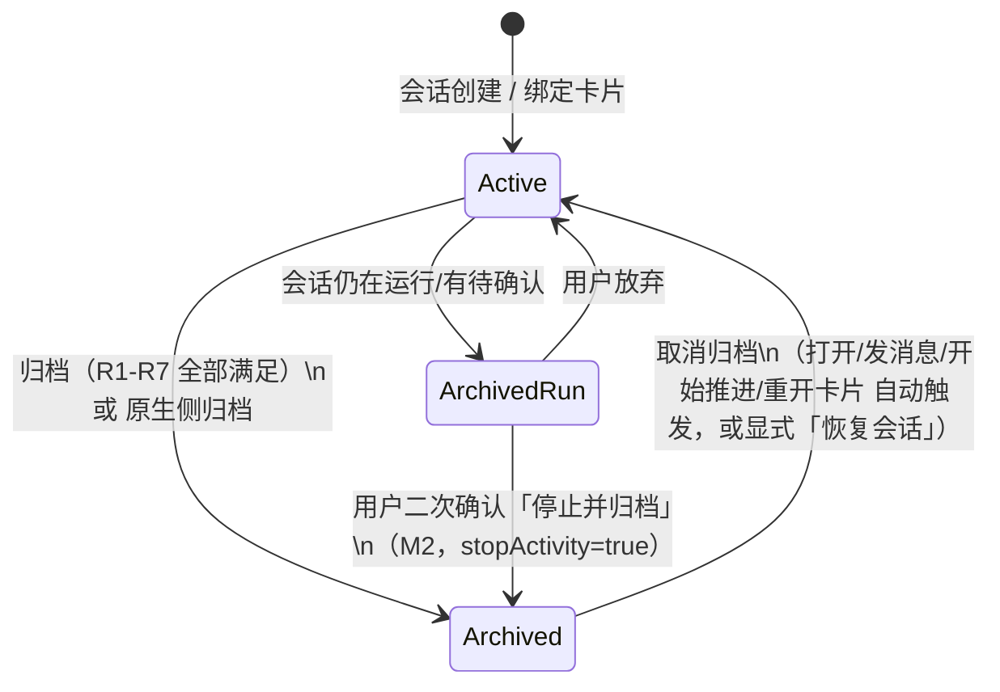

# 会话归档联动设计（草案 v0.1）

> 卡片：`card-3c39a762`「一直用看板新建卡片可能会导致宿主会话条数数量爆炸」 · 项目：dsh-kanban · 日期：2026-10-23
> 状态：**草案，等待用户拍板**（触发方式 / 运行中策略 / 自动恢复 / 落地范围，见 §11）
> 结论先行：以 DSH 0.2.x 的**可逆会话归档**为底座，把「会话归档」绑定到卡片生命周期：**已完成卡片上显式归档 + 任何重新使用会话的动作自动恢复**。不删会话、不自动停活、默认不自动归档。

---

## 0. TL;DR

1. **问题不是卡片太多，而是"每张卡一个宿主会话"**：看板把「卡片」当控制面、DSH 会话当执行面，一次「开始推进 / 进行中建卡 / 详情补建」就会创建一个宿主会话；卡片完成后会话仍留在侧栏与磁盘。本机实测：`~/.dsh/sessions` 下 **91 个会话目录 / 173 MB**，本看板工作区 **17 个会话 / 25 MB**，而看板共 **37 张卡（已完成 21）**。
2. **DSH 原生「归档」不是「删除」，但它正是我们要的"收纳"**：归档后会话从所有分组/侧栏消失、**不能再跑模型步骤**（archived-session-gate），但工作区槽位与磁盘日志保留，**可逆**（0.2.1 起提供 `unarchiveSession`）。
3. **建议方案（推荐度从高到低）**：
   - **M1（最小闭环）**：详情抽屉「会话」区，对**已完成/已取消卡片**的绑定会话提供「归档会话」；归档前做**反向依赖检查**（同一会话绑定的其它卡片是否都完成）、**运行/待确认检查**；会话已归档时显示「已归档」+「恢复会话」；**打开会话 / 发消息 / 开始推进 / 重开卡片时自动取消归档**。
   - **M2**：完成时轻提示；原生侧归档检测警示 + 「停止并归档」二次确认（对齐原生文案）；批量归档已完成列；归档后 toast「撤销」。
   - **M3（另拍板）**：自动归档策略（完成 N 天后自动归档，可配置，默认关）+ 从源头减少会话创建（开始推进时可复用已有会话）。
4. **本方案不解决**：物理删除会话日志（DSH 无面向用户的删除接口）、卡片「已完成」与「已归档」语义合并（两者继续保持独立：卡片归档是业务归档，会话归档是执行面收纳）。

---

## 1. 问题与目标

### 1.1 现状数据（2026-10-23，本机真实数据）

| 指标 | 数值 | 来源 |
| --- | --- | --- |
| 全部宿主会话目录 | 91 个，共 173 MB | `~/.dsh/sessions` |
| 本看板工作区会话目录 | 17 个，共 25 MB | `~/.dsh/sessions/--Users-roxor-Desktop-dsh-dsh~0020kanban--` |
| 本看板卡片 | 37 张（待办 11 / 进行中 4 / 待确认 1 / 已完成 21） | `kanban_boards` |
| 卡片自动归档策略 | 已完成 30 天后自动归档（仅卡片） | `lib/index.js:25-26` |

结论：会话数量与"启动过的卡片"正相关，卡片完成/归档后会话没有任何收敛机制 → 侧栏越用越长。

### 1.2 目标

- **G1 收敛**：卡片完成后，其宿主会话可被收进「归档」，侧栏会话数随完成卡片一起收敛。
- **G2 可逆**：归档必须能一键恢复；任何"还要用这个会话"的动作不能让用户撞上"已归档不可用"的墙。
- **G3 安全**：不能在会话还承担其它卡片任务、还在跑、或还在等用户回答时把它归档。
- **G4 单一事实源**：会话是否归档以 DSH `workspaceRegistry.archivedSessionIds` 为准，看板不另存一份状态、不伪造。
- **G5 渐进**：先做桌面 0.2.1+ 的可逆能力；旧宿主（CLI 0.1.5）优雅降级，不提供不可逆的入口。

### 1.3 非目标

- 删除/清理会话日志与工作区（无官方接口，手动删目录有风险）。
- 把卡片状态机与会话状态机合并（`已完成` ≠ `已归档`，两者解耦、可分别操作）。
- 自动决定"哪个会话该归档"（M3 的可选策略除外，且默认关闭）。

---

## 2. 现状核查（设计所依赖的事实）

### 2.1 卡片 ↔ 会话

- 卡片持有多对多绑定 `Card.sessionIds: string[]`（上限 8），见 `lib/domain.js:44,307`；绑定/解绑只写卡片活动，不触碰 DSH 会话：`linkSession` / `unlinkSession`（`lib/domain.js:986-1007`）。
- 一个会话可被多张卡片绑定；**没有反向索引**，「会话还关联哪些卡片」只能扫 `cards[].sessionIds`。
- 会话使用有四个入口；前三个会创建"新宿主会话"，第四个只复用已有会话：
  - 待办卡「开始推进」→ `session.ensure`（`web/src/lib/startCard.ts:64-69`、`lib/client.js` 的 `ensureSession`）；
  - 新建卡片时选「进行中 + 新会话」→ `session.ensure` / `session.create`（`web/src/lib/createCardSession.ts`）；
  - 详情抽屉「新建会话」→ `session.create`；
  - 绑定已有会话（不新建，但会把旧会话继续绑到新卡）。
- 卡片归档是**单向**的（`archiveCard` 只写 `archived=true`，无恢复入口，`lib/domain.js:1017-1032`）；卡片状态 `done/canceled` 与会话归档无任何联动。

### 2.2 DSH 0.2.1-rc.2 的归档语义（桌面版实测/源码核对）

证据均在桌面版运行时 `app.asar` 内（`dsh/node_modules/@deepseek-ai/...`）：

| 能力 | 语义 | 证据 |
| --- | --- | --- |
| `workspaceRegistry.archiveSession(sessionId, {stopActivity})` | 加入**全局归档集合**：从所有分组/侧栏隐藏，保留工作区槽位与磁盘日志。默认**拒绝正在干活的会话**（瀑布询问 `workspace/session-activity`，有 turn / job / subagent / schedule 活动则抛 `WorkspaceActiveSessionError`）；`stopActivity:true` 则先停活再归档，且归档写入后这些唤醒都被 pre-step 闸门挡住。归档同时**取消置顶**。 | `dsh-workspace/lib/index.js:526-542`（行号随版本略移） |
| `unarchiveSession(sessionId)` | 从归档集合移除，会话回到原工作区位置；幂等、不校验存在性。 | 同文件 `553-562` |
| 归档闸门 | 归档会话（及其 subagent 后代）在取消归档前**不能跑模型步骤**：`prompt` 本身不会被拒收（仍返回 accepted），但 turn 在 pre-step 被拒、以 `blocked` 结束；迟到的唤醒/排队 follow-up 同样被拦。fork 出来的是独立会话，不受影响。 | `dsh-api-session-controller/lib/types/archived-session-gate.js` |
| 客户端能力 | `ctx.uiWorkspace.archiveSession(sessionId, {stopActivity?})` / `unarchiveSession(sessionId)`；`ctx.workspaces.list` 快照含 `archivedSessionIds`、`pinnedSessionIds`。 | `dsh-client-ui-workspace/lib/client.js:1541-1547` |
| 原生交互 | 侧栏行悬停图标按钮 + 行尾「…」菜单（**无右键菜单**）「归档会话 ↔ 取消归档」；搜索结果中已归档行有 hover「取消归档」；打开已归档会话提示「已归档对话暂时无法查看，请取消归档后查看」；归档正在跑的会话时弹「停止并归档此会话？」确认框（列出将被停止的回合/子代理/后台任务/定时提醒），确认后 `{stopActivity:true}`；成功后 toast 带「撤销」和「筛选已归档会话」。 | 同文件 `4096-4180, 4685-4716, 4803-4831` |
| 可发现性 | 已归档会话默认从侧栏消失，可在视图选项「全部对话（显示已归档）/ 仅显示已归档」+ 搜索里找回。 | 同上 `4772-4778, 4894-4900` |

**活跃判定与 `stopActivity` 的实际副作用**（`workspace/session-activity` 由 4 个 provider 回答）：

- `turn`：会话 Agent 状态为 `running` 即报告一项，**等待审批/回答的回合也算 running**；
- `job`：该会话下 running/stopping 的后台任务（一项一个）；
- `subagent`：在线 subagent 后代（任意深度；fork 不算血缘）；
- `schedule`：该会话的 active 定时任务（一项一个）。

`stopActivity:true` 时：turn 以 `cancel({kind:'user'})` 停止并**丢弃排队输入**；后台任务被 kill；子代理被 cancel；定时任务被**从表中删除**（不是暂停）。停止失败只记日志，不回滚归档（`dsh-workspace/lib/index.js:621-629`）。

### 2.3 旧宿主（CLI 0.1.5-rc.2）差异

- 有 `archiveSession`（无活动检查），**没有** `unarchiveSession`、没有归档闸门、没有 `stopActivity`。
- ⇒ 旧宿主上的归档**不可逆**（只能改 `workspace.json` 或换新版宿主）。看板只做"可逆"能力：**宿主不提供 `unarchiveSession` 时，隐藏归档入口**（G2/G5）。

### 2.4 插件现状（要改的点）

| 位置 | 现状 | 缺口 |
| --- | --- | --- |
| `lib/client.js` 桥方法（`methods`，~505-646 行） | `sessions.list / workspaces.list / session.open / session.create / session.prompt / session.ensure / pending.*` | 无归档/恢复操作；`session.open/prompt/ensure` 不感知归档：原生 UI 会拦打开，但 `uiWorkspace.openSession` 本身不校验；`prompt` 看似成功、turn 却被闸门 blocked（消息静默失效） |
| `kanban:sessions` 推送（`lib/client.js:~684-704`） | `{sessions, current}`，会话行无归档信息 | 需要带上 `archivedSessionIds`，并订阅 `workspaces.list` 变化触发推送 |
| `web/src/bridge.ts` | `BridgeMethod`/`BridgeState` 无归档字段 | 新增 `archivedSessionIds` 状态与推送处理 |
| `web/src/components/SessionSection.tsx` | 绑定会话列表：主会话、打开、解绑、设为主会话、新建会话 | 无归档/恢复入口、无"还差哪些卡片"提示、无归档状态徽标 |
| `lib/routes.js` / `lib/index.js` | 服务端只注入 `webServer` + `tools`；卡片数据是唯一业务真源 | 归档动作需要服务端（见 §5）：反向依赖检查 + 活动写入在同一事务，且可复用宿主 registry |
| 契约文档 | `docs/contracts/01~04` | 需增量更新（活动类型、HTTP 接口、桥字段） |

### 2.5 关键限制（直接决定方案边界）

1. **归档会话不能再干活**（项目文档已踩过：`docs/02-dsh-integration.md:172`）：`prompt` 仍可能返回 accepted，但 turn 在 pre-step 被拒、以 `blocked` 结束，消息看似发出却没被处理——**静默失效风险**，所以必须"使用前先恢复"。
2. **归档 ≠ 删存储**：日志仍在磁盘，侧栏数量才是主要收益；"爆掉"的存储问题本方案不解决（无官方删除接口）。
3. **agent 不能归档自己的会话**：归档当前会话会把它自己的后续步骤全部闸掉——归档动作只能由用户在 UI 触发（或由另一个会话/工具显式操作，本期不做）。
4. **运行中/等待回答**：活动瀑布覆盖 turn / job / subagent / schedule，且**等待审批/回答的回合按 running 计入 turn 活动**——宿主侧能拦住"等回答时归档"；看板 UI 仍用 native pending 预检，目的是给出更准确、可读的阻止原因。
5. **归档是全局集合**：不区分工作区；看板只归档"绑定到卡片、且触发卡已完成"的会话，不做跨看板批量清理。

---

## 3. 设计原则

- **P1 可逆优先**：任何入口都先问"能否恢复"；不能恢复的宿主不出归档入口。
- **P2 自动恢复兜底**：不用要求用户记住"先取消归档再发消息"；打开/发消息/开始推进/重开卡片时自动恢复（幂等），并把动作提示出来。
- **P3 不替用户停活**：默认不 `stopActivity`；会话在跑就拒绝并说明。需要停止时走二次确认（对齐原生文案），M2 再上。
- **P4 反向依赖完整**：归档前置条件必须基于"会话 → 所有未归档卡片"的全量检查，而不是只看当前卡。
- **P5 状态不落库**：看板不缓存归档状态，`archivedSessionIds` 由宿主推送到 UI；归档/恢复后由推送回填。
- **P6 服务端裁决**：涉及卡片数据的检查（完成状态、反向依赖）与活动写入放服务端同一事务；不使用客户端计算结果作为最终依据。
- **P7 显式审计**：每次归档/恢复写卡片时间线（谁、何时、哪个会话、触发卡），失败也要可解释。

---

## 4. 规则与状态机

### 4.1 归档前置条件（服务端最终裁决）

对"从卡片 C 归档会话 S"的操作，以下条件**全部满足**才执行：

| # | 条件 | 服务端 | UI 预检 |
| --- | --- | --- | --- |
| R1 | C 未归档，且 C 状态 ∈ {done, canceled}（"已完成卡片"） | ✅ | 只对 done/canceled 卡显示按钮 |
| R2 | S ∈ C.sessionIds（防止通过卡片 API 归档任意会话） | ✅ | 按钮只出现在绑定行 |
| R3 | S 未归档（已归档则走恢复接口） | ✅（宿主幂等） | 显示"已归档" |
| R4 | 反向依赖：所有**未归档**且绑定了 S 的卡片，状态 ∈ {done, canceled}（当前卡 C 本身也满足 R1） | ✅ | 用当前已加载卡片预检，禁用按钮并提示"还有 N 张卡片未完成" |
| R5 | S 没有运行中的工作（宿主活动检查） | ✅（宿主 `workspace/session-activity`） | 用 `SessionRow.running` 预检 |
| R6 | S 没有待处理的确认（approval / question / plan-review） | ✅（等待回答的 turn 仍算 running，宿主活动检查覆盖） | ✅ 用 native pending 推送预检并禁用 |
| R7 | 宿主提供可逆能力（`unarchiveSession`） | ✅ | 能力不可用时隐藏入口 |

> R5/R7 由宿主最终把关：即使 UI 预检通过，宿主仍可能因竞态返回 `workspace/session-active`；服务端把 activity 原样带回给 UI 展示。
> R6 在宿主侧由 turn 活动覆盖（等待审批/回答的回合仍视为 running）；UI 预检是为了给出更准确、可读的阻止原因，而不是弥补服务端空白。

### 4.2 会话归档状态机（简版）



### 4.3 使用前自动恢复（P2 的落地规则）

统一在**桥层**做一个 `ensureSessionActive(sessionId)`，所有会"使用会话"的桥方法先调用：

| 入口 | 行为 |
| --- | --- |
| `session.open`（打开会话） | S 已归档 → 先 `unarchiveSession`，成功后打开；失败则报错并提示手动恢复 |
| `session.prompt`（卡片回复/审批回写） | 同上；**绝不能**把消息发进归档会话（会被闸门吞掉） |
| `session.ensure({sessionId})`（开始推进/续接） | 同上 |
| 卡片从 done 拖回 running（重开） | 前端在 move 成功后，对该卡的绑定会话执行恢复（`session.unarchive`，M1 用 HTTP 接口；失败只提示不阻断） |
| 新建卡绑定已有归档会话 | 绑定动作后由发消息路径恢复；绑定本身允许（绑定不执行会话） |
| 用户显式点「恢复会话」 | 直接恢复 |

> 恢复是幂等的（宿主保证），重复调用无副作用；错误只影响当前操作，不破坏卡片数据。

### 4.4 反向依赖的边界定义

- **"完成"** = 卡片状态 `done` / `canceled`，**或**卡片已被归档（卡片归档单向、不可恢复，视为不再需要会话）。
- **"未完成"** = 其余全部状态（backlog/running/needs_you/blocked/failed）且卡片未归档。
- 只统计**未归档卡片**；已归档卡片不再阻止归档，但宿主活动检查仍会拦住"会话还在跑"的情况。
- 绑定关系上限 8 个会话/卡；反向扫描是 O(cards)，数据量小，无需索引。

---

## 5. 接口与数据契约变更

### 5.1 服务端（`lib/`）——归档动作的裁决与审计

新增宿主适配器（新文件 `lib/session-archive.js` 或并入 `lib/index.js`）：

```js
// 通过可选注入拿宿主 registry；旧版/宿主缺失时为 null，接口返回 501
ctx.inject(['workspaceRegistry'], (c) => c.effect(() => {
  refs.workspaceRegistry = c.workspaceRegistry
  return () => { refs.workspaceRegistry = null }
}, 'dsh-kanban: workspace registry ref'))
```

`createRoutes({ store, ..., archive })` 增加 `archive` 依赖（便于测试注入假实现）：

| 接口 | 请求 | 成功 | 失败 |
| --- | --- | --- | --- |
| `POST /api/kanban/cards/:cardId/sessions/:sessionId/archive` | `{ stopActivity?: boolean, actor? }` | `{ ok:true, card, revision, archivedSessionIds: string[] }` | `400 CARD_NOT_DONE` / `400 SESSION_NOT_BOUND` / `404 SESSION_NOT_FOUND` / `409 SESSION_BUSY_CARDS { blockingCards:[{id,title,status}] }` / `409 SESSION_ACTIVE { activity:[{kind,items?}] }` / `501 SESSION_ARCHIVE_UNAVAILABLE` / `500 SESSION_ARCHIVE_FAILED` |
| `POST /api/kanban/cards/:cardId/sessions/:sessionId/unarchive` | `{ actor? }` | `{ ok:true, card, revision, archivedSessionIds }` | `400 SESSION_NOT_BOUND` / `404 SESSION_NOT_FOUND`?（宿主不校验存在性，恒成功）/ `501 SESSION_ARCHIVE_UNAVAILABLE` |
| `GET /api/kanban/sessions/archive`（可选，M2） | – | `{ archivedSessionIds }` | `501` |

处理顺序（archive）：读卡 → R1/R2 → 反向依赖扫描（store 内全量卡片）→ 调宿主 `archiveSession`（R5/R7 由宿主裁决）→ 成功后 `store.update` 写活动 + 返回。活动写入失败不影响归档结果，返回 `warnings`。

### 5.2 活动类型（增量）

契约 01 增加两种活动（`ACTIVITY_TYPES`、`web/src/types.ts`、i18n `activity.*`、Timeline 通用文本渲染天然兼容）：

- `session_archived`：文本如「归档了会话「{title}」，恢复入口在卡片详情」；`data: { sessionId, cardId, reason? }`
- `session_unarchived`：文本如「恢复了会话「{title}」」；`data: { sessionId, auto?: true }`

> 不用 `session_linked` 复用的原因：时间线语义与筛选要区分"绑定关系变化"和"会话收纳动作"，后续 audit/导出也更清楚。

### 5.3 客户端桥（`lib/client.js` + `web/src/bridge.ts`），增量 v1

| 变更 | 说明 |
| --- | --- |
| `kanban:sessions` 推送新增 `archivedSessionIds: string[]` | 父页面从 `ctx.workspaces.list.getSnapshot().archivedSessionIds` 读取；订阅 `workspaces.list` 变化推送（与现有 `sessions.list` 节流共用） |
| `BridgeState` 新增 `archivedSessionIds` | iframe 用它渲染「已归档」状态、禁用提示、恢复入口 |
| `session.open` / `session.prompt` / `session.ensure` 内部前置 `ensureSessionActive()` | 见 §4.3；宿主无 `unarchiveSession` 时返回 `SESSION_ARCHIVE_UNAVAILABLE`（不静默 prompt） |
| 错误映射 | 归档/恢复走 HTTP，不走桥；桥只负责"使用会话前恢复"。错误码：`SESSION_ARCHIVE_UNAVAILABLE`、`SESSION_ARCHIVED`（恢复失败时）、`SESSION_NOT_FOUND` |

> 归档动作**不走桥**的原因：反向依赖检查必须基于服务端卡片真源并与活动写入同事务；桥只做"使用前恢复"这类无业务裁决的动作。

> 归档状态同步：`workspaces.list.subscribe(listener)` 是**无 payload 的失效通知**（归档/恢复/置顶/工作区变更都会触发），回调里重新 `getSnapshot()` 读 `archivedSessionIds` 再推送；archive/unarchive 的一元响应也返回完整集合，可先本地安装、由后续推送覆盖（无需在插件侧复制 `archiveRequestSeq` 的竞态逻辑）。

### 5.4 Web UI（`web/src/`）

- `api.ts`：`archiveCardSession(cardId, sessionId, {stopActivity})` / `unarchiveCardSession(cardId, sessionId)`。
- `types.ts`：`ActivityType` 增加两种；`BridgeState.archivedSessionIds`。
- `SessionSection.tsx`（主入口）：
  - 每个绑定会话行：状态徽标（运行中 / 已归档 / 待确认）+ 操作（打开 / 设为主会话 / 解绑 / **归档** / **恢复**）。
  - 归档按钮仅在卡片 `done/canceled` 且条件满足时可用；不可用时显示原因（"还有 2 张卡片未完成：…" / "会话运行中" / "会话有待确认项" / "宿主版本不支持恢复"）。
  - 已归档会话行提供「恢复会话」；非完成卡片上一律不显示「归档」。
  - 卡片为 running 且绑定会话已归档：区块顶部警示「该会话已归档，继续前需恢复」，附恢复按钮。
- `App.tsx`：`handleArchiveSession` / `handleUnarchiveSession`（调用 HTTP、更新卡片、toast、维护本地归档集合临时值）；重开卡片（done → running）后对绑定会话尝试恢复。
- 卡片/列表徽标（M2）：running 卡的会话已归档时显示警示图标 + tooltip。
- 完成提示（M2）：卡片进入 done 且存在可归档会话时，toast「卡片已完成，可在详情归档会话」。
- 二次确认（M2）：服务端返回 `SESSION_ACTIVE` 时，弹与原生同语义的确认框（"停止并归档此会话？" + 将被停止的工作列表），确认后以 `stopActivity:true` 重试。
- 文案：中/英 i18n 各 ~20 个键；术语统一为「归档会话 / 恢复会话」（对齐原生「归档会话 / 取消归档」，看板侧用「恢复」更贴合卡片语境，文档/代码注记对应关系）。

---

## 6. 交互设计（M1）

### 6.1 详情抽屉「会话」区（主入口）

```
会话                                      [新建会话]
├─ ● 会话标题 A            运行中 · 主会话
│    打开   设为主会话   解绑
├─ ● 会话标题 B            已归档
│    恢复会话   解绑
├─ ○ 会话标题 C            [归档会话]   ← 卡片已完成且 R4-R6 满足
│    打开   设为主会话   解绑
└─ ⓘ 该会话还关联 2 张未完成卡片：修复登录 / 需求评审
```

- 「归档会话」按钮的位置在会话行右侧；卡片未完成时**不渲染**（不是禁用），避免误解。
- 条件不满足时按钮禁用 + 行下方灰色说明（例如"会话运行中，结束后可归档"）。
- 归档成功后：行变「已归档 / 恢复会话」，卡片时间线新增节点，toast「会话已归档」。
- 归档后若当前打开的正是该会话：不关闭当前会话面板（用户可能只是想收纳），但会话区显示已归档；打开动作会自动恢复。

### 6.2 失败与竞态

| 场景 | 提示 |
| --- | --- |
| 服务端 `SESSION_BUSY_CARDS` | 「还有 N 张卡片未完成：A、B」+ 按钮恢复可用（不重试） |
| 服务端 `SESSION_ACTIVE` | M1：直接展示 activity 摘要 + "会话仍在运行，结束后再归档"；M2：换成「停止并归档」确认框 |
| `SESSION_NOT_FOUND` | 「会话不存在或已删除」+ 建议解绑 |
| `SESSION_ARCHIVE_UNAVAILABLE` | 隐藏/禁用入口 + 「当前 DSH 版本不支持会话归档恢复」 |
| 网络/500 | toast 错误，卡片状态不变（归档未发生） |
| 归档成功但活动写入失败 | 成功 + 时间线缺节点（日志记录 warning），不提示用户 |

**M2「停止并归档」确认框直接对齐原生文案**（0.2.1 实测）：

- 标题「停止并归档此会话？」；描述「“{title}”仍有正在进行的工作。归档会先停止这些工作；之后可在侧栏筛选“全部对话（显示已归档）”中恢复会话，被停止的工作不会自动继续。」
- 工作清单：进行中的回合 / N 个运行中的子智能体：names / N 个后台任务：names / N 条定时提醒：names。
- 按钮「停止并归档」，提交中「正在停止并归档…」。
- 必须写明副作用：`stopActivity` 会**丢弃 turn 排队输入**、kill 后台任务、**删除**该会话的定时任务（不是暂停）。

### 6.3 文案与图标

- 按钮：`归档会话` / `恢复会话`；徽标：`已归档` / `运行中` / `待确认`。
- 原生对应关系：原生菜单「归档会话 / 取消归档」、归档 toast「会话已归档，可撤销或筛选已归档会话」。
- 图标：归档用 `IconArchive`（已有），恢复用镜像/反归档图标（M2 再补，M1 可用文字按钮）。

---

## 7. 兼容与降级

| 环境 | 行为 |
| --- | --- |
| 桌面 0.2.1-rc.2（有 `unarchiveSession` + 活动检查） | 全功能（M1/M2） |
| CLI 0.1.5-rc.2（无 `unarchiveSession`） | 服务端 `archive` 返回 501 / UI 隐藏入口；桥的自动恢复返回 `SESSION_ARCHIVE_UNAVAILABLE`（发消息前阻断并提示，不静默） |
| 宿主无 `workspaceRegistry`（纯 dev-server / 独立预览） | 归档接口 501；桥无归档集合（空数组）；UI 不显示归档相关入口 |
| 旧版 iframe 缓存（未更新 web/dist） | 推送多字段被忽略（向后兼容）；不调用新接口 |

---

## 8. 风险与不做的事

| 风险 | 影响 | 缓解 |
| --- | --- | --- |
| 归档会话不能再跑模型步骤 | 误归档后继续提问会被闸门挡 | 自动恢复 + 已完成卡才可归档 + 可撤销 |
| 归档后消息被静默吞掉 | 用户以为 agent 没反应 | 桥层使用前恢复；恢复失败阻断并提示 |
| 反向依赖跨看板/跨窗口不一致 | 误归档共享会话 | 服务端全量扫描；宿主活动检查兜底 |
| 归档不影响磁盘占用 | 用户以为能省空间 | 文档/文案明确"归档=收纳，不删日志" |
| `stopActivity` 的副作用比"暂停"重 | 排队输入丢失、定时任务被删除、后台任务被杀 | M2 确认框逐项列出 + 文案写明"被停止的工作不会自动继续"；M1 不提供停止入口 |
| agent 归档自身会话导致新回合被闸 | 会话卡死 | 不提供 agent 工具入口（本期） |
| 卡片归档单向不可恢复 | 归档卡绑定的会话判断口径 | R4 把"卡已归档"视为完成；session 活动检查兜底 |
| 多窗口同时操作 | 竞态 | 宿主幂等 + UI 以推送为准 |

**明确不做**：删除会话、清理磁盘、自动批量归档（M3 待拍板）、agent 侧归档工具、跨工作区"会话大扫除"。

---

## 9. 分阶段落地

### M1 — 可逆归档闭环（本卡主体）

- [ ] 服务端：`workspaceRegistry` 可选注入 + `session-archive` 适配器 + 2 个 REST 接口 + 反向依赖/状态校验 + 活动写入 + 错误映射（501 降级）。
- [ ] 服务端测试：接口 200/400/404/409/501 全 case、幂等、活动写入、反向依赖（多卡/归档卡）。
- [ ] 桥：`kanban:sessions` 增 `archivedSessionIds` + 订阅 workspaces 变化推送；`session.open/prompt/ensure` 前置自动恢复 + 错误码。
- [ ] Web：`BridgeState` 字段、`api.ts` 两方法、`SessionSection` 归档/恢复/条件提示/已归档徽标、App 处理函数与 card 重开恢复、i18n。
- [ ] 测试：桥推送/状态单测、归档条件纯函数单测、SessionSection 交互单测（若现有测试栈支持）。
- [ ] 真实宿主验收（桌面 0.2.1）+ 独立预览降级验收。
- [ ] 文档：契约 01/02/03、README、docs/11 更新状态。

### M2 — 体验与安全加固

- [ ] 卡片完成时轻提示（toast/详情横幅）。
- [ ] 原生侧归档检测（推送驱动的徽标/警示）。
- [ ] `SESSION_ACTIVE` 的「停止并归档」二次确认（对齐原生文案）。
- [ ] 归档后 toast「撤销」；已完成列批量归档。
- [ ] `GET /sessions/archive`（可选，供无桥场景刷新）。

### M3 — 收敛源头（需另拍板）

- [ ] 自动归档策略：卡片 done/canceled 后 N 天（默认关，参照卡片 30 天自动归档的配置形态，`lib/index.js:25-26`），且满足 R4-R7。
- [ ] 会话复用：开始推进时可选「复用已有会话」（减少新建），或每工作区固定执行会话（激进，需评估上下文混杂）。
- [ ] 侧栏计数/看板统计展示"未归档会话数"，给用户可见的收敛进度。

---

## 10. 验收标准（M1）

1. 完成卡 C 的绑定会话 S，且无其它未完成卡片、S 空闲、无待确认 → 详情出现「归档会话」；点击后 S 从宿主侧栏消失，C 时间线出现 `session_archived` 节点，会话区显示「已归档」。
2. S 同时绑定未完成卡 D → 「归档会话」不可用，提示剩余卡片；即使并发调用接口也返回 409 `SESSION_BUSY_CARDS`，S 不被归档。
3. S 仍在运行（或后台任务/子代理在跑）→ 提示"会话运行中"；接口返回 409 `SESSION_ACTIVE`，不归档。
4. S 有待确认项（原生 approval/question）→ UI 不提供归档；服务端不裁决该条件（文档记录）。
5. 已归档的 S：详情行显示「已归档 / 恢复会话」；点恢复后回到侧栏原位置，C 时间线出现 `session_unarchived`。
6. 卡片 C 从 done 拖回 running，其绑定 S 已归档 → 自动恢复（toast 提示）；随后可正常发消息/开始推进。
7. 对已归档 S 直接发卡片回复 / 打开会话 / 开始推进 → 桥先自动恢复再执行，消息被正常接受；恢复失败时消息不发出并明确报错。
8. 归档卡（archived）绑定的 S，不阻止同会话其它完成卡的归档；但 S 运行中仍被拦。
9. 会话在原生侧被归档 → 看板推送更新，卡片会话行显示已归档；running 卡出现警示（M2 徽标）。
10. 非桌面宿主（CLI 0.1.5 / 独立预览）→ 入口隐藏或 501 提示；不出现"归档后无法恢复"的路径。
11. 多张完成卡共享 S：任一卡归档成功后，另一张卡也显示已归档；重复归档幂等、不重复写活动。
12. 全量回归：服务端测试、Web 测试、`tsc`、`vite build`、真实宿主冒烟（侧栏数量、归档/恢复/自动恢复、console 0 error）。

---

## 11. 待用户拍板（对应看板审批）

| # | 问题 | 选项（推荐加粗） |
| --- | --- | --- |
| Q1 | 归档触发方式 | **A. 仅手动按钮（已完成卡）** / B. 手动 + 卡片完成时轻提示 / C. 完成即自动归档 |
| Q2 | 会话还在跑/有待确认时 | **A. 拒绝并说明，不做停止** / B. 拒绝 + M2 提供「停止并归档」二次确认 / C. 直接停止并归档 |
| Q3 | 归档会话后再次使用时 | **A. 自动恢复（打开/发消息/开始推进/重开卡片）** / B. 只提示用户手动恢复 |
| Q4 | 本轮落地范围 | **A. M1 最小闭环** / B. M1+M2 / C. 全量含 M3 自动策略 |
| Q5 | 是否从源头减少会话创建 | **A. 本轮不做** / B. M2 增加"复用已有会话"选项 / C. 默认复用 |
| Q6 | 批量入口 | **A. 本轮不做** / B. 并入 M2（已完成列批量归档） |

> 拍板后按选中的里程碑开工；未选中的项保留为后续卡，不混进本轮。

---

## 附录 A：证据索引

- 项目内：
  - 卡片/会话数据模型：`lib/domain.js:44,307,986-1007,1017-1032`
  - 自动归档（卡片）：`lib/index.js:25-26,52-68`
  - 会话创建编排：`web/src/lib/startCard.ts:64-69`、`web/src/lib/createCardSession.ts`
  - 桥方法：`lib/client.js:505-646`，推送：`lib/client.js:~684-704`；Web 桥：`web/src/bridge.ts:9-37,180-380`
  - 会话 UI：`web/src/components/SessionSection.tsx`、`web/src/components/DetailDrawer.tsx:494-510`
  - 契约：`docs/contracts/01-data-model.md`、`02-http-api.md`、`03-client-bridge.md`
  - 历史结论：`docs/02-dsh-integration.md:172`（归档会话不能 prompt）
- 宿主（桌面 0.2.1-rc.2，`app.asar` 内路径）：
  - `dsh/node_modules/@deepseek-ai/dsh-workspace/lib/index.js`（registry 归档/恢复/置顶）
  - `dsh/node_modules/@deepseek-ai/dsh-api-session-controller/lib/types/archived-session-gate.js`
  - `dsh/node_modules/@deepseek-ai/dsh-api-workspace-controller/lib/index.js`（Remote 错误码 `workspace/session-active`）
  - `dsh/node_modules/@deepseek-ai/dsh-client-ui-workspace/lib/client.js`（原生 UI 交互与文案）
  - `dsh/node_modules/@deepseek-ai/dsh-agent/lib/index.js`、`dsh-jobs`、`dsh-subagent`、`dsh-schedule`（`workspace/session-activity` / `session-stop` 四个 provider）
  - `dsh/node_modules/@deepseek-ai/dsh-agent-loop/lib/index.js:956-963`（pre-step reject → turn `blocked`）
- 本机数据：`~/.dsh/sessions`（91 目录 / 173 MB，2026-10-23 统计）。
